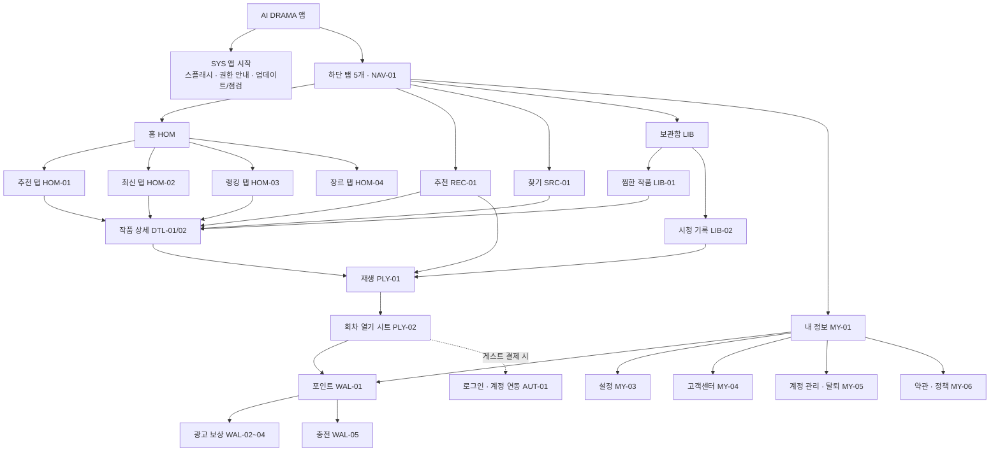
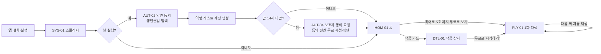
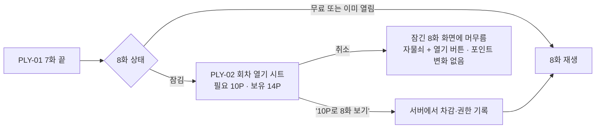
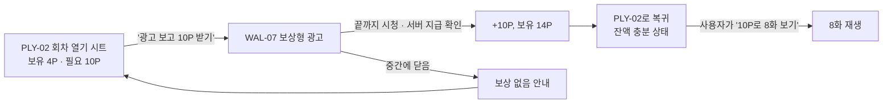
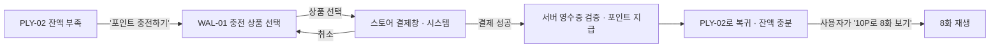
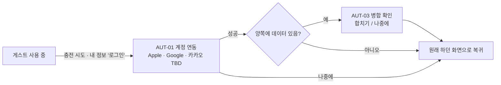
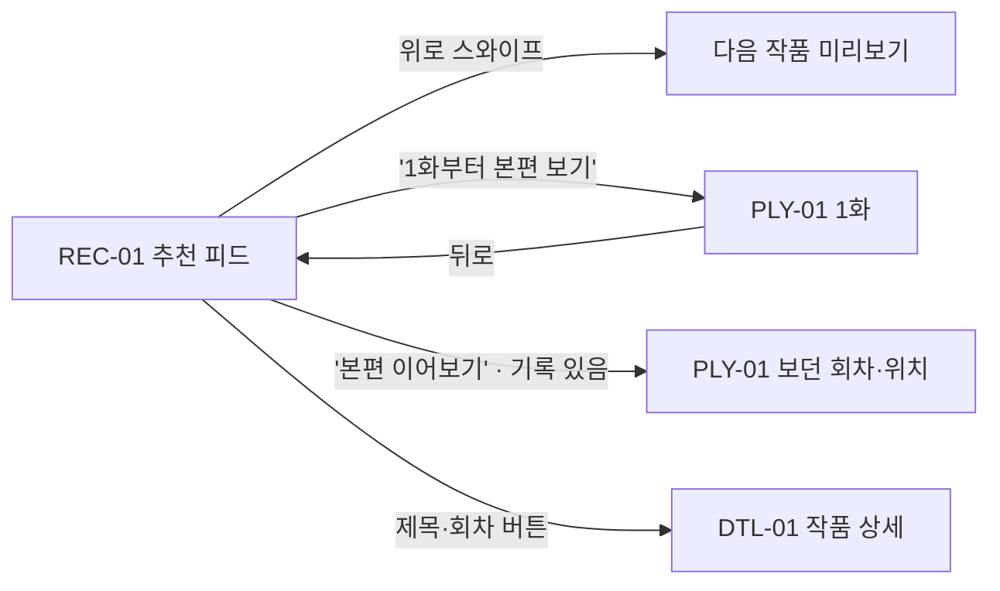
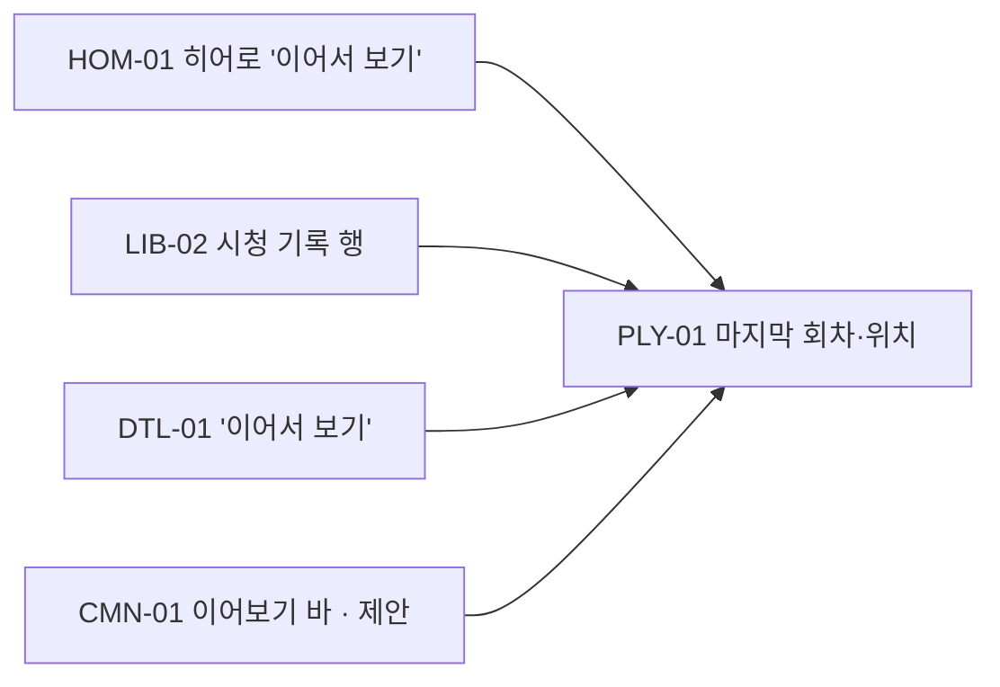

# 02. 정보 구조(IA) · 메뉴 정의 · 유저 플로우

> 이 문서는 앱에 **어떤 메뉴가 있고, 각 메뉴가 무슨 뜻이며, 어디서 어디로 이동하는지**를 정의한다.
> 화면 안의 버튼 하나하나는 [05_화면설계서](./05_화면설계서.md), 규칙(포인트·회차 열기 등)은 [03_정책정의서](./03_정책정의서.md)를 본다.
> 표기: `[확정]` 사용자 결정 · `[구현]` 현재 front 코드에 있음 · `[시안]` 시안용 임시값 · `[제안]` 기획 제안(승인 필요) · `[TBD]` 미결정

---

## 1. 화면 ID 규칙

모든 화면·시트·팝업에 `영역코드-번호` 형식의 ID를 붙인다. 기능명세서·화면설계서·이슈·커밋 메시지에서 같은 ID를 쓴다.

| 영역코드 | 영역 | 예 |
|---|---|---|
| `NAV` | 하단 탭바 | NAV-01 |
| `GBL` | 현재 앱의 전역 준비·저장 오류 상태 | GBL-01 |
| `CMN` | 여러 화면이 함께 쓰는 공통 요소(이어보기 바, 토스트 등) | CMN-01 이어보기 바 |
| `SYS` | 앱 시작·시스템 화면(스플래시, 권한 안내, 업데이트, 점검, 오류) | SYS-01 스플래시 |
| `AUT` | 로그인·계정 연동·약관 동의·연령 확인(보호자 동의·성인 인증) | AUT-01 로그인 |
| `HOM` | 홈 탭 | HOM-01 홈(추천) |
| `REC` | 추천 탭(세로 넘겨보기 피드) | REC-01 추천 피드 |
| `SRC` | 찾기 탭 | SRC-01 찾기 |
| `LIB` | 보관함 탭 | LIB-01 찜한 작품 |
| `MY` | 내 정보 탭과 하위 화면 | MY-01 내 정보 |
| `DTL` | 작품 상세 | DTL-01 작품 소개 |
| `PLY` | 재생 화면과 재생 중 시트 | PLY-02 회차 열기 시트 |
| `WAL` | 포인트(지갑)·광고 보상·충전 | WAL-01 포인트 |
| `NTF` | 알림·공유 링크로 들어오는 진입 | NTF-01 |
| `ADM` | 운영자(어드민) 웹 — 화면 ID는 어드민 설계 시 부여, 기능은 04 문서 §13 | FN-ADM-02 작품 등록 |

---

## 2. IA(메뉴 구조도)

### 텍스트 트리 (전체 화면 목록)

| 1 Depth | 2 Depth | 3 Depth(시트·팝업) | 화면 ID | 상태 |
|---|---|---|---|---|
| 앱 시작 | 스플래시 | – | SYS-01 | [제안] 미구현 (현재는 "이야기를 준비하고 있어요" 로딩만 있음) |
| | 알림 권한 사전 안내 | – | SYS-02 | [제안] 미구현 |
| | 강제 업데이트 · 점검 공지 | – | SYS-03 | [제안] 미구현 |
| | 네트워크 오류 | – | SYS-04 | [제안] 미구현 |
| 로그인 | 로그인 · 계정 연동 | 첫 실행 동의·생년월일 · 계정 병합 확인 | AUT-01~03 | [제안] 미구현 |
| | 14세 미만 보호자 동의 · 성인 본인인증 | – | AUT-04, AUT-05 | [확정] 14세 미만 가입 허용 → 미구현 |
| 홈 | 추천 / 최신 / 랭킹 / 장르 | – | HOM-01~04 | [구현] |
| 추천 | 세로 넘겨보기 피드 | – | REC-01 | [구현] |
| 찾기 | 검색 · 장르 필터 | – | SRC-01 | [구현] |
| 보관함 | 찜한 작품 / 시청 기록 | – | LIB-01, LIB-02 | [구현] (탭 이름 "저장한 작품" → "찜한 작품" 변경 필요) |
| 내 정보 | 내 정보 메인 | 안내 팝업(FAQ·문의·앱 정보) | MY-01, MY-02 | [구현] 팝업은 임시 문구 |
| | 설정 | 알림 설정 | MY-03 | [제안] 미구현 (현재 재생 설정만 MY-01에 있음) |
| | 고객센터 | FAQ · 1:1 문의 · 내 문의 | MY-04 | [제안] 미구현 |
| | 계정 관리 | 로그아웃 · 회원 탈퇴 | MY-05 | [제안] 미구현 (스토어 심사 필수) |
| | 약관 · 정책 | 이용약관 · 개인정보 처리방침 · 유료 이용 약관 | MY-06 | [제안] 미구현 |
| 작품 상세 | 작품 소개 / 전체 회차 | – | DTL-01, DTL-02 | [구현] |
| 재생 | 재생 화면 | 회차 열기 · 회차 목록 · 작품 소개 · 재생 설정 · 배속 | PLY-01~06 | [구현] |
| | 신고 · 영상 오류 상태 · 자동 사용 동의 | – | PLY-09~11 | [제안] 미구현 |
| | 회차 끝 · 완결 화면 | 다음 화 카드 · 추천작 | PLY-07, PLY-08 | [제안] 미구현 |
| 포인트 | 포인트(지갑) | 광고 보상(안내→시청→완료) · 충전 확인 | WAL-01~05 | [구현] 체험용 가짜 광고·결제 |
| | 포인트 내역 · 처리 상태 | 내역 상세 · 광고/결제 확인 중 | WAL-06, WAL-07 | [제안] 미구현 (내역은 현재 WAL-01 하단 목록으로만 존재) |
| | 광고 참여형(오퍼월) | – | WAL-08 | [TBD] P2 |
| 공통 | 이어보기 바 · 토스트 · 알림/링크 진입 | – | CMN-01, CMN-02, NTF-01 | [제안] 미구현 |
| 앱 시작 | 첫 실행 안내 | – | SYS-05 | [제안] P1 |
| 운영자 웹 | 작품·회차·편성·포인트·신고·문의 관리 | – | ADM (04 문서 §13) | [제안] 미구현 |

---

## 3. 메뉴 정의 — 각 메뉴의 뜻과 필요한 기능

개발자가 "이 메뉴는 왜 있고, 여기에 무엇을 넣고, 무엇을 넣지 말아야 하는지"를 판단할 수 있게 정리했다.

### 3-1. 하단 탭 5개 `[구현]`

| 탭 | 화면 ID | 한 줄 정의 | 사용자가 들어오는 이유 | 운영(마케팅) 목적 | 꼭 필요한 기능 | 넣지 않는 것 |
|---|---|---|---|---|---|---|
| **홈** | HOM-01~04 | 운영팀이 **편성한 작품 진열대** | 오늘 볼 작품을 고른다 · 보던 작품을 이어본다 | 밀고 싶은 작품을 노출해 첫 시청(1화 재생)을 만든다 | 대표 작품(히어로) 배너, 무료 시작 버튼, 테마별 가로 목록, 내부 탭(추천·최신·랭킹·장르), 상단 포인트 잔액·검색 | 개인 업로드 작품, 커뮤니티 |
| **추천** | REC-01 | 숏폼처럼 **위아래로 넘기며 맛보는 예고·1화 피드** | 뭘 볼지 모를 때 가볍게 넘겨본다 | 탐색 피로 없이 작품을 연속 노출해 "본편 보기" 전환을 만든다 | 세로 1화면 1작품 스와이프, 자동 재생/화면 밖 정지, 찜·회차·공유 버튼, "1화부터 본편 보기 / 본편 이어보기" | 포인트 차감, 시청 기록 생성 (추천 피드 시청은 기록·차감 없음) |
| **찾기** | SRC-01 | 제목·장르로 **원하는 작품을 직접 찾는** 곳 | 알고 있는 작품명을 검색하거나 장르로 좁힌다 | 광고·SNS에서 작품명을 보고 들어온 사용자를 놓치지 않는다 | 검색창(제목·영문 제목·장르·분위기), 장르 칩 필터, 결과 수, 결과 없음 안내 | 인기 검색어(데이터 없이 임의로 만들지 않음) |
| **보관함** | LIB-01, LIB-02 | 내가 **찜한 작품과 보던 기록** 모음 | 찜해둔 작품, 보다 멈춘 회차로 돌아간다 | 재방문 사용자가 바로 이어보게 해 재시청률을 올린다 | 찜한 작품(2열 포스터, 찜 해제), 시청 기록(회차·시청 위치·진행 막대, 탭하면 그 위치부터 재생) | 포인트 관련 기능 |
| **내 정보** | MY-01 | 내 **계정·포인트·설정·도움말** 관리 | 잔액 확인, 포인트 충전, 설정 변경, 문의 | 충전 진입점 · 고객 문의 창구 · 스토어 필수 항목(탈퇴·약관) 제공 | 프로필(게스트/로그인), 보유 포인트+충전 버튼, 나의 활동(시청 기록·찜·포인트 내역), 재생 설정, 고객센터, 앱 정보·약관, 계정 관리 | 콘텐츠 추천 |

### 3-2. 홈 내부 탭 `[구현]`

| 내부 탭 | 화면 ID | 뜻 | 정렬·선정 기준 | 현재 구현 | 출시 시 필요한 것 |
|---|---|---|---|---|---|
| 추천 | HOM-01 | 운영팀이 고른 **오늘의 편성** | 운영자가 지정한 순서 | 히어로 3작품(01·02·03 전환), "1분이면, 빠져드는 이야기" 가로 목록, 로맨스 배너, 에디터 TOP 3, 추천 피드 바로가기 | 어드민에서 섹션·작품·순서를 편성(FN-ADM-05, 04 §13) |
| 최신 | HOM-02 | 최근 **공개된 작품** | 첫 공개일 내림차순 `[제안]` | 전체 작품 2열 포스터(정렬 없음) | 작품 공개일 필드, "NEW" 배지 기간 `[TBD]` (제안: 공개 후 7일) |
| 랭킹 | HOM-03 | 지금 **많이 보는 작품** 순위 | 현재: 편집부 선정 TOP 3 (실제 집계 아님) | 3작품 순위 목록 | 집계 기준 확정 `[TBD]` — 제안: 최근 7일 본편 시청자 수(중복 제거). 집계 전에는 "에디터 픽"으로 이름 표시 |
| 장르 | HOM-04 | 장르별로 **골라보기** 입구 | 장르 목록 | 장르 타일 → 찾기 탭(장르 필터 적용)으로 이동 | 장르 목록을 어드민에서 관리 |

### 3-3. 상단 헤더 · 탭 밖 화면

| 메뉴/요소 | 화면 ID | 뜻 | 필요한 기능 |
|---|---|---|---|
| 상단 **포인트 잔액(예: 4 P)** | HOM-01 ② | 지금 쓸 수 있는 포인트. 누르면 포인트 화면 | 잔액 실시간 반영, 탭 → WAL-01 |
| 상단 **검색 아이콘** | HOM-01 ③ | 찾기 탭 바로가기 | 탭 → SRC-01 |
| **작품 상세** | DTL-01/02 | 한 작품의 **소개서 + 회차 목차** | 표지, 제목, 장르·전체 회차·회당 길이, 무료 범위, 시작/이어보기, 저장, 공유, 소개/전체 회차 탭, 회차 상태(무료·잠김·열림) |
| **재생 화면** | PLY-01 | 실제 **드라마를 보는 화면** | 영상 재생·정지·탐색, 자막, 배속, 회차 이동, 잠긴 회차 안내, 찜·회차·공유, 시청 위치 저장, 다음 화 자동 재생 |
| **포인트(지갑)** | WAL-01 | 포인트를 **받고(광고)·사고(충전)·확인(내역)** 하는 곳 | 잔액, 광고 보상(일일 한도 표시), 충전 상품, 포인트 내역 |

### 3-4. 용어 통일 `[제안]`

현재 화면에 같은 기능을 다른 말로 부르는 곳이 있다. 출시 전 아래로 통일한다.

| 개념 | 통일할 표기 | 현재 혼용 | 비고 |
|---|---|---|---|
| 작품을 내 목록에 담기 | **찜** (아이콘: 북마크) `[확정: 2026-10-12]` | 찜(재생·추천 화면), 저장(홈·상세), + 버튼, "찜한 작품"(내 정보), "저장한 작품"(보관함 탭) | 보관함 탭도 "찜한 작품"으로 변경. 국내 OTT(넷플릭스 등) 관용 표현 |
| 잠긴 회차를 포인트로 보기 | **회차 열기** | 열기, 보기, 해금 | 버튼은 "10P로 9화 보기"처럼 결과를 말한다 |
| 앱 안 재화 | **포인트(P)** | 크레딧(초기 기획서), 포인트 | 사용자 화면은 "포인트"만 사용 |
| 광고 보고 받는 포인트 | **광고 보상** | 광고 보상 체험, 광고로 포인트 받기 | |
| 돈 내고 사는 포인트 | **충전** | 충전, 결제 | 결제는 스토어 결제창을 말할 때만 |

---

## 4. 내비게이션 규칙

### 4-1. 화면 종류

| 종류 | 설명 | 해당 화면 |
|---|---|---|
| 탭 화면 | 하단 탭바가 보이는 최상위 화면 | HOM, REC, SRC, LIB, MY-01 |
| 스택 화면 | 탭 위로 쌓이는 전체 화면. 하단 탭바 없음. 뒤로 가기로 닫음 | DTL, PLY-01, WAL-01, WAL-06, MY-03~06 |
| 시트(아래에서 올라오는 창) | 현재 화면 위에 뜨는 선택·확인 창. 닫으면 원래 화면 그대로 | PLY-02~06, WAL-02~05, MY-02 |
| 시스템 화면 | 운영체제가 띄우는 창(권한 요청, 스토어 결제창, 공유창). 문구를 앱이 바꿀 수 없음 | 알림 권한, ATT, 결제, 공유 |

### 4-2. 공통 규칙

1. **상태 보존**: 탭을 바꿨다 돌아오면 이전 스크롤 위치·선택한 내부 탭·검색어를 유지한다. `[제안]`
2. **뒤로 가기 순서**(Android 뒤로 버튼 포함): 열린 시트 → 키보드 → 스택 화면 → 탭 화면. 탭 화면에서 뒤로 가기는 시스템 기본 동작(앱 종료/백그라운드).
3. **재생 화면에서 나가면** 재생을 멈추고 현재 회차·위치를 시청 기록에 저장한다. `[구현]`
4. **시트가 열리면 영상은 멈춘다.** 시트를 닫으면, 시트를 열기 전에 재생 중이었고 화면이 활성 상태이며 회차를 볼 수 있을 때만 같은 위치에서 다시 재생한다(사용자가 일시정지해 둔 상태는 유지). 광고·결제·공유 같은 외부 화면에서 돌아오면 멈춘 상태로 둔다. `[구현 + 제안]` (05 §2-4)
5. **앱이 백그라운드로 가면** 재생·광고 타이머를 멈춘다. `[구현]`
6. **추천 피드**에서 화면 밖으로 나간 카드의 미리보기는 멈춘다. `[구현]`
7. **사용자가 직접 눌러야 시작되는 동작**: 광고 보기, 충전(구매 시작), 회차 열기(포인트 사용). 광고·충전을 마치고 돌아와도 회차를 자동으로 열지 않는다 `[확정]`. 단 서버가 검증한 광고 보상·충전 포인트는 별도 "받기" 버튼 없이 자동으로 잔액에 들어온다 `[제안]`.

### 4-3. 화면 ID ↔ 앱 경로(Expo Router) 매핑

| 화면 ID | 경로 | 파라미터 | route 파일 | 화면 컴포넌트 |
|---|---|---|---|---|
| HOM-01~04 | `/` | – (내부 탭은 화면 상태) | `src/app/(tabs)/index.tsx` | `src/screens/HomeScreen.tsx` |
| REC-01 | `/recommend` | `id`(처음 보여줄 작품) | `src/app/(tabs)/recommend.tsx` | `RecommendationScreen.tsx` |
| SRC-01 | `/search` | `genre` | `src/app/(tabs)/search.tsx` | `SearchScreen.tsx` |
| LIB-01/02 | `/library` | `tab=saved\|history` | `src/app/(tabs)/library.tsx` | `LibraryScreen.tsx` |
| MY-01 | `/account` | – | `src/app/(tabs)/account.tsx` | `AccountScreen.tsx` |
| DTL-01/02 | `/drama/[id]` | `tab=episodes` | `src/app/drama/[id].tsx` | `DramaDetailScreen.tsx` |
| PLY-01~06 | `/player/[id]` | `ep`(회차 번호) | `src/app/player/[id].tsx` | `PlayerScreen.tsx` |
| WAL-01~05 | `/wallet` | – | `src/app/wallet.tsx` | `WalletScreen.tsx` |
| AUT, MY-03~06, SYS, WAL-06 | 신규 | – | 신규 | 신규 |

### 4-4. 공유 링크 · 딥링크 `[제안]`

- 현재 공유 링크는 공개 웹 시안(`https://ai-drama-screen.qwerqerqwere.chatgpt.site/?drama=<id>`)을 가리킨다. `[구현]`
- 출시 시: `https://<도메인>/drama/<id>` 형태의 링크 하나로 **앱이 설치되어 있으면 앱의 작품 상세(DTL-01)**, 없으면 스토어 또는 웹 소개 페이지로 연결한다(iOS Universal Links / Android App Links). 도메인은 `[TBD]`.
- 링크로 들어와도 포인트·시청 권한 규칙은 똑같이 적용한다. 공유받은 사람에게 공유한 사람의 포인트·기록은 보이지 않는다.
- 광고 캠페인용 링크에는 유입 경로(utm 등)를 붙여 어떤 광고에서 설치·시청이 일어났는지 측정한다(07 문서 제안 참고).

---

## 5. 핵심 유저 플로우

아래 플로우의 포인트 수치(시작 4P, 회차 10P, 광고 +10P)는 `[시안]` 값이다.

### F-01. 첫 실행 → 무료 시청

### F-02. 무료 구간이 끝남 → 회차 열기 (잔액 충분)

### F-03. 잔액 부족 → 광고 보상 → 돌아와서 직접 열기

### F-04. 잔액 부족 → 충전(스토어 결제) → 돌아와서 직접 열기

### F-05. 게스트 → 계정 연동 `[확정: 게스트 충전 허용]`

03 정책정의서 §1: 게스트도 시청·광고 보상·충전·회차 열기를 모두 할 수 있고, **충전 직전 또는 보유 포인트가 일정 이상일 때** 계정 연동을 권한다. 연동해도 게스트 때의 포인트·열린 회차·기록은 그대로 옮겨진다.

### F-06. 추천 피드 → 본편

### F-07. 이어보기

