# 05. 화면설계서

> 화면마다 **무엇이 보이고(번호), 그게 무슨 뜻이고, 누르면 어디로 가며, 어떤 상태가 있는지**를 정리한 문서다.
> 실제 업체의 화면설계서(스토리보드)처럼 **번호 붙은 화면 이미지 + 번호별 설명(Description) 표**로 구성했다.
> 규칙의 근거는 [03_정책정의서](./03_정책정의서.md), 기능 ID는 [04_기능명세서](./04_기능명세서.md), 메뉴의 뜻은 [02_IA_메뉴정의_유저플로우](./02_IA_메뉴정의_유저플로우.md).

## 0. 읽는 법

- **구성:** §1 화면 목록 → §2 공통 규칙 → §3 디자인 시스템 → §4 **현재 구현 화면**(25개, 요소 약 256개) → §5 **출시 전에 새로 만들 화면**.
- **기준:** 현재 화면의 정답은 `front/src/screens/*.tsx` 코드다. 이미지(`images/`)는 2026-09 웹 시안 캡처에 번호를 덧그린 것이라 위치·문구가 조금 다를 수 있다. 다를 때는 **표가 정답**이고, 각 화면의 "캡처 차이/캡처 대조"에 차이를 적었다.
- **번호:** 이미지의 빨간 원 숫자 `1` = 표의 `①`. 번호는 화면마다 1부터 다시 시작한다. 반복되는 카드·회차 칸·상품은 대표 하나에만 번호를 붙였다. 번호가 건너뛰면 캡처 밖이거나 조건부로만 나타나는 요소다.
- **구현 수준 열:**

| 표기 | 뜻 | 출시 전 할 일 |
|---|---|---|
| 실동작 | 화면 이동·선택·검색·기기 내 저장이 실제로 동작 | 서버 데이터로 교체 |
| 체험용 가짜 | 실제 영상·광고·결제·서버 권한을 포스터·타이머·예시값으로 흉내 냄 | 실제 연동(영상 SDK·광고 SDK·인앱결제·서버) |
| 미구현 | 기능·상태가 없음 | 새로 개발 |

- **판단 구분:** `[현재 구현에서 확인]` 코드 분석 · `[캡처에서 확인]` 시안 이미지 관찰 · `[제안]` 기획 제안. 표의 "의미·목적" 열은 설계 의도에 대한 해석이다(실측 성과 아님).
- **예시 데이터:** 마지막 신호(미스터리·스릴러, 36부작, 7화 무료, AI DRAMA ORIGINAL) / 낯선 계절(로맨스·재회, 40부작, 10화 무료, STUDIO ON) / 달의 도시(SF·판타지, 24부작, 7화 무료). 가격·포인트(시작 4P, 회차 10P, 광고 +10P·하루 5회, 충전 100/300/600P)는 모두 `[시안]` 값이다. 회차 가격은 출시 마지막 단계에 확정되므로 화면 문구에 숫자를 고정하지 않는다(06 D-10).
- **2026-10-12 결정 반영:** 아래 §4의 현재 화면 표는 지금 코드의 문구("저장", "+", "저장한 작품")를 그대로 적었다. 출시 버전에서는 모두 **"찜"**(북마크 아이콘, 보관함 "찜한 작품")으로 바꾼다(03 §7). 게스트 충전 허용, 14세 미만 가입 허용·등급별 시청 제한(03 §1-1, §3-9)은 §5의 신규 화면에 반영했다.
- **초기 로딩 주의:** 앱은 기기 데이터 복원 전 화면 전체를 "이야기를 준비하고 있어요" 로딩으로 덮는다(GBL-01). 표의 "준비 전 비활성"은 컴포넌트 내부 방어 코드라 정상 사용 중에는 보이지 않는다.

---

## 1. 화면 목록

| 화면 ID | 화면 | 종류 | 경로 / 부모 | 주석 이미지 | 상태 | 우선 |
|---|---|---|---|---|---|---|
| GBL-01 | 앱 초기 준비·전역 저장 오류 | 전역 | root layout | – | 구현 → SYS-01로 확장 | P0 |
| HOM-01 | 홈 · 추천 | 탭 | `/` | [HOM-01](images/HOM-01.jpg) | 구현 | P0 |
| HOM-02 | 홈 · 최신 | 탭(내부) | `/` | – | 구현 | P0 |
| HOM-03 | 홈 · 랭킹 | 탭(내부) | `/` | [HOM-03](images/HOM-03.jpg) | 구현 | P0 |
| HOM-04 | 홈 · 장르 | 탭(내부) | `/` | – | 구현 | P0 |
| REC-01 | 추천 피드(세로 넘겨보기) | 탭 | `/recommend` | [REC-01](images/REC-01.jpg) | 구현 | P0 |
| SRC-01 | 찾기 | 탭 | `/search` | [SRC-01](images/SRC-01.jpg) | 구현 | P0 |
| LIB-01 | 보관함 · 찜한 작품 | 탭 | `/library` | – | 구현(탭 이름 "저장한 작품" → "찜한 작품" 변경) | P0 |
| LIB-02 | 보관함 · 시청 기록 | 탭(내부) | `/library?tab=history` | – | 구현 | P0 |
| MY-01 | 내 정보 | 탭 | `/account` | [MY-01](images/MY-01.jpg) | 구현 | P0 |
| MY-02 | 내 정보 · 안내 팝업 3종 | 시트 | MY-01 | – | 구현(임시) → MY-04·MY-06으로 대체 | – |
| NAV-01 | 하단 탭바 | 공통 | `(tabs)/_layout.tsx` | [NAV-01](images/NAV-01.jpg) | 구현 | P0 |
| DTL-01 | 작품 상세 · 작품 소개 | 스택 | `/drama/[id]` | [DTL-01](images/DTL-01.jpg) | 구현 | P0 |
| DTL-02 | 작품 상세 · 전체 회차 | 스택 | `/drama/[id]?tab=episodes` | [DTL-02](images/DTL-02.jpg) | 구현 | P0 |
| PLY-01 | 재생 | 스택 | `/player/[id]?ep=N` | [PLY-01](images/PLY-01.jpg) | 구현(체험 영상) | P0 |
| PLY-02 | 회차 열기 시트 | 시트 | PLY-01 | [PLY-02](images/PLY-02.jpg) | 구현 → §5 개선 | P0 |
| PLY-03 | 회차 목록 시트 | 시트 | PLY-01 | – | 구현 | P0 |
| PLY-04 | 작품 소개 시트 | 시트 | PLY-01 | – | 구현 | P0 |
| PLY-05 | 재생 설정 시트 | 시트 | PLY-01 | – | 구현 | P0 |
| PLY-06 | 재생 속도 시트 | 시트 | PLY-01 | – | 구현 | P0 |
| WAL-01 | 내 포인트 | 스택 | `/wallet` | [WAL-01](images/WAL-01.jpg) | 구현(체험) | P0 |
| WAL-02 | 광고 보상 ① 안내 | 시트 | WAL-01 | – | 체험 → 실제 광고로 대체 | P0 |
| WAL-03 | 광고 보상 ② 시청 | 시트 | WAL-01 | – | 체험 → 광고 SDK 화면 | P0 |
| WAL-04 | 광고 보상 ③ 완료·수령 | 시트 | WAL-01 | – | 체험 → §5 WAL-07 | P0 |
| WAL-05 | 충전 확인 | 시트 | WAL-01 | – | 체험 → 스토어 결제 | P0 |
| SYS-01 | 스플래시·초기화·시작 실패 | 전역 | 신규 | – | 신규 | P0 |
| SYS-02 | 권한 사전 안내(알림·추적) | 시트 | 신규 | – | 신규 | 알림 P1 · 추적 P0(광고 연동 시) |
| SYS-03 | 강제 업데이트·점검 | 전역 | 신규 | – | 신규 | P0 |
| SYS-04 | 로딩·네트워크 오류·빈 목록(공통 상태) | 공통 | 신규 | – | 신규 | P0 |
| SYS-05 | 첫 실행 안내 | 전역 | 신규 | – | 신규 | P1 |
| AUT-01 | 로그인·계정 연동 | 시트/스택 | 신규 | – | 신규 | P0 |
| AUT-02 | 약관 동의 | 시트 | 신규 | – | 신규 | P0 |
| AUT-03 | 계정 병합 확인 | 시트 | 신규 | – | 신규 | P0 |
| AUT-04 | 14세 미만 보호자 동의 | 스택 | 신규 | – | 신규 | P0 |
| AUT-05 | 성인 본인인증 | 스택 | 신규 | – | 신규 | P1(청불 콘텐츠 도입 시 P0) |
| MY-03 | 설정(재생·알림·수신 동의) | 스택 | 신규 | – | 신규 | P0(알림 항목 P1) |
| MY-04 | 고객센터(FAQ·1:1 문의·내 문의) | 스택 | 신규 | – | 신규 | P0 |
| MY-05 | 계정 관리·로그아웃·탈퇴 | 스택 | 신규 | – | 신규 | P0 |
| MY-06 | 약관·정책 문서 | 스택 | 신규 | – | 신규 | P0 |
| PLY-07 | 회차 종료·다음 화 카드 | 오버레이 | PLY-01 | – | 신규 | P0(기본) · P1(카운트다운) |
| PLY-08 | 완결·연재 대기 | 오버레이 | PLY-01 | – | 신규 | P0(기본) · P1(추천작) |
| PLY-09 | 신고 | 스택 | PLY-01 | – | 신규 | P0 |
| PLY-10 | 영상 로딩·버퍼링·재생 실패·제공 중단 | 오버레이 | PLY-01 | – | 신규 | P0 |
| PLY-11 | 작품별 포인트 자동 사용 동의 | 시트 | PLY-02·PLY-05 | – | 신규 | P1 |
| WAL-06 | 포인트 내역·거래 상세 | 스택 | WAL-01·MY-01 | – | 신규(현재 WAL-01 하단 목록) | P0 |
| WAL-07 | 광고·결제·회차 열기 처리 상태 | 시트 | WAL·PLY-02 | – | 신규 | P0 |
| WAL-08 | 광고 참여형(오퍼월) | 스택 | WAL-01 | – | 신규 | P2 `[TBD]` |
| CMN-01 | 이어보기 바 | 공통 | 탭 화면 하단 | – | 신규 | P1 |
| CMN-02 | 토스트(되돌리기·결과 안내) | 공통 | 전체 | – | 신규 | P1 |
| NTF-01 | 알림·공유 링크로 진입 | 진입 | 딥링크 | – | 신규 | P1(공유 출시 시 P0) |

---

## 2. 공통 규칙

### 2-1. 상태 표기

- 회차의 **이용 상태**: `무료` / `열린 회차` / `N포인트로 열기` / `공개 예정` / `제공 종료`.
- 회차의 **시청 상태**는 따로: `미시청` / `시청 중` / `시청 완료`. "열림"은 "봤음"을 뜻하지 않는다.
- 광고의 `시청 완료`·`지급 완료`, 결제의 `결제 완료`·`포인트 지급 완료`, 회차의 `열림`은 서로 다른 상태다. 문구도 구분한다.
- 색만으로 선택·오류·유료 여부를 나타내지 않는다. 체크·자물쇠·"선택됨" 같은 아이콘·문구를 함께 쓴다.

### 2-2. 로딩·빈 화면·오류는 서로 다른 상태다

1. 불러오는 중에는 0개·0포인트를 보여주지 않는다. 스켈레톤(회색 틀)이나 기존 값 + "확인 중"을 쓴다.
2. 데이터가 정말 없으면 빈 화면(EmptyState) + 다음 행동 버튼.
3. 실패하면 "무슨 일이 있었는지 + 다시 시도". 기존 목록이 있으면 지우지 않고 위에 안내를 덧붙인다.

### 2-3. 돈·포인트가 관련된 처리 규칙

1. **결과를 모르는 것은 실패와 다르다.** 회차 열기·광고·결제 요청 후 결과가 불명확하면 **같은 거래의 상태를 다시 확인**한다. 새 결제·새 광고를 해결책으로 먼저 요구하지 않는다.
2. **진입 문맥을 보존한다.** 작품 ID·회차·재생 위치·원래 화면을 기억해, 로그인·광고·충전 후 **해당 회차의 회차 열기 시트**로 돌아온다. 포인트를 받았다고 자동으로 쓰지 않는다.
3. 처리 중인 버튼은 비활성화해 연타를 막는다.
4. 한 화면에서 결제·광고·본편 재생을 동시에 자동 시작하지 않는다.

### 2-4. 시트·복귀 규칙 `[제안]`

- 시트를 **닫으면** 원래 화면·위치를 그대로 둔다. 재생 화면에서 시트를 닫으면 사용자가 정지하지 않았던 경우에만 이어서 재생한다(현재 구현 방식 유지).
- 잠긴 회차에서 회차 열기 시트를 **취소**하면 잠긴 회차 화면(자물쇠 + "N화 · 10P로 열기" 버튼)에 머문다.
- 외부 앱(공유창·스토어 결제창·광고)에서 돌아오면 재생은 **멈춘 상태**로 둔다.
- 시트를 아래로 끌어 닫는 동작·Android 뒤로 버튼 동작은 실기기에서 확인한 뒤 확정한다.

## 3. 디자인 시스템

> 현재 코드(`front/src/theme/tokens.ts`, `front/src/components/ui.tsx`)에서 확인한 값과 사용 규칙이다. `[제안]` 표시가 없는 수치는 현재 구현값이다.

### 1. 코드의 색상·글꼴 토큰

아래는 모두 **[코드 확인]**이다. `tokens.ts`에는 색과 글꼴 family만 있으며 글자 크기·간격·모서리의 공통 토큰은 아직 없다.

| 토큰 | 값 | 현재 의미·사용 예 | 사용 규칙 제안 |
|---|---|---|---|
| `colors.background` | `#0B0C0F` | Page·시트 기본 바탕, primary 버튼 글자 | 화면 최하위 배경 및 라임 버튼의 대비 글자 |
| `colors.surface` | `#171A20` | 카드·포스터·입력·지갑·탭바 | 배경 위 1단계 구획 |
| `colors.elevated` | `#22262E` | secondary 버튼, 보관함 선택탭 | 떠오른/선택된 구획에 제한 |
| `colors.text` | `#F7F7F2` | AppText 기본 글자 | 제목·본문·핵심 상태 |
| `colors.muted` | `#9197A3` | 보조 설명·비선택 아이콘 | 핵심 금액·필수 동의를 지나치게 약하게 표시하지 않음 |
| `colors.accent` | `#CBF46A` | primary CTA·선택탭·포인트 획득·진행선 | 주요 행동 및 현재 선택에 일관 적용. 장식 남용 금지 |
| `colors.border` | `#2B3039` | 구분선·secondary 테두리·진행선 바탕 | 1px 구획 경계 기본 |
| `colors.danger` | `#FF8D91` | 계정/전역 저장 실패 안내 | 오류·위험 안내에만 사용. 경고 아이콘·문구 병기 |
| `typography.regular` | `Pretendard-Regular` | AppText 기본·입력 | 본문 |
| `typography.medium` | `Pretendard-Medium` | 메타 일부·탭바 | 보조 강조 |
| `typography.semibold` | `Pretendard-SemiBold` | 버튼·카드 제목 | 행동·목록 제목 |
| `typography.bold` | `Pretendard-Bold` | 화면/히어로 제목·잔액 | 정보 계층 최상위 |

토큰 밖의 값도 현재 사용된다. 플레이어/추천 배경 `#08090A`, 영상 위 흰 글자 `#fff`, 메타 `#DDDEE0`, 반투명 검정 그라데이션, 포스터 `#000000CC`, 상세 열린 회차 바탕 `#252C22`·테두리 `#343E2F` 등이다. 정리 시 현재 자산 명암을 유지하면서 `mediaOverlay`, `availableEpisode` 등 의미 중심 토큰으로 승격하는 것은 **제안**이며 기존 토큰으로 오기하지 않는다. 밝은 테마는 코드에 없다.

### 2. 실제 타이포 크기 체계

수치는 React Native 스타일의 숫자다. 줄높이를 따로 지정하지 않은 AppText는 기본 `lineHeight:24`를 상속한다. 특히 큰 제목·잔액은 별도 줄높이를 함께 유지해야 한다.

| 용도·컴포넌트 | fontSize / lineHeight | 현재 예 |
|---|---|---|
| 기본 AppText·Button 라벨 | 16 / 24 | 본문, 기본 버튼 |
| 홈 히어로 제목 | 40 / 49 | 마지막 신호 |
| 지갑·계정 잔액 | 36 / 46, 36 / 44 | 포인트 숫자 |
| 상세 작품 제목 | 32 / 43 | 상세 헤딩 |
| 홈 배너 제목 | 29 / 38 | 로맨스 배너 |
| 추천 작품 제목 | 28 / 36 | 피드 하단 제목 |
| 플레이어 제목 | 26 / 34 | 본편 하단 |
| 화면 제목·추천 헤더 | 24 / 32 | 내 정보 프로필·추천 |
| SectionTitle | 23 / 31 | 구역 헤딩 |
| 시트 제목 | 22 / 30 | 회차 열기·충전 확인 |
| Poster 내 작품 제목 | 22 / 29 | 포스터 내부 타이틀 |
| EmptyState 제목 | 20 / 28 | 빈 보관함 |
| 자막 | 18 / 27 | 본편·미리보기 |
| 상세 줄거리 | 15 / 27 | 작품 소개 |
| 검색 입력 | 14 / 별도 미지정 | TextInput |
| 피드 설명 | 14 / 22 | 줄거리 요약 |
| 공통 meta | 13 / 19 | 장르·무료 회차 |
| 영상 메타·우측 조작 라벨 | 12 / 화면별 18 또는 AppText 기본24 | 회차·시간·찜 |
| 배지·무료 범위·탭바 등 | 9~11 / 화면별 13~18 또는 기본24 | 코드에 소형 글자 다수 |
| 영문 장식·제작사 | 8~10 / 12~16 등 | Poster 영문8/12, Section eyebrow10/15 |

**[제안]** 가격·무료 범위·유료 전환 조건은 장식용 9~11 크기와 분리한다. 새 디자인 시스템에서는 12/14/16/20/24/32/40처럼 역할별 규모를 합의하고, 큰 글자 설정에서 가격·회차·버튼 문구를 생략하지 않는다. 이 표는 통일된 크기 토큰이 이미 있다는 뜻이 아니다.

### 3. 간격·모서리·안전영역의 실제 값

| 항목 | 코드에서 확인한 수치 | 사용 규칙 |
|---|---|---|
| Page | 가로/기본 padding22, 아래36, gap24, maxWidth960 | 일반 화면의 기본. 홈·상세는 contentStyle로 재정의 |
| 홈 | 섹션 가로22·위30, 포스터 간격14, hero 좌우14·반경20 | 히어로와 목록 폭 관계 유지 |
| 찾기/보관함 | 가로22·위26·아래30, grid gap14 | 2열 카드 기준. 화면 확장 시 열수가 늘 수 있음 |
| 포스터 폭 | `min(max((min(width,960)-58)/2,140),230)` | 모바일은 2열 지향. 넓은 기기에서도 반드시 2열이라고 쓰지 않음 |
| 공통 Button | minHeight50, 가로18/세로12, gap9, radius14 | 짧은 문구라도 최소 높이 유지, disabled opacity0.38·pressed0.72 |
| Poster | 기본 width148, 이미지 높이 width×1.48, radius14, 카드 내 gap10 | 포스터 이미지 비율과 설명 블록을 분리 |
| 본편/피드 | 하단 가로20, gap10/8, rail gap18·min48×56 | 실제 영상 자막 영역과 우측 버튼을 겹치지 않게 검수 |
| 플레이어 시트 | padding20, gap20, 위 max(safeTop,20), 아래 max(safeBottom,24) | 인셋은 노치/홈바를 피하기 위한 안전 여백 |
| 지갑/계정 모달 | padding24, gap24, 위/아래 max(safe inset,24) | 스크롤 가능한 내용으로 작은 화면 대응 |
| 모서리 | 카드12~20, 원형 재생36/38, 완전 둥근 칩23/24 등 | 현재 분산값. 신규 수정 때만 역할별 공통화 검토 |
| SafeAreaView | Page edges=top,left,right | Page 자체가 bottom safe area를 직접 처리하지 않음. NativeTabs·별도 화면 인셋 확인 필요 |
| NativeTabs | 높이 고정값 없음, 글자11·항상 라벨, surface 배경 | 플랫폼 기본 치수를 존중하며 실제 iOS/Android 렌더에서 확인 |

**[제안]** 간격은 4/8/12/16/20/24/32를 역할별 기본값으로 정하되 현행 22·14·9 값을 임의로 ‘오류’ 처리하지 않는다. 문서상의 리디자인과 현재 구현 인벤토리를 구분한다.

### 4. 공통 컴포넌트 목록과 사용 규칙

| 구성요소 | 구현 위치·현재 기능 | 현재 상태/variant | 권장 사용 규칙·보완 |
|---|---|---|---|
| `AppText` | `components/ui.tsx`; 색·family·기본 크기 제공 | weight regular/medium/semibold/bold | 일반 텍스트는 이를 사용. 별도 크기 토큰은 향후 역할 기준으로 정의 |
| `Icon` | Feather wrapper, 기본22·text색 | name/size/color | 인터랙션은 자체적으로 없음. 누르는 아이콘은 Pressable·라벨·터치영역 필요 |
| `Button` | Pressable+AppText+선택 icon | primary/secondary/ghost, disabled, pressed | primary=다음 주행동, secondary=대안/취소, ghost=닫기/약한 행동. loading variant는 없음 |
| `Page` | 상단/좌우 SafeArea + 선택적 ScrollView | scroll true/false, style/contentStyle | 일반 화면의 배경·폭·여백 담당. 전체 재생은 자체 View 사용 |
| `DramaImage` | 3개 로컬 작품 이미지, expo-image | contentFit cover, transition180, 표지 접근성 설명 | 실제 영상과 혼동 금지. 네트워크 이미지 오류/placeholder는 별도 필요 |
| `Poster` | 표지·그라데이션·배지·영문/한글 제목·아래 제목·장르/무료회차 | width 기본148, onPress 필수 | 전체 영역은 상세 이동. 이어보기 행동과 구분. 아래 제목은 현재 1줄 잘림 |
| `SectionTitle` | eyebrow+제목+선택 action/chevron | 선택 action/onAction | action이 보이면 동작을 함께 제공. ‘전체/더 보기’의 범위를 명확히 함 |
| `EmptyState` | film 아이콘·제목·설명·선택 버튼 | action과 onAction 둘 다 있을 때 버튼 | 데이터 없음에 사용. 네트워크 오류·권한 문제는 문구/아이콘·재시도별 구분 제안 |
| 검색창·장르칩 | `SearchScreen` 안에 직접 구현 | query/clear, 선택·비선택 칩 | 아직 공통 SearchField/Chip 컴포넌트는 없음 |
| 탭/세그먼트 | Home·Detail underline, Library filled 직접 구현 | selected, tablist/tab 접근성 | 같은 계층 안의 내용 전환. 라우트 이동 탭과 구분 |
| 회차 셀 | Detail·Player 각각 직접 구현 | 무료/열림/잠금, Player만 현재회차 테두리 | 상태·가격·현재회차 문법을 공통화할 후보 |
| 모달/시트 | Player·Wallet·Account 각각 RN Modal+ScrollView | slide, formSheet, onRequestClose | 공통 Sheet 컴포넌트는 없음. ‘화면 아래서 끌어 닫기’가 모두 보장된다고 쓰지 않음. OS·기기별 확인 필요 |
| Switch | Account·Player의 RN Switch | captions/autoNext | 라벨·설명과 현재 상태를 함께 표시. 포인트 자동 사용 Switch는 없음 |
| Slider | Player·Recommendation | 0~60·step1 | 현재는 체험 타이머 이동. 실제 duration/buffered/seek 실패와 연결 필요 |
| 재생 우측 버튼 | 두 미디어 화면 안 직접 구현 | 찜 선택색, 회차, 공유 중 disabled | 순서·라벨·접근성 상태 공통화 후보 |
| 포인트 패널·거래행 | Wallet/Account 각각 스타일 구현 | 잔액/credit/ledger empty | 성공·대기·실패·만료 등 금융 상태 공통 컴포넌트는 아직 없음 |
| 로딩·저장오류 | Root의 ActivityIndicator/전역 alert, Library spinner, 각 화면 notice | ready/storageError | 이미 구현된 상태. 콘텐츠 skeleton/재시도/처리중 Button은 미구현 |
| 하단 탭바 | `app/(tabs)/_layout.tsx` NativeTabs | 홈/추천/찾기/보관함/내 정보, 선택 accent | 전체 재생·상세·Wallet은 Stack 별도 화면. 고정 웹 시안 높이를 앱 규격으로 복사하지 않음 |

### 5. 명세에 추가할 상태·문구 사용 규칙

- 일반 사용자 문구는 ‘포인트’로 통일하고 좁은 공간에만 `P`를 사용한다. 접근성 라벨은 항상 ‘포인트’로 읽는다. ‘크레딧’은 내부 용어로만 남긴다.
- 시청 권한은 `무료 / 열린 회차 / N포인트로 열기 / 제공 예정 / 제공 종료`로 나누고, 시청 진행은 별도로 `미시청 / 시청 중 / 시청 완료`로 표시한다. ‘열림’은 ‘봤음’을 뜻하지 않는다.
- 잠금 회차에 탭했다고 바로 차감하지 않는다. 본문·CTA에서 대상 회차와 차감량을 함께 확인하며, 처리중 버튼은 반복 요청을 막는다.
- 광고의 `시청 완료`, `지급 완료`, 결제의 `결제 완료`, `포인트 지급 완료`, 시청의 `회차 열림`은 각각 다른 상태명이다.
- 색만으로 선택·오류·유료 여부를 표현하지 않는다. 체크/잠금/선택됨·상태 문구를 함께 사용한다.
- 실제 시트 드래그·Android 뒤로·iOS 닫기 동작을 플랫폼별로 검증한 후 화면설계서에 약속한다. 코드의 `presentationStyle='formSheet'`만으로 웹 시안과 동일한 바텀시트라 단정하지 않는다.
- 한 화면의 구매/보상·광고·본편 재생을 동시에 자동 시작하지 않는다. 앱 비활성화/외부 화면 진입 시 실제 미디어 중단과 복귀 규칙을 통일한다.
- 이미 있는 빈 상태·로딩·저장오류·공유 실패는 유지하고, 없는 네트워크·거래 검증 상태를 보완한다. ‘오류 상태 전체 미구현’이라고 묶지 않는다.

---

## 4. 현재 구현 화면 상세

> 각 화면: 진입·이탈 경로 → (있으면) 번호 주석 이미지 → 번호별 설명 표 → 캡처와 코드의 차이. "근거"의 `파일:줄`은 해당 동작이 구현된 코드 위치다.

### GBL-01 · 앱 초기 준비 및 전역 저장 오류

**[현재 구현에서 확인]** `front/src/app/_layout.tsx:10–42`, `front/src/features/drama/ExperienceProvider.tsx`.

- **진입:** 앱 시작 시 폰트 준비 → 기기 체험 데이터 복원. 저장 공간 사용 실패는 이후 어떤 스택 화면에서도 조건부 노출.
- **이탈:** 폰트 준비 완료 또는 폰트 오류 시 다음 단계; 기기 데이터 복원 성공/실패가 처리되면 화면 스택 표시. 저장 실패 안내에는 닫기·재시도 버튼이 없다.

| 번호 | 요소명 | 의미·목적 | 표시 데이터 | 동작 | 상태 | 현재 구현 수준 |
|---|---|---|---|---|---|---|
| ① | 폰트 준비 화면 | 화면 글꼴 준비 중임을 표시 | 배경색 + 라임 ActivityIndicator(회전 표시) | 사용자의 탭 없음. 준비 완료 또는 오류 뒤 앱 진입 절차 계속 | 로딩; 문구 없음 | 실동작 |
| ② | 기기 데이터 준비 화면 | 잔액·저장·기록 복원 전 오표시 방지 | 스피너 + ‘이야기를 준비하고 있어요’ | 준비 처리 후 스택 마운트. 시간 초과·재시도 없음 | ready=false 동안 전체 화면 | 실동작 |
| ③ | 전역 저장 오류 안내 | 기록이 다음 실행에 유지되지 않을 수 있음을 설명 | ‘저장 공간을 사용할 수 없어 이번 실행에서만 기록이 유지돼요.’ | 페이지 아래 Alert 접근성 영역. 개별 재시도 없음 | storageError=true; 코드상 오류 해소 시 숨김 | 실동작(로컬 오류); 서버 동기화 오류와 다름 |

**각 표의 로딩 해석:** 화면의 `disabled={!ready}`는 내부 방어조건이다. 정상 앱에서는 GBL-01 ②가 화면 스택 전체를 대체하므로 초기부터 모든 버튼이 비활성인 화면을 보여주는 설계가 아니다. 초기 스피너는 이미 있으며, §5에서 추가할 것은 실제 콘텐츠·네트워크·영상·광고·결제별 로딩과 복구 상태다.

### HOM-01 — 홈 / 추천

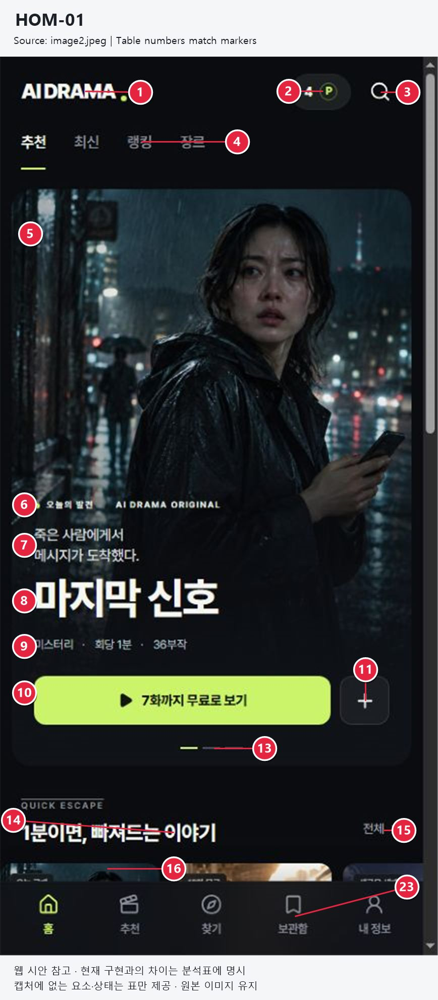

- 진입: 앱의 홈 탭(`/`), 보관함 빈 화면의 `드라마 둘러보기`. 홈 내부 탭 최초값은 추천이다.
- 이탈: HOM-02/03/04, SRC-01, REC-01, DTL-01, PLY-01, WAL-01, NAV-01의 다른 탭.
- 근거: `front/src/screens/HomeScreen.tsx:10–67`, 공통 포스터 `front/src/components/ui.tsx:58–70`.
- 이미지: `images/HOM-01.jpg` ← `웹 시안 image2.jpeg`. 실제 캡처는 화면 상단 일부만 포함한다.

| 번호 | 요소명 | 이 요소의 의미·목적 | 표시 데이터 | 동작 | 상태 | 현재 구현 수준 |
|---|---|---|---|---|---|---|
| ① | 브랜드 워드마크·라임 점 | 서비스 인지와 일관된 브랜드 기억 | AI DRAMA | 정적 표시, 홈 이동 버튼 아님 | 기본; 다른 상태 없음 | 실동작(정적 UI) |
| ② | 보유 포인트 칩 | 재화 잔액을 항상 인지시키고 충전 접근 유도 | `state.balance` 천 단위 구분 + P; 최초 4P | 탭 → WAL-01 | 기본; 복원은 전역 대기 화면에서 처리 | 실동작(이동) / 잔액은 체험용 가짜 |
| ③ | 찾기 아이콘 | 특정 작품을 빠르게 찾는 지름길 | 돋보기 | 탭 → SRC-01 | 기본 | 실동작 |
| ④ | 홈 내부 탭 | 편집 추천·신작·순위·장르라는 서로 다른 탐색 의도 지원 | 추천 / 최신 / 랭킹 / 장르 | 각 탭 → HOM-01/02/03/04로 본문 교체; 가로 스와이프 전환 없음 | 선택 탭 라임 밑줄·굵은 흰색, 비선택 회색 | 실동작 |
| ⑤ | 대표 작품 이미지·그라데이션 | 감정과 장르를 즉시 전달, 첫 재생 전환 유도 | `dramas[heroIndex]` 표지 | 이미지 자체 탭 동작 없음 | 기본, 이미지 전환 180ms; 실패 대체 UI 없음 | 실동작(로컬 정적 표지) |
| ⑥ | 오늘의 발견·제작사 | 운영진 추천이라는 신뢰와 오리지널/제휴 정체성 제공 | 오늘의 발견 / `hero.studio`, 라임 점 | 정적 표시 | 기본 | 체험용 가짜(고정 예시 편성) |
| ⑦ | 작품 훅 문구 | 짧은 갈등·궁금증으로 재생 욕구 형성 | `hero.copy`, 예: 죽은 사람에게서 / 메시지가 도착했다. | 정적 표시 | 기본 | 실동작(예시 데이터 표시) |
| ⑧ | 작품 제목 | 시청할 콘텐츠의 명확한 식별 | `hero.title` | 제목 자체 동작 없음 | 기본 | 실동작 |
| ⑨ | 작품 메타 | 장르·소요시간·전체 분량 판단 | 장르 · 회당 1분 · 총 N부작 | 정적 표시 | 기본; 실제 회차 길이 아님 | 체험용 가짜(1분 고정 문구) |
| ⑩ | 무료 보기 / 이어서 보기 CTA | 무료 구간으로 최초 재생 장벽을 낮추고 기존 시청자의 재진입 단축 | 기록 없으면 N화까지 무료로 보기; 폭 360 미만에서는 N화 무료로 보기; 기록 있으면 이어서 보기 | 탭 → PLY-01, `ep=history.ep ?? 1` | 데이터 복원 전 비활성; 기록 유무로 문구 전환 | 실동작(라우팅); 영상은 체험용 가짜 |
| ⑪ | 작품 저장 버튼 | 즉시 보지 않는 수요를 보관함으로 회수 | 미저장 `+`, 저장 `check`; 접근성 문구 작품 저장/저장 취소 | 탭 → 해당 작품을 기기 내 `saved`에 추가/제거 | 복원 전 비활성; 저장 시 체크·라임·테두리 변화 | 실동작(로컬 저장) |
| ⑫ | 작품 소개 링크 | 재생 전 줄거리·전체 회차 확인 선택권 | 작품 소개 + 대각 화살표 | 탭 → DTL-01 | 기본 | 실동작 |
| ⑬ | 대표 작품 선택기 | 첫 화면에서 여러 작품 노출 기회 확보 | 작품별 선 + 01/02/03 | 탭 → `heroIndex` 변경; 자동 회전·스와이프 없음 | 선택 선 길어짐·라임 숫자 | 실동작 |
| ⑭ | 가로 작품 목록 제목 | 약 1분 단위 소비 가치 전달 | QUICK ESCAPE / 1분이면, 빠져드는 이야기 | 정적 표시 | 기본 | 실동작 |
| ⑮ | 전체 링크 | 더 많은 콘텐츠 탐색 연결 | 전체 + 화살표 | 탭 → HOM-02 최신; 별도 전체 목록으로 가지 않음 | 기본 | 실동작 |
| ⑯ | 가로 포스터 카드 목록 | 시각적 비교와 추가 작품 발견 | 3작품 각각 표지·배지·영문명·표지 위 한글명·바깥 한글명·장르·무료 N화 | 좌우 스크롤, 카드 탭 → DTL-01 | 기본; 로딩·빈 상태·오류 없음 | 실동작(탐색) / 목록은 고정 예시 |
| ⑰ | 로맨스 캠페인 배너 | 감정·시간대 맥락으로 로맨스 탐색 전환 유도 | 낯선 계절 표지, A LITTLE ROMANCE, 오늘은 설레도 괜찮아, 퇴근길을 채울 로맨스 한 편, 로맨스 만나기 | 전체 배너 탭 → SRC-01 `genre=로맨스` | 항상 같은 소재·문구; 선택 상태 없음 | 실동작(이동), 개인화·운영 편성 미구현 |
| ⑱ | TOP 3 섹션 제목 | 선택 부담 완화, 편집 추천 노출 | EDITOR’S PICK / 지금 눈여겨볼 TOP 3 | 정적 표시 | 기본 | 체험용 가짜(고정 편집 순서) |
| ⑲ | 더 보기 링크 | 순위 중심 탐색 확장 | 더 보기 + 화살표 | 탭 → HOM-03 | 기본 | 실동작 |
| ⑳ | 순위 작품 행 | 번호로 우선순위 제시, 무료 범위로 재생 유도 | 순위·썸네일·제작사·제목·장르·분위기·총편수·N화까지 무료·우측 화살표 | 행 전체 탭 → DTL-01 | 1위 숫자만 라임, 나머지 회색; 빈 상태 없음 | 실동작(이동) / 순위 체험용 가짜 |
| ㉑ | 추천 피드 진입 카드 | 제목 탐색이 어려운 사용자에게 미리보기 탐색 제공 | 필름 아이콘, 어떤 이야기가 취향인가요?, 넘겨보며 다음 드라마를 골라보세요., 화살표 | 탭 → REC-01 | 기본 | 실동작 |
| ㉒ | 체험판 안내 푸터 | 예시 데이터를 실제 서비스로 오인하지 않게 안내 | AI DRAMA · 앱 디자인 체험 / 예시 작품과 포인트로 감상 흐름을 둘러보세요. | 정적 표시 | 기본 | 실동작 |
| ㉓ | 하단 탭바 | 핵심 5개 목적지 상시 접근 | NAV-01 참조 | 탭 전환 | 홈 선택 | 실동작 |

캡처 차이: 이미지2의 로고는 `AIDRAMA`처럼 붙어 보이지만 코드는 `AI DRAMA`. ⑫ 작품 소개 링크가 캡처에 없고 ⑬은 선만 있어 숫자 01~03이 없다. ⑯은 카드 상단만 보인다. ⑰~㉒은 스크롤 아래여서 번호를 붙이지 않았다. 시안 아래 탭의 추천/찾기 아이콘도 네이티브 코드의 film/search와 다르다. 캡처에서 없는 UI를 새로 그려 넣지 않는다.

### HOM-02 — 홈 / 최신

- 진입: HOM-01의 최신 탭 또는 ⑮ 전체. 이탈: 홈 다른 내부 탭, 작품 카드 → DTL-01, 포인트/찾기/하단 탭.
- 근거: `HomeScreen.tsx:39–46,67`, `ui.tsx:58–70`. 캡처 없음.

| 번호 | 요소명 | 이 요소의 의미·목적 | 표시 데이터 | 동작 | 상태 | 현재 구현 수준 |
|---|---|---|---|---|---|---|
| ① | 로고 | 브랜드 일관성 | AI DRAMA + 점 | 정적 표시 | 기본 | 실동작 |
| ② | 포인트 칩 | 재화 인지·충전 진입 | 로컬 잔액 + P | → WAL-01 | 기본, 별도 복원 로딩 없음 | 실동작 / 잔액 체험용 가짜 |
| ③ | 찾기 아이콘 | 검색 지름길 | 돋보기 | → SRC-01 | 기본 | 실동작 |
| ④ | 내부 탭 | 탐색 기준 전환 | 추천·최신·랭킹·장르 | → HOM-01~04 | 최신 선택 | 실동작 |
| ⑤ | 최신 섹션 제목 | 신규 공급·다시 방문할 이유 제시 | JUST ARRIVED / 새로운 이야기가 도착했어요 | 정적 표시 | 기본 | 실동작(표시); 실제 신작 판정 미구현 |
| ⑥ | 작품 포스터 그리드 | 한눈에 후보 비교 | 표지·배지·영문명·한글명 2곳·장르·무료범위, 3작품 | 카드 → DTL-01; 세로 스크롤 | 기본; 로딩·빈·오류 없음 | 실동작(표시·이동) / 순서 체험용 가짜 |
| ⑦ | 하단 탭바 | 주요 목적지 이동 | NAV-01 | 탭 이동 | 홈 선택 | 실동작 |

검증된 불일치: 최신 탭도 `dramas.map` 순서 그대로이며 게시일 필드·정렬·새로고침·페이지 추가 로딩은 없다. `오늘 공개` 배지도 catalog 고정값이다. 최신순 실서비스로 명세하면 안 된다.

### HOM-03 — 홈 / 랭킹

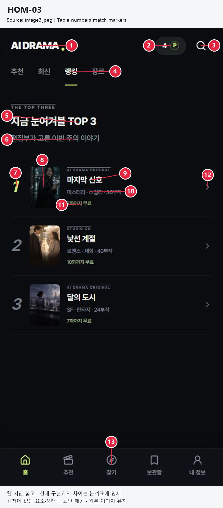

- 진입: 홈 랭킹 탭 또는 HOM-01 TOP 3 더 보기. 이탈: DTL-01, 홈 다른 탭, SRC-01, WAL-01, 하단 탭.
- 근거: `HomeScreen.tsx:28–35,39–46,67`. 이미지: `images/HOM-03.jpg` ← image3.jpeg.

| 번호 | 요소명 | 이 요소의 의미·목적 | 표시 데이터 | 동작 | 상태 | 현재 구현 수준 |
|---|---|---|---|---|---|---|
| ① | 브랜드 로고 | 브랜드 기억 | AI DRAMA + 점 | 정적 표시 | 기본 | 실동작 |
| ② | 포인트 칩 | 충전 접근 | 잔액 + P | → WAL-01 | 기본 | 실동작 / 잔액 체험용 가짜 |
| ③ | 찾기 아이콘 | 검색 접근 | 돋보기 | → SRC-01 | 기본 | 실동작 |
| ④ | 홈 내부 탭 | 탐색 기준 전환 | 추천·최신·랭킹·장르 | → HOM-01~04 | 랭킹 선택·라임 밑줄 | 실동작 |
| ⑤ | 순위 제목 | 선택을 돕는 추천 프레임 | THE TOP THREE / 지금 눈여겨볼 TOP 3 | 정적 표시 | 기본 | 실동작 |
| ⑥ | 선정 기준 설명 | 순위의 의미를 보충 | 편집부가 고른 이번 주의 이야기 | 정적 표시 | 기본; 기간·집계 기준 링크 없음 | 체험용 가짜(이번 주 고정 문구) |
| ⑦ | 순위 번호 | 첫 후보를 시각적으로 강조 | `rank` 1/2/3 | 소속 행 탭 → DTL-01 | 1위 라임, 나머지 회색 | 체험용 가짜(정적 순위) |
| ⑧ | 작품 썸네일 | 이미지로 작품 재인·장르 전달 | 해당 작품 표지 | 소속 행 탭 → DTL-01 | 기본 | 실동작 |
| ⑨ | 제작사·제목 | 콘텐츠 출처와 작품 식별 | `studio`, `title` | 소속 행 탭 → DTL-01 | 기본 | 실동작 |
| ⑩ | 장르·분위기·총회차 | 취향과 분량 판단 | `tag` · `mood` · `total`부작 | 소속 행 탭 → DTL-01 | 기본 | 실동작 |
| ⑪ | 무료 구간 | 진입 비용 불안 완화 | `free`화까지 무료 | 소속 행 탭 → DTL-01 | 라임 텍스트 | 실동작(시안 데이터 표시) |
| ⑫ | 행 우측 화살표 | 상세 이동 가능성을 명확히 표시 | chevron-right | 행 전체 → DTL-01 | 기본 | 실동작 |
| ⑬ | 하단 탭바 | 핵심 목적지 이동 | NAV-01 | 탭 이동 | 홈 선택 | 실동작 |

캡처는 코드와 의미상 일치한다. 단, 명칭 `랭킹`에 비해 코드가 실제로 제공하는 것은 편집부 고정 추천이다. 주간 집계·등락·조회수는 없다. 주석의 ⑦~⑫는 첫 행에서 대표 표시하며 2·3위도 같은 구성이다.

### HOM-04 — 홈 / 장르

- 진입: 홈 장르 탭. 이탈: SRC-01(선택 장르), 홈 다른 탭, 포인트·하단 탭.
- 근거: `HomeScreen.tsx:27,39–46,67`. 캡처 없음.

| 번호 | 요소명 | 이 요소의 의미·목적 | 표시 데이터 | 동작 | 상태 | 현재 구현 수준 |
|---|---|---|---|---|---|---|
| ① | 브랜드 로고 | 서비스 인지 | AI DRAMA + 점 | 정적 표시 | 기본 | 실동작 |
| ② | 포인트 칩 | 충전 접근 | 잔액 + P | → WAL-01 | 기본 | 실동작 / 잔액 체험용 가짜 |
| ③ | 찾기 아이콘 | 검색 접근 | 돋보기 | → SRC-01 | 기본 | 실동작 |
| ④ | 내부 탭 | 탐색 방식 전환 | 추천·최신·랭킹·장르 | → HOM-01~04 | 장르 선택 | 실동작 |
| ⑤ | 장르 섹션 제목 | 취향 질문으로 탐색 시작 | FIND YOUR MOOD / 오늘은 어떤 이야기인가요? | 정적 표시 | 기본 | 실동작 |
| ⑥ | 장르 타일 | 콘텐츠명을 몰라도 원하는 분위기로 진입 | 표지 배경·그라데이션·미스터리/로맨스/SF·대각 화살표 | 탭 → SRC-01 `genre=drama.tag` | 기본; 선택 표시·작품수 없음 | 실동작 |
| ⑦ | 하단 탭바 | 주요 목적지 이동 | NAV-01 | 탭 이동 | 홈 선택 | 실동작 |

현재 장르 목록은 장르 사전이 아니라 작품 3개를 그대로 map한다. 작품이 늘면 같은 장르 타일이 중복될 수 있는 코드 구조다. 운영용 장르 목록·정렬·작품수는 미구현이다.

### REC-01 — 추천 / 세로 미리보기 피드

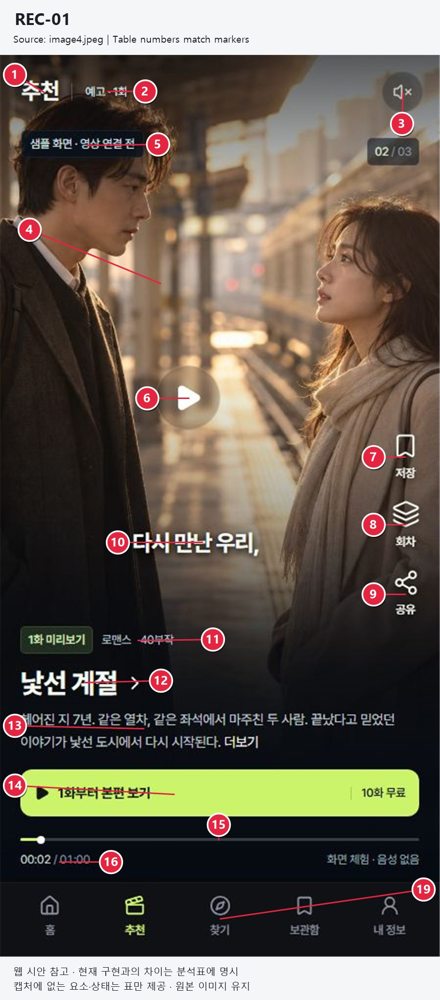

- 진입: 하단 추천 탭, HOM-01 취향 카드, 작품 ID를 전달하는 추천 경로. 이탈: DTL-01, PLY-01, 시스템 공유 UI, 하단 탭.
- 근거: `RecommendationScreen.tsx:13–102`, `services/share-drama.ts:6–12`, `ExperienceProvider.tsx:85–87`. 이미지: `images/REC-01.jpg` ← image4.jpeg.

| 번호 | 요소명 | 이 요소의 의미·목적 | 표시 데이터 | 동작 | 상태 | 현재 구현 수준 |
|---|---|---|---|---|---|---|
| ① | 추천 제목 | 탐색 문맥 표시 | 추천 | 정적 표시 | 기본 | 실동작 |
| ② | 무료 미리보기 안내 | 과금 없는 탐색임을 알림 | 예고편 · 무료 미리보기 | 정적 표시 | 기본 | 실동작(안내) |
| ③ | 음소거 모양 아이콘 | 소리 상태처럼 보이는 시각 표시 | volume-x | 탭 핸들러 없음; 음소거 전환 불가 | 정적; 선택·해제 상태 없음 | 미구현(음량 제어) |
| ④ | 세로 표지·확대 애니메이션 | 영상처럼 몰입하도록 분위기 전달 | 작품 표지, 12초 주기로 1↔1.065배 확대 | 위아래 스와이프 → 이전/다음 작품; 80% 이상 노출된 카드만 활성 | 탭 이탈·앱 비활성·일시정지·스크럽·공유 중 타이머 정지; 마지막 작품 다음 추가 로딩 없음 | 체험용 가짜(영상 없음); 피드 넘기기는 실동작 |
| ⑤ | 샘플 안내 | 시안과 실제 영상 구분 | 샘플 화면 · 영상 연결 전 | 정적 표시 | 기본 | 실동작 |
| ⑥ | 중앙 재생/일시정지 | 소비자가 미리보기 흐름 제어 | running 시 pause, 정지 시 play | 탭 → `paused` 반전; 표지 애니메이션·가상 시간만 제어 | 재생/일시정지; 버퍼링·재생 오류 없음 | 체험용 가짜 |
| ⑦ | 찜 버튼 | 본편을 지금 보지 않아도 재방문 단서 확보 | 북마크 아이콘 + 찜 | 탭 → saved 토글; LIB-01 반영 | 저장 시 라임; 복원 전 disabled 표시는 없으나 provider가 변경 무시 | 실동작(로컬 저장) |
| ⑧ | 회차 버튼 | 회차 탐색 의도 수용 | layers + 회차; 접근성 문구 작품 소개와 회차 | 탭 → DTL-01 **소개 탭 기본 진입**; 회차 시트를 즉시 열지 않음 | 기본 | 실동작(이동), 직접 회차 열기 미구현 |
| ⑨ | 공유 버튼 | 입소문·외부 유입 촉진 | share-2 + 공유 | 네이티브 시스템 공유; 웹은 공개 웹 시안의 `?drama=id` 링크 클립보드 복사 | 처리 중 버튼 disabled; 실패 안내 ⑱ | 실동작(시스템 공유/복사); 서비스 딥링크 미구현 |
| ⑩ | 샘플 자막 | 무음 상황에서 갈등과 감정 전달 | 0~19초 copy 첫 줄, 20~39초 두 번째 줄, 40초 이후 이야기는 이제 시작이다. | 설정 `captions`로 표시/숨김 | 자막 설정 on/off; 실제 자막 트랙 없음 | 체험용 가짜 |
| ⑪ | 장르·분량·무료 정보 | 취향·시청 부담·무료 범위 판단 | 장르 · N부작 · N화 무료 | 정적 표시 | 기본 | 실동작(예시 데이터 표시) |
| ⑫ | 작품 제목·상세 화살표 | 작품 기억 및 자세한 정보 접근 | `drama.title` + chevron-right | 탭 → DTL-01 | 기본 | 실동작 |
| ⑬ | 줄거리 | 미리보기만으로 부족한 맥락 보완 | `description`, 최대 2줄 | 펼치기·더보기 동작 없음 | 2줄 초과는 생략 | 실동작 |
| ⑭ | 본편 보기 CTA | 미리보기 관심을 본편 시청으로 전환 | 기록 있으면 본편 이어보기, 없으면 1화부터 본편 보기 | → PLY-01, 기록 회차 또는 1화 | 기록에 따라 문구 변경; ready에 따른 disabled 없음 | 실동작(이동), 영상은 체험용 가짜 |
| ⑮ | 미리보기 위치 슬라이더 | 원하는 구간 확인 | 0~60, 1초 간격; 라임 트랙·손잡이 | 드래그 중 진행 멈춤; 놓으면 가상 위치를 바꾸고 드래그 상태만 해제. 사용자가 이미 일시정지해 두었으면 정지 유지(활성·일시정지 아님·공유 중 아님일 때만 진행) | 스크럽/재생; 버퍼 상태 없음 | 체험용 가짜 |
| ⑯ | 시간 표시 | 시청 길이와 위치 인지 | mm:ss / 01:00; 60초 후 0으로 반복 | 정적 표시 | 매초 갱신 | 체험용 가짜 |
| ⑰ | 다음 작품 제스처 힌트 | 세로 탐색 발견 가능성 확보 | 위로 넘겨 다음 작품 | 스와이프는 ④에서 처리 | 마지막 작품에도 같은 문구 표시 | 실동작(문구), 마지막 경계 안내 없음 |
| ⑱ | 공유 결과 메시지 | 공유 성공/실패 피드백 | 웹 성공: 작품 링크를 복사했어요. / 실패: 공유를 완료하지 못했어요. | 별도 버튼 없음 | 결과 발생 시 표시, 자동 해제 타이머 없음 | 실동작 |
| ⑲ | 하단 탭바 | 탐색 목적지 전환 | NAV-01 | 탭 이동 | 추천 선택 | 실동작 |

캡처 차이: 상단의 `예고·1화`, 우상단 `02/03` 작품 카운터, 미리보기 배지, `더보기`, CTA 안 무료편수, 하단 `화면 체험·음성 없음`은 코드에 없거나 다른 문구다. ⑦ 캡처는 `저장`, 코드는 `찜`. ⑤는 캡처 상단, 코드 중앙이다. ②·⑪·⑭는 같은 기능 영역에 번호를 두되 문구는 표가 정답이다. ⑰의 제스처 힌트·⑱ 결과는 캡처에 없어 표시하지 않았다. ⑥ 캡처의 play 아이콘은 정지 상태로 볼 수 있으며 코드에서는 실행 상태에 따라 달라진다.

### SRC-01 — 찾기

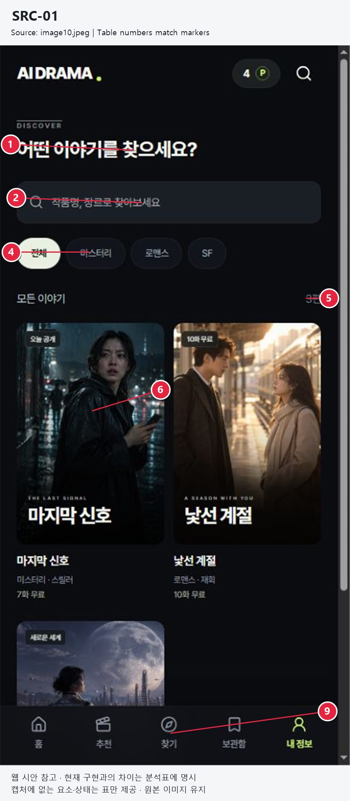

- 진입: 하단 찾기 탭, 홈 돋보기, 홈 장르 타일/로맨스 배너. `genre` 경로 인자는 전체·미스터리·로맨스·SF만 인정하며 다른 값은 전체가 된다.
- 이탈: 결과 카드 → DTL-01, 하단 탭. 검색 입력은 즉시 로컬 결과를 바꾸며 별도 검색 제출 페이지 없음.
- 근거: `SearchScreen.tsx:8–34`. 이미지: `images/SRC-01.jpg` ← image10.jpeg.

| 번호 | 요소명 | 이 요소의 의미·목적 | 표시 데이터 | 동작 | 상태 | 현재 구현 수준 |
|---|---|---|---|---|---|---|
| ① | 찾기 제목 | 검색 의도 유도 | FIND YOUR NEXT STORY / 어떤 이야기를 찾으세요? | 정적 표시 | 기본 | 실동작 |
| ② | 검색 입력창·돋보기 | 제목·장르·취향 키워드로 후보 축소 | 작품 제목이나 장르를 검색해요; 입력 문자열 | 글자 변경 즉시 필터; 앞뒤 공백 제거·소문자 비교. 제목·영문명·장르·분위기 문자열 포함 여부 검색; 줄거리·제작사는 대상 아님 | 빈 입력/입력 중; 네트워크 로딩·오류 없음 | 실동작(로컬 검색) |
| ③ | 입력 지우기 X | 빠르게 새 검색 시작 | X | 탭 → query 비움, 선택 장르 유지 | 입력 길이가 0보다 클 때만 표시 | 실동작 |
| ④ | 장르 필터 칩 | 취향 필터와 검색의 결합 | 전체 / 미스터리 / 로맨스 / SF | 탭 → 장르 교체; 가로 스크롤 가능; 검색어 유지 | 선택 라임 배경·어두운 글자, 나머지 테두리·회색 | 실동작 |
| ⑤ | 결과 제목·개수 | 현재 조건과 결과 범위 이해 | 모든 이야기 / N장르 이야기 / '검색어' 검색 결과, N개 작품 | 정적 표시 | 입력·필터에 따라 갱신 | 실동작 |
| ⑥ | 결과 포스터 그리드 | 검색 후보 확인·상세 전환 | 표지·배지·영문명·표지 한글명·외부 한글명·장르·무료범위 | 카드 → DTL-01 | 기본; 너비에 따라 줄바꿈, 별도 정렬·페이지 추가 없음 | 실동작(고정 3작품 대상) |
| ⑦ | 결과 없음 안내 | 실패가 아닌 조건 재설정으로 회복 | 필름 아이콘, 아직 찾는 이야기가 없어요 / 다른 제목을 검색하거나 장르를 바꿔보세요. | 정적 표시 | 결과 0개일 때 그리드 대체 | 실동작 |
| ⑧ | 모든 작품 보기 CTA | 빈 결과에서 탐색 복귀 | 모든 작품 보기 | 탭 → 검색어 비움 + 장르 전체 | 빈 결과에서만 표시 | 실동작 |
| ⑨ | 하단 탭바 | 주요 목적지 이동 | NAV-01 | 탭 이동 | 코드에서는 찾기 선택 | 실동작 |

캡처 차이: image10은 **찾기 단일 화면**이며 보관함 캡처로 재사용하지 않는다. 캡처 상단 AI DRAMA·잔액·돋보기 공통 헤더는 `SearchScreen` 코드에는 없다. 영문 제목은 DISCOVER, 검색 힌트 문구와 결과 단위는 `3편`, 포스터 바깥 메타는 장르·분위기/무료 2줄이다. 코드의 기본 Poster는 장르·무료 1줄이다. 캡처의 하단 내정보가 활성화된 것은 명백한 상태 불일치이며 코드의 찾기 활성 상태로 명세한다. ③·⑦·⑧은 해당 상태 캡처가 없어 번호 미표시.

### LIB-01 — 보관함 / 저장한 작품

- 진입: 하단 보관함(`/library` 기본), MY-01 찜한 작품(`tab=saved`). 이탈: DTL-01, LIB-02, 빈 화면 CTA → HOM-01, 하단 탭.
- 근거: `LibraryScreen.tsx:9–30`, `experience.ts:125–133`. 캡처 없음.

| 번호 | 요소명 | 이 요소의 의미·목적 | 표시 데이터 | 동작 | 상태 | 현재 구현 수준 |
|---|---|---|---|---|---|---|
| ① | 보관함 제목 | 저장 콘텐츠를 재방문할 장소 안내 | MY COLLECTION / 다음 이야기도, 여기서 | 정적 표시 | 기본 | 실동작 |
| ② | 저장·기록 탭과 개수 | 수집 콘텐츠와 진행 중 콘텐츠 구분 | 저장한 작품 `saved.length` / 시청 기록 `history.length` | 탭 → LIB-01/02 | 선택 elevated 배경·흰 글자, 비선택 muted | 실동작 |
| ③ | 불러오는 중 표시 | 로컬 데이터 복원 대기 설명 | ActivityIndicator, 접근성: 보관함 불러오는 중 | 자동 복원 완료 후 내용 표시 | `!ready`에서만 표시 | 실동작 |
| ④ | 저장 작품 포스터 | 나중에 볼 후보 재발견 | 저장 ID 순서로 표지·배지·영문명·한글명 2곳·장르·무료범위 | 카드 → DTL-01; 저장 순으로 뒤에 추가되는 구조 | 저장 1개 이상이면 표시 | 실동작(로컬) |
| ⑤ | 저장 취소 아이콘 | 더 이상 원치 않는 작품 정리 | 카드 우상단 라임 북마크 | 탭 → 즉시 제거, 확인·실행취소 없음 | 취소 결과 0개면 빈 화면 | 실동작(로컬) |
| ⑥ | 저장 없음 안내 | 아직 저장하지 않았음을 설명하고 저장법 교육 | 필름 아이콘, 다음에 볼 이야기를 담아보세요 / 작품의 + 버튼을 누르면 여기에 모아드려요. | 정적 표시 | ready이며 saved 0개 | 실동작 |
| ⑦ | 드라마 둘러보기 CTA | 빈 화면에서 콘텐츠 탐색 재개 | 드라마 둘러보기 | 탭 → HOM-01 | 빈 화면에 표시 | 실동작 |
| ⑧ | 보관 위치·저장 오류 안내 | 계정 동기화와 혼동 방지·유실 가능성 전달 | 정상: 저장한 작품과 시청 기록은 현재 기기에 보관돼요. / 오류: 기록을 기기에 저장하지 못했어요. 지금 이용하는 동안에는 유지돼요. | 별도 재시도 없음 | 기본/저장 오류 | 실동작 |
| ⑨ | 하단 탭바 | 주요 목적지 이동 | NAV-01 | 탭 이동 | 보관함 선택 | 실동작 |

정렬·일괄 선택·일괄 삭제·저장일·계정 간 동기화는 없다. ⑥의 `+` 설명은 추천 피드 북마크와 내정보 `찜` 용어와 맞지 않는다.

### LIB-02 — 보관함 / 시청 기록

- 진입: LIB-01 시청 기록 탭, MY-01 시청 기록(`tab=history` 또는 `tab=시청 기록`). 이탈: 기록 행 → PLY-01, LIB-01, 빈 화면 CTA → HOM-01, 하단 탭.
- 근거: `LibraryScreen.tsx:14–30`, `experience.ts:135–143`. 캡처 없음.

| 번호 | 요소명 | 이 요소의 의미·목적 | 표시 데이터 | 동작 | 상태 | 현재 구현 수준 |
|---|---|---|---|---|---|---|
| ① | 보관함 제목 | 이어보기 장소 인식 | MY COLLECTION / 다음 이야기도, 여기서 | 정적 표시 | 기본 | 실동작 |
| ② | 저장·시청 기록 탭과 개수 | 저장 후보와 진행작 구분 | 저장한 작품 N / 시청 기록 N | LIB-01/02 전환 | 시청 기록 선택 | 실동작 |
| ③ | 로컬 데이터 로딩 | 복원 중 상태 안내 | ActivityIndicator | 복원 후 자동 전환 | !ready | 실동작 |
| ④ | 기록 행 표지·제목 | 전에 본 콘텐츠 식별 | drama 표지·제목 | 행 → PLY-01 `id`, `ep` 전달 | 기록 1개 이상 | 실동작(로컬) |
| ⑤ | 회차·시청 초 표시 | 어디까지 봤는지 기억 보조 | `entry.ep`화 · `floor(entry.time)`초 시청 | 행과 같은 동작 | 기본; 최대 60초 | 체험용 가짜(영상 대신 가상 시간 기록) |
| ⑥ | 진행 막대 | 남은 분량 직관적 전달 | `time/60`, 0~100% 제한 | 탐색 바 아님; 행 탭만 가능 | 기록에 따라 채움 | 체험용 가짜 |
| ⑦ | 이어보기 아이콘 | 즉시 재생 가능성을 표시 | 라임 play | 행 전체 → PLY-01; 상세 페이지를 거치지 않음 | 기본 | 실동작(이동) |
| ⑧ | 시청 기록 없음 안내 | 첫 시청 유도 | 필름, 첫 번째 이야기를 시작해 볼까요? / 보다 멈춘 회차도 여기서 이어볼 수 있어요. | 정적 표시 | ready이며 기록 0개 | 실동작 |
| ⑨ | 드라마 둘러보기 CTA | 빈 상태의 다음 행동 제공 | 드라마 둘러보기 | → HOM-01 | 빈 기록에서 표시 | 실동작 |
| ⑩ | 저장 위치·오류 안내 | 로컬 기록 한계 설명 | LIB-01 ⑧과 동일 | 재시도 없음 | 기본/저장 오류 | 실동작 |
| ⑪ | 하단 탭바 | 주요 목적지 이동 | NAV-01 | 탭 이동 | 보관함 선택 | 실동작 |

기록은 **회차별 전체 시청 이력 목록이 아니라 작품당 마지막 회차·위치 1건**이며 갱신 시 맨 앞으로 이동한다. 날짜·본 회차 누적·삭제·완결 표시가 없다. 접근성 문구는 `N초부터 이어보기`이고 라우트에는 초가 아닌 회차만 전달하며 Player가 같은 작품·회차의 저장 위치를 읽는 구조다.

### MY-01 — 내 정보

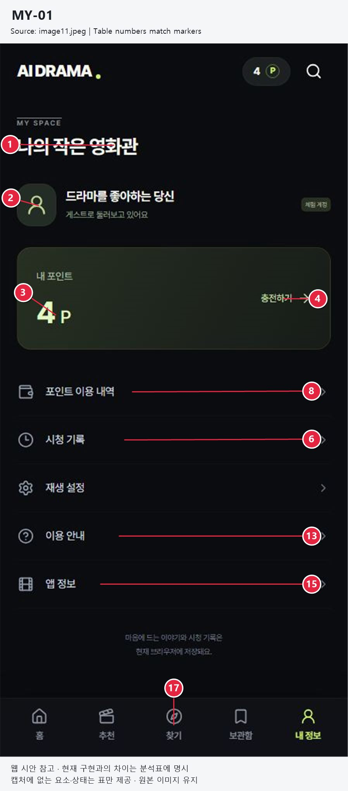

- 진입: 하단 내 정보(`/account`). 이탈: WAL-01, LIB-01/02, MY-02 정보 모달, 하단 탭.
- 근거: `AccountScreen.tsx:9–30`, `ExperienceProvider.tsx:116–118`, `experience.ts:36–47`. 이미지: `images/MY-01.jpg` ← image11.jpeg. 이미지와 코드의 구조 차이가 크므로 아래 표를 정답으로 사용한다.

| 번호 | 요소명 | 이 요소의 의미·목적 | 표시 데이터 | 동작 | 상태 | 현재 구현 수준 |
|---|---|---|---|---|---|---|
| ① | 화면 제목 | 개인 이용 영역 식별 | MY PAGE / 내 정보 | 정적 표시 | 기본 | 실동작 |
| ② | 게스트 프로필·아바타 | 로그인 없이 사용하는 현 상태 설명 | 사용자 아이콘, 게스트, 이 기기에서 즐기는 나의 드라마 | 탭 동작·로그인 CTA 없음 | 게스트 고정 | 체험용 가짜(회원 계정 미구현) |
| ③ | 포인트 잔액 카드 | 사용 가능한 재화를 크게 인지 | 보유 포인트 / `balance` 포인트 | 잔액 텍스트 자체 동작 없음 | 기본; 별도 로딩 없음 | 체험용 가짜(로컬 잔액) |
| ④ | 포인트 받기·충전 버튼 | 광고 보상·결제 진입 | 포인트 받기 · 충전 | 탭 → WAL-01 | 기본 | 실동작(이동) |
| ⑤ | 나의 활동 제목 | 활동 관련 바로가기 묶음 | 나의 활동 | 정적 표시 | 기본 | 실동작 |
| ⑥ | 시청 기록 버튼 | 중단 콘텐츠 재생을 빠르게 재개 | clock + 시청 기록 | → LIB-02 `tab=history` | 기본 | 실동작 |
| ⑦ | 찜한 작품 버튼 | 재방문 후보와 저장량 인지 | bookmark + 찜한 작품 · N | → LIB-01 `tab=saved` | 개수 실시간 반영 | 실동작 |
| ⑧ | 포인트 내역 버튼 | 재화 변화 확인 경로 | list + 포인트 내역 | → WAL-01 맨 위 진입; 내역으로 자동 스크롤하지 않음 | 기본 | 실동작(이동); 전용 내역 화면 없음 |
| ⑨ | 재생 설정 제목 | 선호하는 감상 방식 설정 묶음 | 재생 설정 | 제목 자체 탭 동작 없음 | 기본 | 실동작 |
| ⑩ | 자막 표시 스위치 | 무음·접근성 상황에서 내용 이해 지원 | 자막 표시 / 재생 화면의 한국어 자막, state.captions | 토글 → 기기 저장·피드와 재생 화면 반영 | 초기 on; 복원 전 disabled; on 라임 | 실동작(로컬 설정), 실제 자막 트랙 없음 |
| ⑪ | 다음 화 자동 재생 스위치 | 연속 감상으로 중단·이탈 감소 | 다음 화 자동 재생 / 유료 회차는 포인트 사용을 먼저 확인해요., state.autoNext | 토글 → 기기 저장·재생 화면 반영 | 초기 on; 복원 전 disabled | 실동작(체험 플레이어 설정); 포인트 자동 사용 설정 아님 |
| ⑫ | 도움말·앱 정보 제목 | 지원·서비스 설명의 위치 안내 | 도움말 · 앱 정보 | 정적 표시 | 기본 | 실동작 |
| ⑬ | 자주 묻는 질문 버튼 | 과금·재시청 정책의 기본 의문 해소 | help-circle + 자주 묻는 질문 | → MY-02 `이용 안내` 정적 문단 | 기본 | 실동작(모달), 검색 가능한 FAQ는 미구현 |
| ⑭ | 문의 안내 버튼 | 문제 발생 시 지원 경로 기대 형성 | message-circle + 문의 안내 | → MY-02 `문의 안내`, 실제 접수 미연결 안내 | 기본 | 실동작(안내), 실제 문의 접수 미구현 |
| ⑮ | 앱 정보·데이터 보관 버튼 | 저장 범위·데이터 소실 조건 고지 | info + 앱 정보 · 데이터 보관 | → MY-02 `AI DRAMA 체험판` | 기본 | 실동작(안내) |
| ⑯ | 저장 오류 경고 | 앱 종료 시 상태가 사라질 가능성 알림 | 기기에 기록을 저장하지 못했어요. 앱을 닫으면 변경 내용이 사라질 수 있어요. | 별도 재시도 없음 | storageError 시 danger 색으로 표시 | 실동작 |
| ⑰ | 하단 탭바 | 주요 목적지 이동 | NAV-01 | 탭 이동 | 내 정보 선택 | 실동작 |

캡처 차이: 상단 로고·잔액·찾기 헤더는 코드에 없다. 캡처의 `MY SPACE / 나의 작은 영화관`, `드라마를 좋아하는 당신 / 게스트로 둘러보고 있어요 / 체험 계정`, `내 포인트 / 4P / 충전하기`는 코드 문구·배치와 다르다. 캡처는 `포인트 이용 내역→시청 기록→재생 설정→이용 안내→앱 정보` 메뉴 순서지만 코드는 활동 3버튼 뒤에 설정 스위치 2개를 바로 노출한다. ⑨ 제목을 시안의 재생 설정 **메뉴 버튼**에 붙이면 잘못된 동작을 암시하므로 미표시했다. ⑤·⑦·⑨~⑫·⑭·⑯은 캡처에 해당 요소가 없어 미표시. ⑬은 시안의 이용 안내(기능상 대응), ⑮는 앱 정보에 매핑했다. 캡처 하단 브라우저 저장 안내는 코드의 상시 문구가 아니다.

### MY-02 — 내 정보 / 안내 모달 3종

- 진입: MY-01 ⑬/⑭/⑮. 이탈: 닫기 또는 OS 닫기 요청 → MY-01. 캡처 없음.
- 근거: `AccountScreen.tsx:26–30`. 실제 고객센터·약관 화면으로 오인하면 안 된다.

| 번호 | 요소명 | 이 요소의 의미·목적 | 표시 데이터 | 동작 | 상태 | 현재 구현 수준 |
|---|---|---|---|---|---|---|
| ① | 모달 제목 | 안내 유형 식별 | 이용 안내 / 문의 안내 / AI DRAMA 체험판 | 정적 표시 | 선택한 메뉴에 따라 교체 | 실동작 |
| ② | 안내 본문 | 기본 정책·체험판 한계를 설명 | 이용: 무료 이후 회당 10P·재시청 추가차감 없음·광고충전 체험·표지자막 시안. 문의: 실제 접수 미연결. 앱정보: 기록·찜·포인트·설정 로컬 저장, 동기화·실서비스 미연결, 앱데이터 삭제 시 소실 | 내용 길면 세로 스크롤 | 정적; 로딩·오류 없음 | 실동작(정적 설명); 정책 수치는 시안 값 |
| ③ | 닫기 버튼 | 원래 맥락 복귀 | 닫기 | info=null → MY-01; OS onRequestClose 동일 | 기본 | 실동작 |
| ④ | 모달 컨테이너 | 본문을 원화면과 구분 | slide 애니메이션, formSheet, 안전영역 고려 스크롤 | OS에 따른 시트 동작; 코드상 배경 탭 닫기 없음 | 열림/닫힘 | 실동작 |

### NAV-01 — 공통 하단 탭바

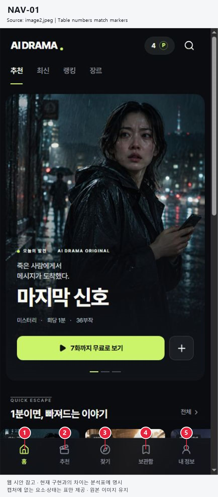

- 진입: 5개 최상위 탭 화면에 공통으로 존재. 작품 상세·재생·포인트는 루트 별도 화면이다.
- 이탈: 선택 탭의 최상위 콘텐츠로 전환. 전역 백 동작·탭 재탭 스크롤 상단 복귀는 개별 화면에서 별도로 구현하지 않았다.
- 근거: 네이티브 `front/src/app/(tabs)/_layout.tsx:5–22`; 웹은 `_layout.web.tsx`의 별도 Tabs 구현. 이미지: `images/NAV-01.jpg` ← image2.jpeg의 전체 캡처에 하단만 번호 표시.

| 번호 | 요소명 | 이 요소의 의미·목적 | 표시 데이터 | 동작 | 상태 | 현재 구현 수준 |
|---|---|---|---|---|---|---|
| ① | 홈 탭 | 편집 추천·전체 탐색 출발점 | home 아이콘 + 홈 | → `/` HOM-01~04 현재 내부 탭 | 선택 accent, 비선택 muted | 실동작 |
| ② | 추천 탭 | 세로 피드로 취향 발견 | film 아이콘 + 추천 | → `/recommend` REC-01 | 동일 | 실동작 |
| ③ | 찾기 탭 | 능동 검색·장르 탐색 | search 아이콘 + 찾기 | → `/search` SRC-01 | 동일 | 실동작 |
| ④ | 보관함 탭 | 저장·기록 재방문 | bookmark 아이콘 + 보관함 | → `/library` LIB-01/02 | 동일 | 실동작 |
| ⑤ | 내 정보 탭 | 재화·활동·개인 설정 | user 아이콘 + 내 정보 | → `/account` MY-01 | 동일 | 실동작 |

네이티브는 `NativeTabs`, 라벨 11px Pretendard Medium, 배경 surface, 기본 아이콘·라벨 muted, 선택 accent, 라벨 항상 표시, 스크롤 가장자리 투명화 비활성이다. 실제 높이·플랫폼 선택 표현은 네이티브 탭바가 결정한다. 캡처의 추천 clapperboard, 찾기 compass 모양을 앱 아이콘 정답으로 쓰지 않는다. image10의 선택 탭 오류는 SRC-01에 별도 기재했다.

### DTL-01 · 작품 상세 — 작품 소개

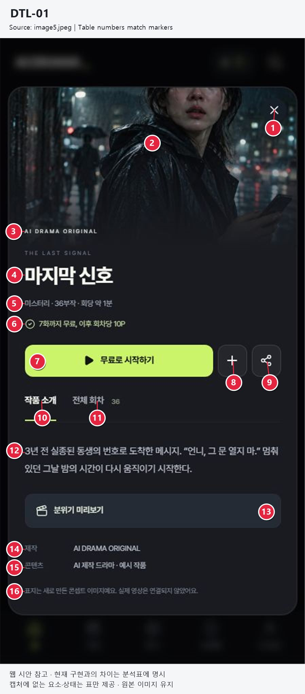

- **현재 구현 확인:** `front/src/screens/DramaDetailScreen.tsx:11–58`, 스타일 `:60–70`; 공유 `front/src/services/share-drama.ts:6–14`.
- **진입:** HOM의 작품 카드/작품 소개, REC의 작품 소개·회차, SRC 검색 결과, LIB 저장 작품 카드. `/drama/[id]` 기본 탭 또는 상세의 ‘작품 소개’ 탭. PLY의 소개는 별도 PLY-04 시트이므로 혼동하지 않는다.
- **이탈:** ① 이전 스택 화면(이력이 없으면 홈), ⑦ PLY-01, ⑨ OS 공유 메뉴, ⑪ DTL-02, ⑬ REC-01. 하단 탭바는 없다.
- **이미지:** [DTL-01.png](images/DTL-01.jpg), 원본 `image5.jpeg`. 웹은 둥근 모달과 우측 상단 X, 코드는 전체 라우트 화면과 좌측 상단 뒤로. ①은 웹의 대응 X에 표시했으며 실제 버튼 위치는 코드 기준 좌상단이다. 웹 배경의 흐릿한 탭바는 상세 화면의 구성 요소가 아니다. ⑰⑱은 조건부라 캡처에 없다.

| 번호 | 요소명 | 이 요소의 의미·목적 | 표시 데이터 | 동작 | 상태 | 현재 구현 수준 |
|---|---|---|---|---|---|---|
| ① | 뒤로 가기 | 탐색 흐름으로 복귀해 상세 진입 부담을 낮춤 | chevron-left 아이콘 | router.back; 이전 화면 없으면 `/` 교체 이동 | 기본; 전역 준비 완료 후 화면 표시 | 실동작(라우팅) |
| ② | 작품 히어로 표지·그라데이션 | 분위기와 장르를 즉시 전달하고 아래 글자의 가독성 확보 | DramaImage의 작품별 로컬 이미지, 검정 그라데이션; 높이 290 | 터치 동작 없음; 페이지 세로 스크롤 | 정적 이미지, 이미지 오류 대체 UI 없음 | 체험용 가짜(콘셉트 표지; 동영상 아님) |
| ③ | 제작사/공급사 표기 | 콘텐츠 출처와 오리지널 브랜드 인지 | `drama.studio`, 예 AI DRAMA ORIGINAL / STUDIO ON | 없음 | 기본 | 체험용 가짜(샘플 제작사) |
| ④ | 영문명·작품명 | 선택 작품 식별, 브랜드 기억 강화 | `drama.english`, `drama.title` | 제목 자체 탭 없음 | 기본 | 실동작(정적 카탈로그 표시) |
| ⑤ | 장르·전체 분량 | 시청 취향과 시간 투입 판단 | `tag · total부작 · 회당 약 1분` | 장르 링크 없음 | 기본 | 실동작(카탈로그 값; 분당 길이는 고정 문구) |
| ⑥ | 무료 범위·유료 가격 | 무료 시작 유도 및 유료 전환 사전 고지 | `{free}화까지 무료, 이후 회차당 10P`; 10P는 시안값 | 읽기 전용 | 기본; 무료 7/10은 작품별 | 체험용 가짜(요금 고정 문구; 실제 가격 조회 없음) |
| ⑦ | 무료로 시작하기 / 이어서 보기 | 첫 시청·재방문 시 최소 조작으로 본편 진입 | 기록 없음 ‘무료로 시작하기’; 기록 있음 ‘이어서 보기’ | PLY-01에 `id`, 기록 회차 `history.ep` 또는 1 전달; 시점 복원은 플레이어가 처리 | 기기 저장값 준비 전 비활성; 기록 유무로 문구 전환 | 실동작(이동); 실제 영상은 미구현 |
| ⑧ | + 저장 / 체크 해제 | 관심 작품을 보관해 재방문 유도 | 미저장 plus; 저장 check·accent; 접근성 이름 ‘작품 저장/저장 취소’ | `toggleSave(id)` 즉시 토글, LIB-01 반영 | 선택/미선택, 준비 전 비활성 방어코드; 개별 실패 재시도 없음, 전역 저장 오류 안내 있음 | 실동작(기기 내 저장); 계정 동기화 미구현 |
| ⑨ | 작품 공유 | 외부 추천 유입 확보 | share-2 아이콘, 제목과 웹 시안 URL `?drama=id` | 네이티브 OS 공유 창; 웹은 클립보드 복사. 직접 발송하지 않음 | 기본; 예외 시 ⑱; 복사 성공 토스트 없음 | 실동작(공유 API 호출); 운영 앱 딥링크는 미구현 |
| ⑩ | 작품 소개 탭 | 줄거리와 제작 정보를 확인 | ‘작품 소개’ | DTL-01 유지/전환 | 선택: 밝은 글씨+라임 밑줄; 회차 탭에서 누르면 선택 전환 | 실동작 |
| ⑪ | 전체 회차 탭·개수 | 무료·잠긴 회차를 미리 확인 | `전체 회차 {total}` | DTL-02; 동일 화면 내 selectedTab 변경 | 기본 비선택 | 실동작 |
| ⑫ | 줄거리 | 작품의 갈등·궁금증을 전달해 시작 전환 유도 | `drama.description` 전체 문장 | 펼치기 없음; 페이지 스크롤 | 기본; 서버 조회/로딩 없음 | 실동작(정적 샘플 문장) |
| ⑬ | 분위기 미리보기 | 본편 시작 전 취향 판단, 추천 피드 진입 | film 아이콘, ‘분위기 미리보기’ | `/recommend?id={id}` → REC-01, 선택 작품부터 탐색 | 기본; 개별 disabled 조건 없음. 전역 준비 후 화면 표시 | 실동작(이동); 영상 미리보기는 체험용 가짜 |
| ⑭ | 제작 정보 행 | 콘텐츠 제공 주체 확인 | 라벨 ‘제작’, `studio` | 없음 | 기본 | 체험용 가짜(샘플 값) |
| ⑮ | 콘텐츠 정보 행 | AI 제작 콘텐츠임을 명시 | ‘콘텐츠 / AI 제작 드라마 · 예시 작품’ | 없음 | 기본 | 실동작(체험 안내) |
| ⑯ | 콘셉트 이미지·영상 미연결 고지 | 실제 시청 가능 서비스로 오인 방지 | ‘표지는 새로 만든 콘셉트 이미지예요. 실제 영상은 아직 연결되지 않았어요.’ | 없음 | 기본 | 실동작(체험 안내); 출시용 문구 아님 |
| ⑰ | 미존재 작품 빈 화면 | 잘못된 작품 ID에서 막히지 않고 탐색 복귀 | film 아이콘, ‘작품을 찾을 수 없어요’ / ‘다른 이야기를 둘러보세요.’ / ‘홈으로’ | 전체 상세 대신 EmptyState; 홈으로 교체 이동 | `getDrama(id)` 없음일 때. 네트워크 오류와는 다름 | 실동작 |
| ⑱ | 공유 실패 알림 | 실패를 알려 재시도 판단 지원 | Alert ‘공유하지 못했어요’ / ‘잠시 후 다시 시도해 주세요.’ | 확인 후 상세 유지, 공유 재시도 가능 | 공유 API 예외 시; 사용자 취소는 별도 실패 분기 없음 | 실동작(예외 처리 코드); 실기기 검증 안 함 |

### DTL-02 · 작품 상세 — 전체 회차

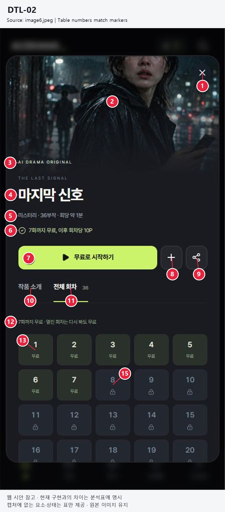

- **현재 구현 확인:** `DramaDetailScreen.tsx:13–16, 29–41, 47–54`.
- **진입:** DTL-01 ⑪, `/drama/[id]?tab=episodes` 또는 `tab=회차`. 추천 피드의 ‘회차’는 현재 `tab`을 전달하지 않아 이 탭으로 바로 들어오지 않는다.
- **이탈:** ① 이전 화면/홈, ⑦ 또는 ⑬/⑭/⑮ 선택 회차 PLY-01(잠겨 있으면 PLY-02), ⑩ DTL-01, ⑨ OS 공유.
- **이미지:** [DTL-02.png](images/DTL-02.jpg), 원본 `image6.jpeg`. ①은 웹 우상단 X에 대응 표시하나 코드에서는 좌상단 뒤로. 표의 ⑭ ‘이미 열린 유료 회차’는 원본에 없어 마커 생략; ⑯은 스크롤 아래라 미노출; ⑰⑱은 조건부. 캡처에 보이는 20화가 끝이 아니라 코드에는 36/40/24화 전체가 생성된다.

| 번호 | 요소명 | 이 요소의 의미·목적 | 표시 데이터 | 동작 | 상태 | 현재 구현 수준 |
|---|---|---|---|---|---|---|
| ① | 뒤로 가기 | 직전 탐색 맥락으로 복귀 | 좌상단 chevron-left | 이전 스택, 없으면 홈 | 기본 | 실동작 |
| ② | 표지·그라데이션 | 선택 작품 분위기와 식별 유지 | 작품 이미지, 높이 290 | 페이지 스크롤 | 기본; 오류 대체 없음 | 체험용 가짜(콘셉트 표지) |
| ③ | 제작사 표기 | 출처·브랜드 확인 | `studio` | 없음 | 기본 | 체험용 가짜(샘플 값) |
| ④ | 영문명·작품명 | 회차가 속한 작품 식별 | `english`, `title` | 없음 | 기본 | 실동작(정적 카탈로그) |
| ⑤ | 장르·부작·회당 길이 | 전체 시청량 판단 | `tag · total부작 · 회당 약 1분` | 없음 | 기본 | 실동작(샘플 표시) |
| ⑥ | 무료·가격 안내 | 유료 경계 사전 고지 | `{free}화까지 무료, 이후 회차당 10P` (시안값) | 없음 | 기본 | 체험용 가짜(실제 요금 조회 없음) |
| ⑦ | 무료 시작 / 이어보기 | 회차 선택 없이 빠르게 시작 | 기록 회차 또는 1화; 버튼 문구는 DTL-01과 같음 | PLY-01 | 준비 전 비활성, 기록 있으면 이어보기 | 실동작(이동); 영상 미구현 |
| ⑧ | 작품 저장 토글 | 다시 찾을 작품 보관 | plus/check | 로컬 saved 토글, LIB-01 반영 | 준비 전 비활성·선택/미선택 | 실동작(로컬) |
| ⑨ | 공유 | 추천 유입 | 작품명+웹 시안 링크 | OS 공유/웹 클립보드 | 기본/실패 ⑱ | 실동작(API 호출); 운영 딥링크 미구현 |
| ⑩ | 작품 소개 탭 | 줄거리로 되돌아가 선택 보조 | ‘작품 소개’ | DTL-01 | 비선택 | 실동작 |
| ⑪ | 전체 회차 탭 | 회차 목록 위치 표시 | ‘전체 회차 {total}’ | 현재 탭 유지 | 선택, 라임 밑줄 | 실동작 |
| ⑫ | 무료·재시청 안내 | 열린 회차에 반복 비용이 없음을 알려 구매 불안 완화 | `{free}화까지 무료 · 열린 회차는 다시 봐도 무료` | 없음 | 기본 | 실동작(로컬 열림 규칙과 일치) |
| ⑬ | 무료 회차 셀(반복) | 즉시 이용 가능한 범위 식별 | 1~free 회차 번호 + ‘무료’ | 해당 회차 PLY-01; 별도 확인·차감 없음 | 녹색계열 배경·밝은 숫자, 준비 전 비활성 | 실동작(로컬 시청 판정); 영상 미구현 |
| ⑭ | 이미 열린 유료 회차 셀(반복) | 재시청 가능 표시, 중복 지출 방지 | `opened`에 `id:ep` 존재; 번호 + check | 해당 회차 PLY-01; 차감 없음 | 무료와 같은 배경, 체크 아이콘; 준비 전 비활성 | 실동작(로컬 열림 기록) |
| ⑮ | 잠긴 유료 회차 셀(반복) | 다음 유료 구간을 식별해 전환 진입 제공 | 번호 + lock; 접근성 이름 ‘N화 10포인트로 열기’ | 셀 자체가 차감하지 않고 PLY-01 진입 → PLY-02 | 회색 숫자·잠금. **잠금은 비활성과 다름**: ready면 탭 가능 | 체험용 가짜(로컬 잠금/해제·10P 시안값) |
| ⑯ | 차감 시점·예시 요금 안내 | 확인 전 차감 없음 고지 | ‘포인트는 회차 열기를 확인할 때만 사용해요. 10P는 체험용 예시 요금이에요.’ | 목록 아래 스크롤로 확인 | 기본 | 실동작(체험 안내) |
| ⑰ | 작품 없음 화면 | 잘못된 ID 복구 | DTL-01 ⑰과 같은 EmptyState | 홈으로 | 빈 상태 | 실동작 |
| ⑱ | 공유 실패 알림 | 예외를 설명 | DTL-01 ⑱과 같은 Alert | 확인 → 상세 유지 | 공유 예외 | 실동작(코드 확인) |

**상세 화면에서 아직 없는 상태:** 작품 정보 네트워크 로딩·재시도, 운영 중단/회차 공개 예정, 서버 권한 갱신, 개별 저장 실패 재시도, 현재 회차/시청 완료/시청 진척 시각화. 현재 ready는 기기 데이터 준비 여부이며 서버 데이터 로딩을 뜻하지 않는다. 정상 앱에서는 전역 준비 화면이 먼저 표시되므로 위 표의 ‘준비 전 비활성’은 컴포넌트 내부 방어조건이다. 전역 저장 공간 오류 안내는 이미 있다(`app/_layout.tsx:10–20`). 스크롤을 끌어 내리는 모달 닫기 제스처는 구현되어 있지 않다.

### PLY-01 — 본편 재생

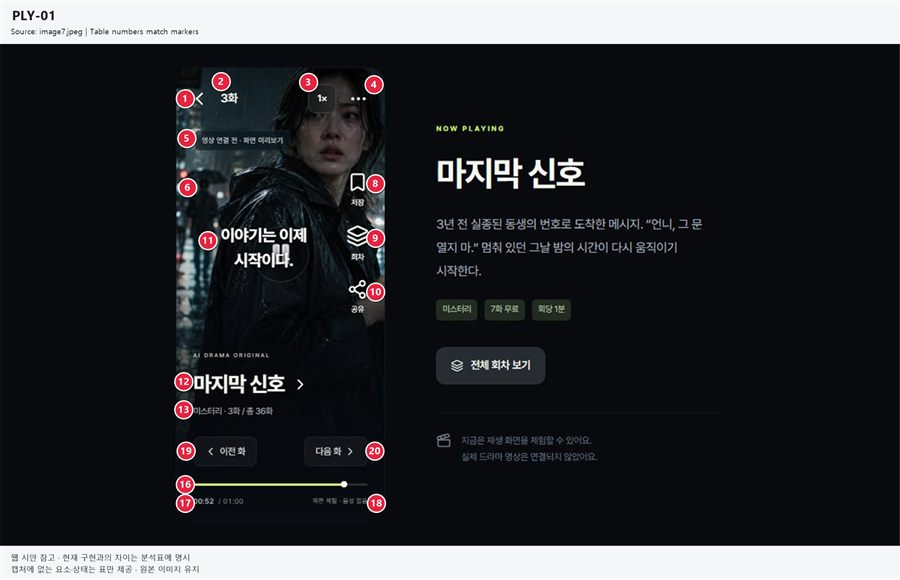

**[현재 구현에서 확인]** 기준: `front/src/screens/PlayerScreen.tsx:16–148`, `front/src/features/drama/experience.ts:135–151`. 전체 영상 길이를 60초로 고정한 포스터 확대·축소와 타이머 체험이며 영상·음성 스트림은 없다. 아래에서 **실동작**은 탐색·화면 전환·기기 내 상태 저장이 실제 동작한다는 뜻이며, 서버 구매 권한이나 실제 콘텐츠 재생을 보장하지 않는다.

**전역 상태 주석:** 아래 표의 ‘ready 전 비활성/준비 전’은 개별 컴포넌트의 방어 조건이며, 실제 앱에서는 `front/src/app/_layout.tsx:10–20`이 기기 데이터 준비 전 화면 스택 전체를 스피너·`이야기를 준비하고 있어요`로 대체하고 준비 후 화면을 표시하며, 저장 오류도 스택 아래 전역 안내로 표시한다.

- **진입:** 상세 재생 CTA·회차 버튼, 홈/추천/보관함의 시청 CTA → `/player/[id]`. URL의 `ep`(PlayerScreen 내부 prop은 `episode`)가 있으면 그 회차, 없으면 해당 작품의 마지막 기록 회차 또는 1화. 유효하지 않은 회차 번호는 1화로 보정. 같은 회차의 기록이 60초 미만이면 그 위치에서 시작한다. 잠긴 회차로 진입하면 PLY-02 자동 표시.
- **이탈:** ① 이전 화면(스택이 없으면 홈), ③ PLY-06, ④ PLY-05, ⑨ PLY-03, ⑫ PLY-04, ⑮ PLY-02. 마지막 회의 ⑳은 REC-01. 시스템 공유창은 닫으면 재생 화면 복귀.
- **전환 규칙:** 화면 포커스·앱 활성·열린 회차·재생 상태가 모두 충족되고 시트/공유/위치조절이 없을 때만 시간 증가. 다음 화 자동 재생 ON이면 60초에 다음 화로 전환하되 잠겼으면 PLY-02에서 정지. 마지막 화에서는 자동 추천 이동 없이 정지한다.

| 번호 | 요소명 | 의미·목적(마케팅 포함) | 표시 데이터 | 동작(결과·이동) | 상태 | 현재 구현 수준 |
|---|---|---|---|---|---|---|
| ① | 뒤로 | 시청 중 탐색 맥락 복귀 | 왼쪽 화살표, 접근성 이름 `뒤로` | 이전 화면, 없으면 HOM-01 | 기본 | 실동작 |
| ② | 현재 회차 | 시리즈에서 현재 위치 인지 | `{ep}화` | 없음 | 회차 선택에 따라 갱신 | 실동작(로컬) |
| ③ | 배속 | 선호 속도로 몰아보기 | `{speed}×`, 초기 1× | PLY-06 | 기본/선택값 | 실동작(선택); 실제 영상 배속은 미구현 |
| ④ | 재생 설정 | 자막·자동재생 설정 진입 | 더보기 아이콘 | PLY-05 | 기본 | 실동작 |
| ⑤ | 샘플 고지 | 영상이 없는 체험임을 설명 | `샘플 화면 · 실제 영상 연결 전` | 없음 | 상시 | 실동작(고지) |
| ⑥ | 배경 비주얼·그라데이션 | 작품 분위기 유지, 흰 컨트롤 가독성 확보 | 작품 포스터, 검정 그라데이션 | 재생 중 1~1.055배 확대·복귀 반복 | 재생/정지/잠금 | 체험용 가짜(실영상 없음) |
| ⑦ | 중앙 재생·정지·잠금 버튼 | 가장 직접적인 시청 제어 | 실행 시 pause, 멈춤 시 play, 미개방 시 lock | 재생/정지; 종료 후 누르면 0초 재시작; 잠금이면 PLY-02 | 재생/정지/완료/잠금. 시트·공유 동안 running=false | 체험용 가짜(타이머 제어) |
| ⑧ | 찜 | 이후 재방문·시청 후보 보관 | 북마크 아이콘, `찜` | 기기 saved 목록 토글, LIB-01에 반영 | 기본 흰색/선택 accent. 준비 전 탭은 상태 반영 안 됨 | 실동작(로컬) |
| ⑨ | 회차 | 원하는 편 탐색·재시청 | 레이어 아이콘, `회차` | PLY-03 | 기본 | 실동작 |
| ⑩ | 공유 | 작품 확산 및 외부 유입 | 공유 아이콘, `공유` | 네이티브 공유창; 웹은 시안 URL 복사 | 진행 중 버튼 비활성; 실패 시 ⑭ | 실동작(공개 웹 시안 링크 공유) |
| ⑪ | 자막 | 무음 시청·서사 이해 지원 | 0~19초 copy 첫 줄, 20~39초 둘째 줄, 40초 이후 `이야기는 이제 시작이다.` | 없음; PLY-05에서 표시 설정 | 자막 ON이면서 열린 회차만 표시 | 체험용 가짜(영상 자막 아님) |
| ⑫ | 작품명·더보기 화살표 | 시청 중 작품 배경·소개 확인 | `drama.title` | PLY-04 | 기본 | 실동작 |
| ⑬ | 회차 메타 | 현재 편·시리즈 규모 안내 | `{ep}화 · {drama.episode} · {drama.total}부작` | 없음 | 현재 회차 갱신; episode 제목은 작품별 단일 고정 문자열 | 체험용 가짜(회차별 제목 데이터 없음) |
| ⑭ | 공유 결과 안내 | 실패·복사 결과 확인 | 웹 복사 완료 또는 공유 실패 문구 | 없음; 접근성 live region | 공유 후 조건부 노출. 자동 소거 없음 | 실동작 |
| ⑮ | 잠긴 회차 열기 CTA | 유료 전환을 명확한 동의 단계로 연결 | `{ep}화 · 10포인트로 열기`(시안 값) | PLY-02 | 잠긴 회차에서만 표시 | 실동작(시트); 실제 구매권한 미구현 |
| ⑯ | 재생 위치 슬라이더 | 원하는 장면 탐색 | 범위 0~60, step 1, accent 진행 트랙 | 드래그 중 타이머 중단, 놓으면 위치 변경 | 잠금/로컬 데이터 준비 전 비활성 | 체험용 가짜(실영상 탐색 없음) |
| ⑰ | 시간 | 남은 시청 분량 인지 | `00:ss / 01:00`, 완료 `01:00 / 01:00` | 없음 | 타이머·배속에 따라 갱신 | 체험용 가짜 |
| ⑱ | 음성 없음 안내 | 체험 한계 안내 | `화면 체험 · 음성 없음` | 없음 | 상시 | 실동작(고지) |
| ⑲ | 이전 화 | 직전 편 복귀 | `이전 화` | 같은 화면에서 ep-1, 잠기면 PLY-02 | 1화에서 비활성 | 실동작(로컬 전환) |
| ⑳ | 다음 화 / 다른 작품 보기 | 연속 시청·후속 콘텐츠 유입 | 마지막 회 이전 `다음 화`, 마지막 회 `다른 작품 보기` | ep+1; 마지막 회는 `/recommend` | 마지막 회면 라벨과 목적지 변경 | 실동작(로컬 전환) |
| ㉑ | 작품 없음 대체화면 | 잘못된 링크에서 복구 | `작품을 찾을 수 없어요` / `다른 작품을 골라 주세요.` / `홈으로` | HOM-01로 replace | 잘못된 작품 ID에서만 전체 대체 | 실동작 |

**캡처 대조:** `image7.jpeg` → `images/PLY-01.jpg`. 캡처는 PC 레이아웃이므로 오른쪽 NOW PLAYING·소개·배지·전체 회차 보기 패널은 앱 코드에 없다. 번호는 왼쪽 플레이어의 대응 요소에만 둔다. 캡처의 `저장`은 코드의 `찜`(⑧), 메타의 장르는 코드에서 회차명(⑬)이다. 캡처의 이전/다음 버튼은 슬라이더 위에 있지만 코드에서는 아래다. 코드의 ⑦ 중앙 재생 버튼, ⑭ 결과 안내, ⑮ 잠금 CTA, ㉑ 오류 대체화면은 이 캡처에서 식별 가능한 형태로 보이지 않아 번호를 억지로 그리지 않는다. ⑥은 포스터 영역을 가리킨다. 자막·배속·회차 값은 촬영 순간의 예시이며 요구값이 아니다.

### PLY-02 — 회차 열기 시트

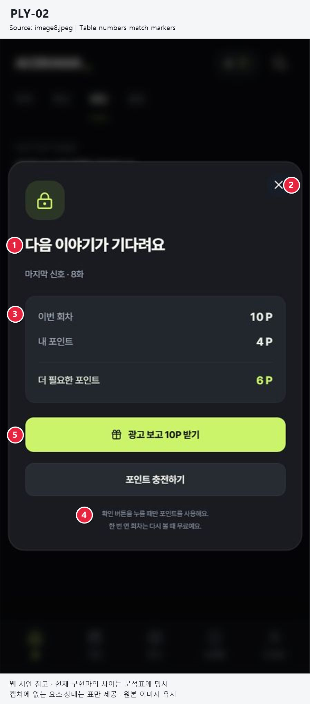

**[현재 구현에서 확인]** `PlayerScreen.tsx:39–49,76–85,125,130–137`, `experience.ts:77–99`.

- **진입:** 잠긴 회차 요청/다음 화 자동 전환/회차 선택 시 자동 표시, 또는 PLY-01의 잠금 버튼·열기 CTA.
- **이탈:** 닫기·취소·시스템 뒤로 → 잠긴 PLY-01 유지. 잔액 충분 상태에서 확인 성공 → 10P 차감·opened 기록·내역 생성 후 PLY-01 시청. 잔액 부족 CTA → 시트를 닫고 WAL-01로 push.
- **상태 분기:** 잔액 10P 이상 / 미만. 시안 시작 잔액 4P이므로 첫 유료 회차에서 부족 상태. 이미 열린 회차에는 재차감하지 않는다. 잔액·가격 모두 현재 로컬 시안 데이터이며 출시 가격은 TBD.

| 번호 | 요소명 | 의미·목적(마케팅 포함) | 표시 데이터 | 동작(결과·이동) | 상태 | 현재 구현 수준 |
|---|---|---|---|---|---|---|
| ① | 시트 제목 | 구매 대상 회차 식별 | `{ep}화 열기` | 없음 | 요청 회차별 변경 | 실동작 |
| ② | 닫기 | 구매 거절·일시 보류 | `닫기` ghost 버튼 | PLY-01로 복귀, 회차 잠금 유지 | 기본 | 실동작 |
| ③ | 보유·필요 포인트 | 잔액과 비용 비교, 비용 투명성 | `보유 {balance}포인트 · 필요한 포인트 10` | 없음 | 충분/부족, 시안 값 | 실동작(로컬) |
| ④ | 사용 동의·재시청 안내 | 자동 차감 우려 해소 | 충분: 보기 버튼을 눌러야 10P 사용·기개방 무료 재시청. 부족: 충전 후 이 화면에서 사용 확인·충전만으로 열리지 않음 | 없음 | 잔액에 따라 문구 변경 | 실동작(고지) |
| ⑤ | 회차 보기 / 광고 보상·충전 CTA | 동의 후 회차 획득, 부족 시 수익화 경로 연결 | 충분 `10포인트로 {ep}화 보기`; 부족 `광고 보상 · 충전` | 충분: local unlock 성공 시 닫기/재생; 부족: WAL-01 | 충분/부족 분기. 처리 로딩·실패 메시지 없음 | 체험용 가짜(포인트/권한); 화면 이동 실동작 |
| ⑥ | 취소 | 부담 없이 시청 화면으로 복귀 | `취소` secondary 버튼 | 시트만 닫기 | 기본 | 실동작 |

**캡처 대조:** `image8.jpeg` → `images/PLY-02.jpg`. 웹 캡처 제목 `다음 이야기가 기다려요`와 작품명+회차, 자물쇠 그림은 현 코드의 단순 `{ep}화 열기`보다 풍부하다. 캡처 ③ 박스에는 `더 필요한 포인트 6P`도 있지만 앱은 부족분을 계산해 표시하지 않는다. 캡처의 광고 CTA와 `포인트 충전하기`가 앱에서는 ⑤ **단일 WAL-01 진입 버튼**으로 합쳐졌다. 이미지 ⑤는 상단 광고 CTA에 대응 마커를 두며, 하단 충전 버튼은 별개 코드 기능으로 오해하지 않도록 웹 시안 전용으로 읽는다. 캡처에는 앱의 ⑥ 취소 버튼이 없다. 웹의 X는 앱의 텍스트 닫기에 대응한다.

**발견:** WAL-01로 이동할 때 시트를 닫는다. 충전 후 돌아오더라도 초기화 키가 유지돼 회차 열기 시트가 자동 재표시되지 않는다. 사용자는 잠긴 화면에서 열기 CTA를 다시 눌러야 한다. 자동 포인트 차감을 막는 정책은 맞지만, 복귀 동선은 명시적인 `8화 열기 — 10P 사용 확인` 버튼으로 보완할 필요가 있다.

### PLY-03 — 회차 목록 시트

**[현재 구현에서 확인]** `PlayerScreen.tsx:117,130–140,157`. **캡처 없음**(별도 이미지 미생성).

- **진입:** PLY-01 ⑨ 회차, PLY-04의 회차 탭.
- **이탈:** 닫기/시스템 뒤로 → PLY-01; 작품 소개 탭 → PLY-04; 회차 셀 → 열린 편은 시트 닫고 PLY-01, 잠긴 편은 PLY-02로 시트 내용 교체.

| 번호 | 요소명 | 의미·목적(마케팅 포함) | 표시 데이터 | 동작(결과·이동) | 상태 | 현재 구현 수준 |
|---|---|---|---|---|---|---|
| ① | 작품명 | 현재 시리즈 확인 | `drama.title` | 없음 | 기본 | 실동작 |
| ② | 닫기 | 현재 재생 편으로 복귀 | `닫기` | PLY-01 | 기본 | 실동작 |
| ③ | 작품 소개 탭 | 탐색 중 줄거리 확인 | `작품 소개` secondary | PLY-04 | 비선택 | 실동작 |
| ④ | 회차 탭 | 현재 시트 범위 표시 | `회차` primary | PLY-03 유지 | 선택 | 실동작 |
| ⑤ | 무료 범위·회당 가격 | 잠금 범위를 미리 알려 전환 예측 가능성 확보 | `1~{free}화 무료 · 이후 회차당 10포인트` | 없음 | 작품별 7/10화 무료, 가격 시안 값 | 실동작(고지) |
| ⑥ | 회차 그리드 | 특정 회차 빠른 접근·재시청 | 1~total화, 아래 `무료` / `열림` / `10 P` | 선택 편으로 이동. 무료/기개방은 재생, 미개방은 PLY-02 | 현재 편 accent 테두리; 무료·기개방·미개방. 잠금도 탭 가능 | 실동작(로컬), 실제 권한 미구현 |

약 4열 자동 줄바꿈(`flexBasis 21%`, gap 10), 셀 최소 너비 64·높이 72. 회차별 썸네일·제목·시청 완료 표시·회차 구간 필터는 없다. 코드상 현재 편 선택 테두리는 있지만 `accessibilityState.selected`는 지정하지 않았다.

### PLY-04 — 작품 소개 시트

**[현재 구현에서 확인]** `PlayerScreen.tsx:122,130–140`. **캡처 없음**.

- **진입:** PLY-01 작품명 ⑫, PLY-03 작품 소개 탭.
- **이탈:** 닫기·돌아가기 → PLY-01; 회차 탭 → PLY-03.

| 번호 | 요소명 | 의미·목적(마케팅 포함) | 표시 데이터 | 동작(결과·이동) | 상태 | 현재 구현 수준 |
|---|---|---|---|---|---|---|
| ① | 작품명 | 시청 중 작품 식별 | title | 없음 | 기본 | 실동작 |
| ② | 닫기 | 시청 복귀 | `닫기` | PLY-01 | 기본 | 실동작 |
| ③ | 작품 소개 탭 | 현재 정보 영역 식별 | `작품 소개` primary | 유지 | 선택 | 실동작 |
| ④ | 회차 탭 | 회차 탐색으로 연결 | `회차` secondary | PLY-03 | 비선택 | 실동작 |
| ⑤ | 작품 메타 | 장르·분량·제작 주체로 선택 확신 | `{tag} · {total}부작 · {studio}` | 없음 | 정적 카탈로그 | 체험용 가짜(목업 정보) |
| ⑥ | 줄거리 | 서사 관심을 재생 지속으로 연결 | description 전체 | 없음 | 기본 | 체험용 가짜(목업 정보) |
| ⑦ | 무료 범위·가격 | 시청 비용 예측 | `1~{free}화 무료 · 이후 회차당 10포인트` | 없음 | 작품별 범위, 가격 시안 값 | 실동작(고지) |
| ⑧ | 회차로 돌아가기 | 소개 확인 후 빠른 시청 복귀 | `{ep}화로 돌아가기` | PLY-01, 시트 닫기 | 기본 | 실동작 |

### PLY-05 — 재생 설정 시트

**[현재 구현에서 확인]** `PlayerScreen.tsx:107,130–144`, `experience.ts:36–47,146–151`. **캡처 없음**.

- **진입:** PLY-01 더보기 ④.
- **이탈:** 닫기·시스템 뒤로 → PLY-01. 설정값은 저장 즉시 반영되며 적용 버튼은 없다.

| 번호 | 요소명 | 의미·목적(마케팅 포함) | 표시 데이터 | 동작(결과·이동) | 상태 | 현재 구현 수준 |
|---|---|---|---|---|---|---|
| ① | 제목 | 설정 맥락 확인 | `재생 설정` | 없음 | 기본 | 실동작 |
| ② | 닫기 | 시청 복귀 | `닫기` | PLY-01 | 기본 | 실동작 |
| ③ | 한국어 자막 스위치 | 무음·접근성 요구 지원 | captions boolean, 초기 ON | ON/OFF 기기 저장 | ON accent/OFF border. 실제 자막 트랙 없음 | 실동작(선호 저장); 표시 자막은 체험용 가짜 |
| ④ | 다음 화 자동 재생 스위치 | 연속 시청 선택권, 시청 지속률 | autoNext boolean, 초기 ON | ON/OFF 기기 저장 | 선택/해제 | 실동작(선호·타이머 전환) |
| ⑤ | 유료 회차 동의 안내 | 연속 재생과 결제 동의 구분 | `유료 회차는 자동 재생 전에 포인트 사용을 확인해요.` | 없음 | 상시 | 실동작(현 로직과 일치) |
| ⑥ | 화질 자리표시 안내 | 향후 영상 옵션 예고 | `화질 · 영상 연결 후 설정할 수 있어요.` | 탭 불가 | 정적 안내; 비활성 컨트롤은 아님 | 미구현(화질 선택) |

포인트 자동 사용 스위치는 없다. 현재는 모든 신규 유료 편에서 확인을 받으며, 자동재생/자동 포인트 사용 분리 원칙(03 정책 §2-4) 중 **자동 포인트 사용 자체는 미구현**이다.

### PLY-06 — 재생 속도 시트

**[현재 구현에서 확인]** `PlayerScreen.tsx:25,57,106,130–141`. **캡처 없음**.

- **진입:** PLY-01 배속 ③.
- **이탈:** 닫기·시스템 뒤로 → PLY-01; 속도 선택 즉시 반영하고 PLY-01 복귀.

| 번호 | 요소명 | 의미·목적(마케팅 포함) | 표시 데이터 | 동작(결과·이동) | 상태 | 현재 구현 수준 |
|---|---|---|---|---|---|---|
| ① | 제목 | 설정 목적 식별 | `재생 속도` | 없음 | 기본 | 실동작 |
| ② | 닫기 | 변경 없이 시청 복귀 | `닫기` | PLY-01 | 기본 | 실동작 |
| ③ | 0.75× 선택 | 느리게 보고 이해 보조 | `0.75×` | speed=0.75 후 닫기 | 선택 시 primary·`선택됨`, 나머지 secondary | 체험용 가짜(타이머 증가량만 변경) |
| ④ | 1× 선택 | 기본 시청 속도 | `1×` | speed=1 후 닫기 | 초기 선택; 위와 동일 | 체험용 가짜 |
| ⑤ | 1.25× 선택 | 소폭 빠르게 몰아보기 | `1.25×` | speed=1.25 후 닫기 | 선택/비선택 | 체험용 가짜 |
| ⑥ | 1.5× 선택 | 빠른 시청 | `1.5×` | speed=1.5 후 닫기 | 선택/비선택 | 체험용 가짜 |
| ⑦ | 2× 선택 | 가장 빠른 시청 | `2×` | speed=2 후 닫기 | 선택/비선택 | 체험용 가짜 |

배속은 PlayerScreen 지역 상태라 기기 저장 설정이 아니다. 화면을 새로 마운트하면 1×로 초기화된다.

### WAL-01 — 내 포인트

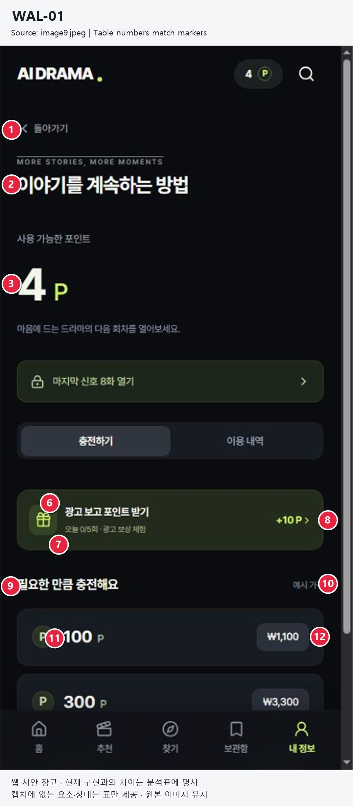

**[현재 구현에서 확인]** `front/src/screens/WalletScreen.tsx:10–63`, `experience.ts:25–47,64–65,102–123`. **시안 값:** 시작 4P / 회당 10P / 광고 1회 +10P / 하루 5회 / 광고 체험 5초 / 충전 100P·1,100원, 300P·3,300원, 600P·6,600원. 확정 사업 정책으로 인용하지 않는다.

- **진입:** PLY-02 잔액 부족 CTA, 내 정보의 포인트·광고 보상 진입, 공통 헤더 포인트(적용 화면). 모두 `/wallet`.
- **이탈:** ① 이전 화면, 스택이 없으면 MY-01(`/account`); ⑧ WAL-02; ⑫ WAL-05. 광고·충전 완료 후 WAL-01에 남아 잔액·내역·안내를 갱신한다. 플레이어 자동 복귀 없음.
- **시안과 구현 차이 핵심:** 캡처는 지갑 내 충전/내역 탭·보류 회차 바로가기·하단 탭바가 있으나 WalletScreen 코드는 모든 섹션을 한 세로 페이지에 표시하고 보류 회차 맥락을 받지 않는다.

| 번호 | 요소명 | 의미·목적(마케팅 포함) | 표시 데이터 | 동작(결과·이동) | 상태 | 현재 구현 수준 |
|---|---|---|---|---|---|---|
| ① | 돌아가기 | 시청·계정 맥락 복귀 | 화살표+`돌아가기` | 이전 화면 또는 MY-01 | 기본 | 실동작 |
| ② | 페이지 제목 | 포인트 관리 목적 안내 | eyebrow `WALLET`, 제목 `내 포인트` | 없음 | 기본 | 실동작 |
| ③ | 잔액 카드·사용 안내 | 구매력·회당 비용 인지 | 번개 아이콘, locale 숫자+`포인트`, `유료 회차를 열 때 10포인트씩 사용해요.` | 없음 | 거래 시 즉시 갱신; 초기 로컬 로딩용 스켈레톤 없음 | 체험용 가짜(로컬 잔액) |
| ④ | 거래 결과 메시지 | 보상·충전 성공/불가 명확화 | 광고 +10P 안내, 일일 한도 소진, 충전 체험 완료/실패 | 없음, live region | 조건부. 자동 소거 없음 | 실동작(로컬 결과) |
| ⑤ | 기기 저장 오류 안내 | 기록 유실 가능성 고지 | `기기에 기록을 저장하지 못했어요. 앱을 닫으면 기록이 사라질 수 있어요.` | 없음; 재시도 버튼 없음 | storageError일 때 | 실동작(오류 표시) |
| ⑥ | 광고 섹션 제목 | 무과금 보상 경로 발견 | `광고로 포인트 받기` | 없음 | 기본 | 실동작 |
| ⑦ | 광고 보상·횟수 안내 | 교환 가치와 일일 기회 설명 | `한 번에 10포인트`, `{adCount} / 5회`, `하루 최대 5회 · 지금은 5초 광고 시청 체험이에요.` | 없음 | 0~5회. 기기 로컬 날짜 기준 초기화 | 체험용 가짜(서버·광고 검증 없음) |
| ⑧ | 광고 시작 CTA | 보상형 광고 유입 | `광고 보고 10포인트 받기`; 한도 시 `오늘 보상을 모두 받았어요` | WAL-02, remaining=5·중복완료 flag 초기화 | 로컬 준비 전/5회 소진 비활성 | 실동작(시트 진입); 광고 미구현 |
| ⑨ | 충전 섹션 제목 | 유료 포인트 구매 구역 구분 | `포인트 충전` | 없음 | 기본 | 실동작 |
| ⑩ | 예시 상품·결제 미연동 고지 | 실제 과금 오인 방지 | `상품과 금액은 예시예요. 실제 앱 마켓 결제는 연결 전이에요.` | 없음 | 상시 | 실동작(고지) |
| ⑪ | 포인트 상품 3행 | 가격·수량 비교로 결제 선택 | 100P·1,100원 / 300P·3,300원 / 600P·6,600원 | 행 자체는 탭 없음 | 모두 동일 단가, 보너스/인기 배지 없음 | 체험용 가짜(시안 상품) |
| ⑫ | 상품별 충전 체험 버튼 | 선택 상품 확인으로 진입 | 각 행 `충전 체험` secondary | 선택 pack 저장 후 WAL-05 | ready 전 비활성 | 실동작(시트); 인앱 결제 미구현 |
| ⑬ | 내역 섹션 제목 | 획득·사용 검증 가능성 | `포인트 내역` | 없음 | 기본 | 실동작 |
| ⑭ | 내역 목록 | 사용처와 획득 출처를 기록해 신뢰 형성 | label, 한국어 월/일/시/분, ±amount P. 광고 보상 체험/충전 체험/작품 n화 열기 | 세로 스크롤, 행 상세 진입 없음 | 최신순; 양수 accent, 차감 일반 텍스트 | 실동작(기기 거래 기록); 실제 영수증 아님 |
| ⑮ | 내역 빈 상태 | 아직 거래하지 않았음을 설명 | `아직 받은 포인트와 사용한 포인트가 없어요.` | 없음 | ledger.length=0 | 실동작 |

**캡처 대조:** `image9.jpeg` → `images/WAL-01.jpg`. 앱 제목 ②는 캡처의 `이야기를 계속하는 방법`과 다르다. ③ 잔액 아래 문구도 캡처는 다음 회차 권유, 앱은 회당 비용 고지다. 웹의 `마지막 신호 8화 열기`, `충전하기/이용 내역` 탭은 앱 미구현이므로 코드 번호를 매기지 않는다. 캡처에서는 광고 카드 전체가 CTA처럼 보이지만 앱은 섹션/안내/별도 버튼으로 분리. ⑥⑦⑧ 마커는 카드의 대응 의미 위치에 둔다. ⑩은 캡처의 `예시 가격`에 대응하지만 앱에서는 더 긴 고지다. ⑪⑫는 첫 100P 상품만 대표 마커를 둔다(아래 상품 반복). ⑬~⑮, ④⑤는 현재 캡처 범위에 없어 마커 없음. 상단 로고·포인트·검색 및 하단 탭바는 웹 전역 UI로 WalletScreen의 구성요소가 아니다.

### WAL-02 — 광고 보상 1단계: 안내

**[현재 구현에서 확인]** `WalletScreen.tsx:57,64–68`. **캡처 없음**.

- **진입:** WAL-01 광고 시작 버튼. 하루 잔여 횟수와 ready는 진입 버튼에서 확인.
- **이탈:** 시작 → WAL-03; 닫기·취소·시스템 뒤로 → WAL-01, 보상 없음.

| 번호 | 요소명 | 의미·목적(마케팅 포함) | 표시 데이터 | 동작(결과·이동) | 상태 | 현재 구현 수준 |
|---|---|---|---|---|---|---|
| ① | 모달 제목 | 보상 목적 유지 | `광고 보상` | 없음 | 기본 | 실동작 |
| ② | 닫기 | 참여 취소 | `닫기` ghost | WAL-01 | 기본 | 실동작 |
| ③ | 보상 제안 | 소요 시간 대비 보상 가치 제시 | `5초를 시청하고 10포인트 받기`(시안 값) | 없음 | 기본 | 체험용 가짜 |
| ④ | 체험·지급 조건 안내 | 완주/수령 버튼/중도 종료 규칙 설명 | 실제 광고 없음·끝까지 본 뒤 받기·중간 종료 무보상 | 없음 | 기본 | 실동작(고지) |
| ⑤ | 시청 시작 CTA | 명시적 광고 참여 의사 | `광고 시청 체험 시작` | WAL-03 | 기본; 광고 로드 중 상태 없음 | 체험용 가짜(타이머 시작) |
| ⑥ | 취소 | 참여 보류 | `취소` secondary | WAL-01 | 기본 | 실동작 |

### WAL-03 — 광고 보상 2단계: 시청 체험

**[현재 구현에서 확인]** `WalletScreen.tsx:19,24–33,64–68`. **캡처 없음**.

- **진입:** WAL-02 시작.
- **이탈:** 5→0초 완료 시 WAL-04 자동 전환. 닫기·그만 보기·시스템 뒤로는 WAL-01로 무보상 종료. 앱 비활성/화면 비포커스 동안 카운트 정지, 재활성 시 재개.

| 번호 | 요소명 | 의미·목적(마케팅 포함) | 표시 데이터 | 동작(결과·이동) | 상태 | 현재 구현 수준 |
|---|---|---|---|---|---|---|
| ① | 모달 제목 | 보상 맥락 유지 | `광고 보상` | 없음 | 기본 | 실동작 |
| ② | 닫기 | 시청 중단 선택권 | `닫기` | WAL-01, 보상 없음 | 언제든 가능; 별도 중단 확인 없음 | 실동작 |
| ③ | 광고 대신 카운트다운 패널 | 완료까지의 대기 정보 | play-circle 아이콘, `{remaining}초`, `광고 시청 체험 · 실제 광고 없음` | 초당 1 감소 | 5~0초/앱 이탈 시 정지 | 체험용 가짜(광고 SDK 없음) |
| ④ | 일시 정지 안내 | 앱 이탈 조건 이해 | `앱을 벗어나면 시간이 멈춰요.` | 없음 | 상시 | 실동작(고지와 타이머 일치) |
| ⑤ | 중단 CTA | 보상 포기를 명시 | `그만 보기 · 보상 없이 닫기` | WAL-01 | 기본 | 실동작 |

### WAL-04 — 광고 보상 3단계: 완료·수령

**[현재 구현에서 확인]** `WalletScreen.tsx:33–38,64–68`, `experience.ts:102–123`. **캡처 없음**.

- **진입:** WAL-03 남은 시간 0.
- **이탈:** 받기 → 지급 가능하면 +10P·횟수+1·내역 생성 후 WAL-01. 한도 소진이면 지급 없이 안내. 닫기·취소·시스템 뒤로 → **완주해도 보상 없음**.

| 번호 | 요소명 | 의미·목적(마케팅 포함) | 표시 데이터 | 동작(결과·이동) | 상태 | 현재 구현 수준 |
|---|---|---|---|---|---|---|
| ① | 모달 제목 | 보상 맥락 유지 | `광고 보상` | 없음 | 기본 | 실동작 |
| ② | 닫기 | 완료 화면 종료 | `닫기` | WAL-01, claimAd 호출 없음 | 기본; 보상 미수령 | 실동작(보상 유실 위험) |
| ③ | 완료 아이콘 | 작업 성공 인지 | accent check-circle | 없음 | 완료 | 체험용 가짜(광고 검증 아님) |
| ④ | 완료 메시지 | 보상 획득 기대 형성 | `시청 체험을 완료했어요` | 없음 | 완료 | 실동작(체험 고지) |
| ⑤ | 포인트 받기 CTA | 사용자가 보상 수령 완료 | `10포인트 받기` | claimAd; 중복완료 ref로 1회 처리; WAL-01 결과 메시지 | 지급 가능/한도 소진. 별도 로딩 없음 | 체험용 가짜(광고 성과·서버 검증 없음) |
| ⑥ | 취소 | 모달 종료 | `취소` | WAL-01, 보상 미수령 | 완료 상태에서도 노출 | 실동작(완료 의미와 충돌) |

### WAL-05 — 포인트 충전 확인

**[현재 구현에서 확인]** `WalletScreen.tsx:10,40–44,61,64–68`. **캡처 없음**.

- **진입:** WAL-01 상품별 충전 체험.
- **이탈:** 결제 완료 체험 → 로컬 포인트 추가·내역 기록 후 WAL-01; 닫기·취소·시스템 뒤로 → 변경 없이 WAL-01. 유료 회차 자동 개방/플레이어 자동 복귀 없음.

| 번호 | 요소명 | 의미·목적(마케팅 포함) | 표시 데이터 | 동작(결과·이동) | 상태 | 현재 구현 수준 |
|---|---|---|---|---|---|---|
| ① | 제목 | 결제 전 최종 확인 | `충전 확인` | 없음 | 기본 | 실동작 |
| ② | 닫기 | 충전 취소 | `닫기` | WAL-01 | 기본 | 실동작 |
| ③ | 선택 포인트 | 충전 수량 재확인 | 100/300/600포인트 | 없음 | 선택 pack | 체험용 가짜(상품 데이터) |
| ④ | 선택 가격 | 결제 금액 확인 | 1,100/3,300/6,600원 | 없음 | 선택 pack, 시안 값 | 체험용 가짜 |
| ⑤ | 체험·회차 개방 분리 안내 | 오과금·자동 차감 우려 해소 | 실제 결제 없이 체험·충전해도 유료 회차 자동 개방 안 됨 | 없음 | 상시 | 실동작(고지) |
| ⑥ | 결제 완료 체험 CTA | 충전 성공 흐름 시험 | `결제 완료 체험` | buyPack; 중복완료 ref로 1회 처리 후 WAL-01 | 완료/불가 메시지. 스토어 대기·취소·실패·복원 상태 없음 | 체험용 가짜(인앱 결제 미구현) |
| ⑦ | 취소 | 구매 보류 | `취소` secondary | WAL-01 | 기본 | 실동작 |

---

## 5. 출시 전에 새로 만들 화면 `[제안]`

현재 시안에 없지만 실제 서비스·스토어 심사에 필요한 화면이다. 모든 화면을 독립 페이지로 만들 필요는 없고, 오버레이·시트·공통 상태로 처리해도 된다. 각 표의 "와이어프레임"은 위→아래 배치 순서다.

### 5-1. 앱 시작 · 시스템

| 화면 ID | 필요한 이유 | 와이어프레임(위→아래) | 동작·예외 | 우선 | 기능 ID |
|---|---|---|---|---|---|
| SYS-01 스플래시·초기화 | 서버 설정·게스트 토큰·`/me` 준비. 무한 로딩과 시작 실패를 구분해야 함 | `[앱 로고]` → `[이야기를 준비하고 있어요]` → 5초 이상: `[연결을 확인하고 있어요]` → 실패: `[다시 시도] [도움말]` | 장식용 대기 시간을 강제하지 않는다. 성공 시 (첫 실행이면 AUT-02 →) HOM-01 또는 딥링크 대상 | P0 | FN-SYS-01~03 |
| SYS-02 권한 사전 안내 | OS 권한 창은 한 번 거절하면 다시 띄우기 어렵다. 이유를 먼저 설명해 허용률을 높임 | 알림: `[아이콘] [찜한 작품의 새 회차를 알려드릴게요] [알림 받기] [나중에]` → OS 창. 추적(iOS): `[맞춤 광고 안내] [계속]` → ATT 창 | 첫 실행 즉시가 아니라 첫 찜·3화 시청 후(알림). 14세 미만은 보호자 동의 전 추적 요청을 띄우지 않는다. 추적은 광고 SDK 초기화 전. 거절해도 기능 사용 가능, 설정에서 `[기기 설정 열기]` | 알림 P1 · 추적 P0 | FN-SYS-07, 08 |
| SYS-03 강제 업데이트·점검 | 서버와 호환되지 않는 구버전·서비스 점검 중 무한 오류 방지 | 업데이트: `[새 버전이 필요해요] [이유 1줄] [업데이트하기]`(닫기 없음) · 점검: `[점검 중이에요] [영향 기능·예상 종료 시각] [다시 확인] [문의]` | 원격 설정(`/app/config`)으로 제어 | P0 | FN-SYS-04, 05 |
| SYS-04 공통 상태 | 서버 연동 후 모든 목록에 필요 | 로딩: 헤더·탭 유지 + 포스터·제목 자리 스켈레톤 · 오류: `[연결을 확인해 주세요] [다시 불러오기]`(기존 목록 있으면 상단 배너 + 마지막 갱신 시각) · 빈 목록: `[아직 공개된 작품이 없어요]` / 피드 `[미리보기 준비 중] [작품 목록 보기]` / 랭킹 `[집계 중이에요] [새 작품 보기]` | 검색어·장르·스크롤 위치 보존 | P0 | FN-SYS-06, FN-HOM-16 |
| SYS-05 첫 실행 안내 | 무료 구간·포인트 개념을 미리 알려 첫 잠금에서의 놀람을 줄임 | `[한 편 약 1분]` `[작품마다 처음 7~10화는 무료]` `[광고나 충전으로 포인트를 받아 다음 화 보기]` → `[바로 둘러보기]` `[건너뛰기]` | 3장 이하. 권한 요청을 섞지 않는다 | P1 | – |

### 5-2. 로그인 · 계정

**AUT-01 로그인·계정 연동** (P0 · FN-AUT-01~03)

| 번호 | 요소 | 내용 | 동작 |
|---|---|---|---|
| ① | 닫기 | 오른쪽 위 X | 진입 전 화면으로 복귀(무료 시청 계속 가능) |
| ② | 제목·설명 | "계정을 연결하면 포인트와 열어 둔 회차를 지킬 수 있어요" | – |
| ③ | 로그인 버튼 | `Apple로 계속하기` / `Google로 계속하기` / (`카카오로 계속하기` `[TBD]`) | 성공 → 게스트 데이터 확인 → 필요 시 AUT-03 → 원래 화면(작품·회차·위치) 복귀 |
| ④ | 약관 링크 | 이용약관·개인정보 처리방침 링크(안내용). 필수 동의는 첫 실행 AUT-02에서 이미 받았으므로 여기서 "계속하면 동의" 방식으로 다시 받지 않는다. 문서 버전이 바뀌었으면 로그인 후 AUT-02를 다시 띄운다 | MY-06 문서 열기 |
| ⑤ | 나중에 | 텍스트 버튼 | ①과 같음 |

| 상태 | 문구 | 다음 행동 |
|---|---|---|
| 사용자가 인증 취소 | "로그인을 완료하지 않았어요." | `[다시 로그인]` `[돌아가기]` |
| 연결 실패 | "로그인에 연결하지 못했어요." | `[다시 시도]` |
| 계정 정보 확인 중 | "계정 정보를 확인하고 있어요." | 잔액을 0으로 표시하지 않음 |
| 세션 만료 | "다시 로그인해 주세요." | 기존 잔액은 "확인 중"으로 표시 |

**AUT-02 첫 실행 동의·연령 확인** (P0 · FN-AUT-04): **첫 실행 1회, 게스트 포함, 광고·분석 SDK 초기화 전.** `[생년월일 입력(연·월·일)]` → `[전체 동의]` → 필수 `이용약관` · `개인정보 수집·이용` / 선택 `광고성 정보 수신(앱 푸시)` · `야간 광고성 알림`. `유료 서비스 이용약관`은 첫 충전 직전에 같은 형식으로 받는다. 각 항목 `[보기]` → MY-06. 생년월일 미입력·필수 미동의 시 `[동의하고 계속]` 비활성. 문서 버전·동의 이력 저장. 문서를 불러오지 못하면 `[다시 시도]`. 만 14세 미만이면 다음 화면 AUT-04(Q-24 확정: 가입 허용). 14세 미만에게는 선택 광고성 동의 항목을 보호자 동의 후에 보여준다.

**AUT-04 14세 미만 보호자 동의** (P0 · FN-AUT-08): `[만 14세 미만은 보호자 동의가 필요해요]` → `[보호자 휴대폰 번호]`(인증 방식 `[TBD: 법률 검토]`) → `[동의 요청 보내기]` → `[보호자 동의를 기다리고 있어요 · 그동안 무료 회차는 볼 수 있어요]` `[홈으로]` · 완료: `[보호자 동의가 완료됐어요]` · 거절·만료: `[다시 요청]` `[문의]`. 동의 전에는 충전·맞춤형 광고·광고성 알림이 막혀 있고, 해당 버튼을 누르면 이 화면으로 안내한다.

**AUT-05 성인 본인인증** (P1, 청소년관람불가 작품 도입 시 P0 · FN-AUT-09): `[이 작품은 청소년관람불가예요]` → `[본인인증으로 만 19세 이상 확인]`(휴대폰 본인인증 등 인증 사업자 화면) → 성공: 원래 작품으로 복귀 / 만 19세 미만·실패: `[이 작품은 볼 수 없어요]` `[다른 작품 보기]`.

**AUT-03 계정 병합 확인** (P0 · FN-AUT-02): `[이 기기의 기록을 계정에 합칠까요?]` → `[합쳐질 항목: 보너스 P · 충전 P · 열린 회차 N개 · 찜 N개 · 시청 기록]` → `[합치기]` `[나중에]`. 이미 다른 계정과 연결된 게스트면 `[연결된 계정 확인]`.

### 5-3. 내 정보 하위 화면

| 화면 ID | 와이어프레임(위→아래) | 동작·예외 | 우선 | 기능 ID |
|---|---|---|---|---|
| MY-03 설정 | `[재생] 자막 표시 · 다음 화 자동 재생 · (화질 P1)` → `[알림] 서비스 알림 · 광고성 알림 · 야간 광고성 알림` → `[작품별 포인트 자동 사용] 켜 둔 작품 목록(P1)` | 광고성 알림 끄면 즉시 수신 거부 처리·일시 안내. OS 알림 꺼져 있으면 `[기기 설정 열기]` | P0(재생) · P1(알림) | FN-MY-04~06 |
| MY-04 고객센터 | `[FAQ 검색·카테고리 목록]` → `[1:1 문의하기]` → `[내 문의(상태: 접수·답변 완료)]` · 문의 작성: `[유형: 영상 · 광고 보상 미지급 · 부적절한 광고 신고 · 결제 · 포인트 · 계정 · 기타] [관련 작품/거래/광고 시도(자동 첨부)] [내용] [보내기]` | 전송 실패 시 입력 보존·중복 전송 방지. 접수 완료 시 접수 번호 표시 | P0 | FN-MY-07, 08 |
| MY-05 계정 관리 | `[연결된 로그인 수단]` → `[로그아웃]` → `[회원 탈퇴]` · 탈퇴 확인: `[사라지는 항목: 충전 P·보너스 P·열린 회차·기록] [환불은 탈퇴 전 문의] [재인증] [탈퇴하기] [취소]` → `[처리 완료]` | 탈퇴는 앱 안에서 끝까지 진행 가능해야 함(스토어 필수). 게스트는 "이 기기 데이터 삭제" | P0 | FN-AUT-05, 06 |
| MY-06 약관·정책 | `[문서 제목·시행일]` → `[본문]` → `[닫기]`. 목록: 이용약관 · 유료 서비스 이용약관 · 개인정보 처리방침 · 오픈소스 라이선스 · 앱 버전 | 웹 문서 링크(인앱 브라우저) 가능 | P0 | FN-MY-09 |

### 5-4. 재생 관련

| 화면 ID | 와이어프레임(위→아래) | 동작·예외 | 우선 | 기능 ID |
|---|---|---|---|---|
| PLY-07 회차 종료·다음 화 카드 | 회차 끝: `[N화 시청 완료]` → `[N+1화 · 무료 / 열린 회차 / 10P 필요]` → `[다음 화 보기]` `[다시 보기]`. 자동 재생 켬 + 다음 화 무료/열림: 하단에 `[3초 후 다음 화] [취소]` | 다음 화가 잠김이면 `[다음 화 보기]` → PLY-02. 자동 재생 꺼짐이면 카드에서 멈춤 | P0(기본) · P1(카운트다운) | FN-PLY-16, 17 |
| PLY-08 완결·연재 대기 | 완결: `[이야기를 모두 봤어요]` → `[1화부터 다시 보기]` → `[비슷한 작품 2~3개(포스터·찜)]` · 연재 중: `[다음 화 준비 중이에요]` → `[공개 예정일]` → `[새 회차 알림 받기]` | 존재하지 않는 "다음 화" 버튼을 보여주지 않는다. 현재 마지막 화의 "다른 작품 보기"(→ REC-01)는 유지 | P0(기본) · P1(추천작·알림) | FN-PLY-18 |
| PLY-09 신고 | `[작품명 · N화]` → `[사유: 부적절한 내용 · 권리 침해 · 잘못된 정보 · 기타]` → `[설명(기타는 필수)]` → `[신고 보내기]` `[취소]` → 완료 `[신고가 접수됐어요] [영상으로 돌아가기]` | 진입: PLY-05 재생 설정 시트에 `[이 작품 신고하기]` 추가. 전송 실패 시 내용 보존 | P0 | FN-PLY-22 |
| PLY-10 영상 상태 오버레이 | 로딩: 표지 위 스피너 · 버퍼링: 화면 가운데 스피너(컨트롤 유지) · 실패: `[영상을 불러오지 못했어요] [다시 재생] [다른 회차] [문제 신고]` · 제공 중단: `[지금은 이 회차를 볼 수 없어요] [이유] [문의]` · 공개 예정: `[MM/DD 공개 예정] [알림 받기]` · 연령 제한: `[15세 이상 시청할 수 있어요]`(회차 열기 버튼 없음, 차감 없음) · 청소년관람불가: `[성인 인증 후 볼 수 있어요] [본인인증]` → AUT-05 | 같은 위치에서 다시 재생. 열린 회차는 재차감하지 않음 | P0 | FN-PLY-01, 06 |
| PLY-11 포인트 자동 사용 동의 | `[마지막 신호에서만 적용돼요]` → `[다음 잠긴 회차부터 회차당 10P를 확인 없이 사용해요]` → `[잔액이 부족하면 멈춰요 · 언제든 끌 수 있어요]` → `[이 작품 자동 사용 켜기]` `[취소]` | 기본 꺼짐. 진입: PLY-02 하단 체크박스 또는 PLY-05. 다음 화 자동 재생과 별개 | P1 | FN-PLY-21 |

### 5-5. 포인트 관련 — PLY-02 회차 열기 시트 출시 버전 `[제안]`

현재 앱(§4 PLY-02)은 "보유 N포인트 · 필요한 포인트 10"과 버튼 하나만 있다. 웹 시안(이미지 PLY-02)처럼 **가격·잔액·부족분을 한눈에** 보여주고, 잔액이 부족하면 **광고와 충전을 각각 바로** 고르게 바꾼다.

| 번호 | 요소 | 잔액 충분 | 잔액 부족 |
|---|---|---|---|
| ① | 자물쇠 아이콘·제목 | "다음 이야기가 기다려요" | 같음 |
| ② | 작품·회차 | "마지막 신호 · 8화" | 같음 |
| ③ | 가격 박스 | 이번 회차 10P / 내 포인트 14P / **사용 후 4P** | 이번 회차 10P / 내 포인트 4P / **더 필요한 포인트 6P**(라임 강조) |
| ③-1 | 금액 출처 | 위 숫자는 모두 예시. 회차 가격은 **출시 마지막 단계에 확정**되고 이후에도 바뀔 수 있으므로 화면은 서버 값(가격·priceVersion·잔액)으로만 그린다(06 D-10) | 같음 |
| ③-2 | 차감 내역(P1) | "보너스 6P + 충전 4P 사용" — 확정된 차감 순서(보너스 소멸 임박순 → 충전) 기준 | 숨김 |
| ④ | 주 버튼 | `10P로 8화 보기` | `광고 보고 10P 받기` (오늘 남은 횟수 표시. 0회면 숨김) |
| ⑤ | 보조 버튼 | `취소` | `포인트 충전하기` → **시트 안에서** 충전 상품 선택 → (출시: OS 결제창) → 같은 시트로 복귀. 지갑 화면으로 이동하지 않는다 `[확정: 2026-10-20]` |
| ⑥ | 안내 | "버튼을 누를 때만 포인트를 사용해요. 한 번 연 회차는 다시 봐도 무료예요." | "포인트를 받은 뒤 이 화면에서 직접 열어요." |
| ⑦ | 닫기 | 오른쪽 위 X | 같음 |
| ⑧ | 자동 사용 체크(P1) | "이 작품은 다음부터 자동으로 열기" → PLY-11 | 숨김 |

| 상태 | 표시 |
|---|---|
| 처리 중 | ④ 버튼 비활성 + "8화를 준비하고 있어요" |
| 결과 불명 | "포인트 사용을 확인하고 있어요. 다시 누르지 않아도 돼요." + `[상태 확인]` |
| 광고·충전 후 복귀 | 같은 시트가 다시 열리고 서버의 최신 가격·잔액으로 충분/부족을 **다시 판단**. 상단에 실제 지급량("10P를 받았어요" / "100P를 충전했어요" — 숫자는 서버 지급값). 여전히 부족하면 부족분과 남은 광고 기회를 다시 표시 |
| 가격 변경 | "가격이 바뀌었어요. 다시 확인해 주세요." + 새 가격·사용 후 잔액. 차감 없음(서버 `409 PRICE_CHANGED`) |
| 요청 전 오프라인 | "인터넷 연결을 확인해 주세요." 차감 없음 |
| 다른 기기에서 이미 엶 | "이미 볼 수 있는 회차예요" → 바로 재생(차감 없음) |
| 다른 기기에서 잔액 사용 | 차감하지 않고 최신 잔액으로 부족 상태 표시 |

### 5-6. 포인트 관련 — 실제 광고·결제 연동

| 화면 ID | 와이어프레임(위→아래) | 동작·예외 | 우선 | 기능 ID |
|---|---|---|---|---|
| WAL-07 처리 상태(광고) | 현재 3단계 가짜 모달(WAL-02~04)을 대체: `[광고 준비 중]` → 광고 SDK 전체 화면(OS·광고사 UI) → `[보상을 확인하고 있어요]` → `[10P를 받았어요 · 현재 14P]` + (회차 열기에서 왔으면) `[8화 열기로 돌아가기]` | 광고 없음: "지금은 볼 수 있는 광고가 없어요. 잠시 후 다시 시도해 주세요." `[충전하기]` · 중간 종료: "광고를 끝까지 보지 않아 포인트가 지급되지 않았어요." · 지급 지연: "다시 광고를 볼 필요 없어요." `[지급 상태 확인]` `[문의]` · 한도: "오늘 받을 수 있는 광고 보상을 모두 받았어요. 내일 0시에 다시 받을 수 있어요." · **완료·중단·확인 중 화면 모두에 `[이 광고 신고하기]`**(부적절·연령 부적합 광고, Apple 2.5.18) → 광고 시도 ID·광고 단위·노출 시각을 자동 첨부해 신고 접수 · 광고 시작 전 서버가 남은 기회 1회를 예약하므로 끝까지 본 광고는 한도 때문에 못 받는 일이 없다. **현재 체험판의 "완료 후 '받기'를 누르지 않고 닫으면 미지급" 동작은 없앤다**(서버 검증 시 자동 지급) | P0 | FN-WAL-03~05, FN-WAL-15 |
| WAL-07 처리 상태(결제) | WAL-05 대체: 상품 선택 → OS 결제창 → `[결제를 확인하고 있어요]` → `[100P를 충전했어요 · 현재 104P]`. 회차 열기 시트에서 시작한 충전은 상품 선택부터 결과까지 **시트 안에서** 진행하고 같은 회차의 시트로 돌아온다(지갑 경유 없음, 2026-10-20 결정). 지갑에서 시작한 충전은 지갑에 머문다 | 취소: "결제를 취소했어요. 포인트는 그대로예요." · 대기: "결제를 확인하고 있어요. 다시 결제하지 않아도 돼요." `[상태 확인]` `[문의]` · 상품 정보 로드 실패: 가격을 추측하지 않고 구매 버튼 비활성 | P0 | FN-WAL-06~10 |
| WAL-06 포인트 내역·거래 상세 | `[전체 · 받은 포인트 · 쓴 포인트]` → `[행: 일시 · 내용 · ±P · 충전/보너스 · 상태(완료/확인 중)]` → 행 탭: `[상세: 작품·회차/상품/광고 · 처리 일시 · 거래 번호] [상태 확인] [이 내역 문의하기]` · 상단에 `[소멸 예정 보너스 P · 날짜]` | 내 정보 "포인트 내역"은 이 화면으로 바로 이동(현재는 WAL-01 맨 위로 이동) | P0 | FN-WAL-11, 12 |
| WAL-01 출시 버전 변경점 | `[잔액: 총 P (충전 P · 보너스 P)]` → `[출석 보상(P1)]` → `[광고로 받기: 한 번에 10P · 오늘 N/5회]` → `[충전 상품: 스토어 가격 · 보너스 표시]` → **구매 버튼 위**: `[청약철회 조건 · 환불 문의 경로 · 미성년자 결제 취소 안내 · 유료 서비스 약관 보기]` · (미연동 게스트) `[계정을 연결하지 않으면 기기 변경 시 포인트를 옮길 수 없어요 · 계정 연결]` → `[포인트 내역 →]` | "예시예요"·"체험" 문구 전부 제거. 안내·약관을 불러오지 못하면 구매를 진행하지 않는다. 유료 서비스 약관 미동의 시 첫 구매 전 동의. 회차 열기에서 왔으면 상단에 `[마지막 신호 8화 열기로 돌아가기]` 배너 | P0 | FN-WAL-01~02, FN-WAL-16, FN-AUT-03 |
| WAL-08 오퍼월 | `[미션 목록·예상 포인트]` → `[조건·기한·주의사항·제공사]` `[참여]` → `[참여 중 / 확인 중 / 지급 / 미승인 사유]` `[문의]` | 사업자·스토어 정책 확인 후 도입 | P2 `[TBD]` | FN-WAL-13 |

### 5-7. 공통 요소

| 화면 ID | 와이어프레임 | 동작·예외 | 우선 | 기능 ID |
|---|---|---|---|---|
| CMN-01 이어보기 바 | 탭바 바로 위 한 줄: `[작은 표지] [마지막 신호 · 8화] [00:27부터 이어보기] [▶] [X]` | 탭 → PLY-01 해당 위치. X는 바만 숨김(기록 삭제 아님). 재생·시트·광고·결제 중에는 숨김. 완결 작품은 표시 안 함 | P1 | FN-HOM-15 |
| CMN-02 토스트 | 화면 아래 3초: "찜을 해제했어요 `[되돌리기]`", "작품 링크를 복사했어요" 등 | 현재 각 화면에 남아 있는 공유 결과 문구(자동으로 사라지지 않음)를 대체 | P1 | FN-LIB-03 |
| NTF-01 알림·링크 진입 | `[작품을 여는 중]` → DTL-01 또는 PLY-01 · 제공 종료: `[제공이 끝난 작품이에요] [홈으로]` | 로그인 필요 시 AUT-01 후 같은 대상으로 복귀 | P1(공유 출시 시 P0) | FN-NTF-05 |
