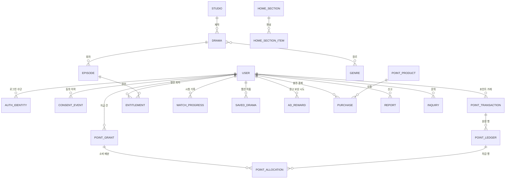
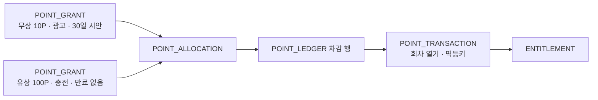
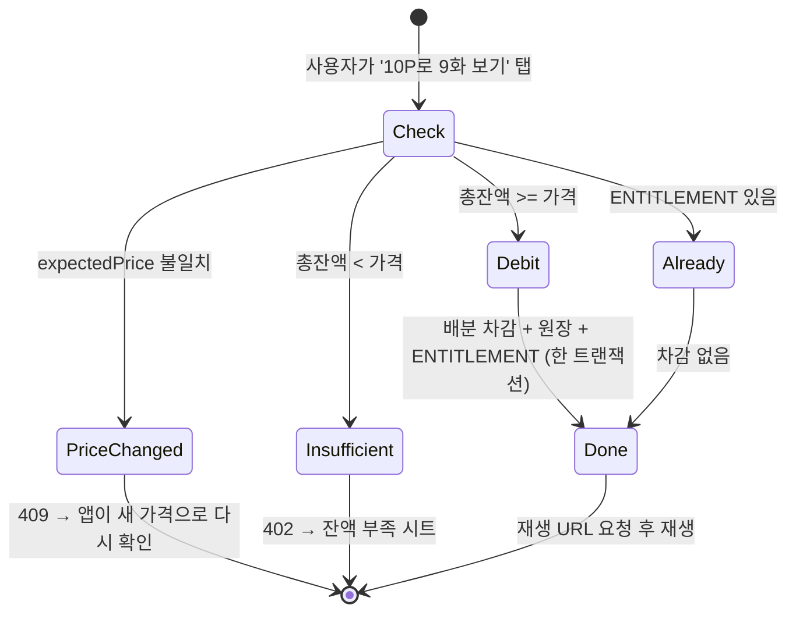
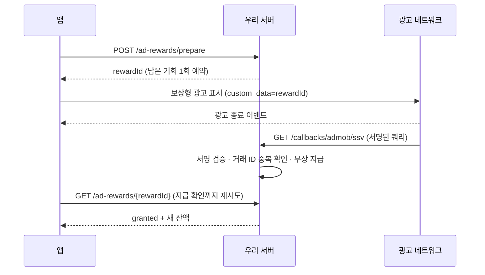
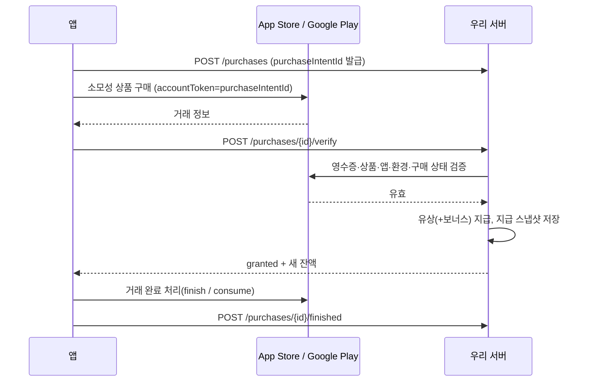

# 06. 데이터 구조 · API 초안

> **2026-10-21 기준 안내**: 실제 데이터 모델과 API는 개발자가 구현한 코드(TypeORM 엔티티)와 개발자 문서 `_docs/api/`가 기준이다. 이 문서는 기획 측의 **요구사항 초안**(포인트 원장·멱등성·광고 검증·결제 귀속 등 지켜야 할 원칙)으로 읽고, 개발자 설계와 다른 부분은 개발자와 합의해 맞춘다.
>
> 백엔드(`back/`, NestJS)와 앱(`front/`)이 주고받을 데이터와 API의 **초안**이다. 필드명·엔드포인트는 개발자가 구현하면서 바꿔도 되지만,
> 바꿀 때는 이 문서와 [04_기능명세서](./04_기능명세서.md)를 함께 고친다. 규칙의 근거는 [03_정책정의서](./03_정책정의서.md).
> 현재 front는 서버 없이 기기 안 체험 데이터(`front/src/features/drama/experience.ts`)로 동작한다. §6에 현재 체험 데이터 → 서버 데이터 대응표가 있다.

---

## 1. 핵심 원칙 (개발 시 반드시 지킬 것)

| # | 원칙 | 이유 |
|---|---|---|
| D-1 | **포인트 잔액과 회차 열림 여부의 정답은 서버**다. 앱은 표시만 하고, 앱에 저장된 값으로 권한을 판단하지 않는다. | 기기 데이터는 조작·유실될 수 있다. 현재 체험 데이터는 권한 근거로 쓰면 안 된다(ARCHITECTURE.md). |
| D-2 | 포인트가 움직이는 모든 요청(회차 열기·충전 검증)은 **거래(POINT_TRANSACTION) 단위 멱등키**를 받는다. `UNIQUE(userId, operation, idempotencyKey)`. 같은 키로 다시 오면 **최초 확정 처리 결과**를 돌려준다(경로·대상·본문 해시가 다르면 `422 IDEMPOTENCY_MISMATCH`). 최신 잔액은 별도로 조회하며, 과거 결과의 잔액을 현재 잔액으로 덮어쓰지 않는다(§3-9). | 버튼 연타·재시도로 두 번 차감/지급되는 것을 막는다. |
| D-3 | 잔액은 **지급 건(POINT_GRANT)의 남은 양 합계**로 계산한다. 원장 행은 수정·삭제하지 않고, 정정은 반대 부호 행을 추가한다. | 소멸·환불·문의 대응 시 "어느 지급분을 얼마 썼는지" 추적해야 한다. |
| D-4 | **유상 포인트(충전)** 와 **무상 포인트(광고·이벤트·보너스)** 를 지급 건 단위로 구분한다. 유상의 `expiresAt`은 항상 null. | 환불·소멸·회계 처리가 다르다. Apple 3.1.1(IAP 크레딧 만료 금지). |
| D-5 | 광고 보상은 **광고 네트워크의 서버 검증 콜백(SSV)** 을 받은 뒤에만 지급한다. 앱이 "다 봤다"고 보내는 것만으로 지급하지 않는다. | 가짜 보상 요청 차단. |
| D-6 | 충전은 **스토어 영수증을 서버가 검증**한 뒤 지급한다(Apple App Store Server API / Google Play Developer API). 구매는 시작 전에 **서버 계정에 귀속**시킨다. | 결제 위조·다른 계정 지급 차단, 환불 시 회수. |
| D-7 | 회차를 한 번 열면 **열림 기록(ENTITLEMENT)** 을 남긴다. `UNIQUE(userId, episodeId)`. 다시 볼 때는 차감하지 않는다. 서로 다른 멱등키로 같은 회차를 동시에 열어도 지갑 잠금으로 1회만 차감한다. | `[확정]` 재시청 무료 정책. |
| D-8 | 회차 열기 요청에는 **사용자가 화면에서 확인한 가격**(`expectedPrice`, `priceVersion`)을 함께 보낸다. 서버 가격과 다르면 차감하지 않고 `409 PRICE_CHANGED`. | 시트에 10P가 보였는데 20P가 차감되는 일을 막는다. |
| D-10 | **가격·보상량은 코드에 넣지 않는다.** 회차 가격은 출시 마지막 단계에 확정하고 이후에도 바뀔 수 있으므로 `[확정: 2026-10-12]`, 앱의 모든 가격·보상 문구("10P로 9화 보기", "이후 회차당 10P", "광고 보고 10P 받기")는 서버 값으로 그린다. 운영자는 앱 업데이트 없이 어드민에서 바꾼다. | 현재 front는 10P를 상수·문구에 직접 쓰고 있어 서버 값으로 바꿔야 한다. |
| D-9 | 앱은 포인트 요청을 보내기 **전에** 멱등키·대상·진입 화면을 기기에 저장한다. 응답을 못 받으면 실패로 단정하지 않고 `GET /me/transactions/by-key?operation={operation}&key={key}`로 결과를 조회한다. | 응답 유실 시 중복 요청·미지급 오해 방지. |

---

## 2. 엔티티(데이터 묶음)

### 2-1. 사용자·계정

**USER**

| 필드 | 타입 | 설명 |
|---|---|---|
| id | uuid | 사용자 ID |
| status | enum `guest` \| `member` \| `merged` \| `withdrawing` \| `withdrawn` \| `suspended` | 게스트(익명)·회원·병합 종료·탈퇴 처리 중·탈퇴·이용 정지 |
| nickname | string? | 표시 이름. 게스트는 "게스트" |
| birthDate / ageSource | date? / enum `self_declared`\|`verified` | 생년월일(만 나이 계산용, 연도만으로는 부족). 첫 실행 AUT-02에서 입력. 출처: 자기 입력 / 본인인증 `[확정: 14세 미만 가입 허용, 2026-10-12]` |
| guardianConsentStatus / guardianConsentAt | enum `not_required`\|`pending`\|`granted`\|`denied` / datetime? | 만 14세 미만이면 법정대리인 동의 필요(개인정보 보호법 제22조의2). 동의 전 허용 범위는 03 §1-1 |
| adultVerifiedAt | datetime? | 청소년관람불가 콘텐츠용 성인 본인인증(해당 콘텐츠 도입 시). 14세(개인정보)·19세(민법 성년)·영상 등급 기준을 한 필드로 섞지 않는다 |
| mergedIntoUserId | uuid? | 게스트가 회원 계정에 병합된 경우 대상 계정(원장 userId는 바꾸지 않고 이 매핑으로 출처 추적) |
| createdAt / lastActiveAt | datetime | |

**AUTH_IDENTITY** — `UNIQUE(provider, providerUserId)`. 로그인 수단: userId, provider(`device`\|`apple`\|`google`\|`kakao` `[TBD]`), providerUserId, linkedAt

**SESSION** — 토큰: id, userId, refreshTokenHash, tokenFamilyId, deviceId, issuedAt, expiresAt, revokedAt. access token 수명 짧게(예: 1시간), refresh는 사용할 때마다 교체(회전) `[제안]`.

**CONSENT_EVENT** — 동의 이력(덮어쓰지 않음)

| 필드 | 설명 |
|---|---|
| userId, item | `terms` · `privacy` · `paid_terms` · `marketing_push` · `night_push` · `guardian_consent`(14세 미만 법정대리인 동의) |
| documentVersion | 동의한 문서 버전 |
| action | `agree` \| `withdraw` |
| source | `first_launch` · `login` · `settings` 등 |
| createdAt | |

현재 동의 상태는 USER_CONSENT_STATE(마지막 이벤트 기준)로 따로 둔다.

**USER_SETTINGS**: captions(true `[구현]`), autoNext(true `[구현]`), autoUnlockDramaIds([] `[제안 P1]`), playbackSpeed(1.0 `[제안]`), serviceNotifications({newEpisode: bool, inquiryAnswer: bool} `[P1]`)

**DEVICE**: id, userId, platform, pushToken, osPermission(`granted`\|`denied`\|`unknown`), lastSeenAt. 로그아웃 시 푸시 토큰 연결 해제.

### 2-2. 콘텐츠

**STUDIO** (제작사): id, name, type(`internal`\|`partner`), contact, contractMemo

**DRAMA** (작품)

| 필드 | 타입 | 설명 | 현재 catalog.ts 필드 |
|---|---|---|---|
| id | string | 작품 ID (URL에 쓰므로 영문 slug 권장) | `id` |
| title / titleEn | string | 작품명 / 영문 제목 | `title` / `english` |
| logline | string | 히어로 배너 한두 줄 카피 | `copy` |
| synopsis | string | 줄거리 | `description` |
| genreIds / moodTags | string[] | 장르(대표 1 + 보조) / 분위기 태그 | `tag` / `mood` |
| studioId | string | 제작사 | `studio` |
| posterUrl / heroImageUrl / themeColor | string | 세로 포스터 / 히어로 이미지 / 대체 색 | (로컬 이미지) / `color` |
| totalEpisodes | number | 전체 회차 수(공개 예정 포함) | `total` |
| freeEpisodes | number | 무료 회차 수(작품별 7~10) `[확정]`. 공개 후 **늘리기만 가능** `[제안]`(03 §3-2) | `free` |
| defaultEpisodePrice / priceVersion | number | 유료 회차 기본 가격(P) — **미정, 출시 마지막 단계에 확정**(시안 10). 어드민에서 언제든 변경 / 가격이 바뀔 때마다 증가 | (상수 `EPISODE_PRICE`) |
| badge | string? | 운영자 지정 배지 | `badge` |
| ageRating / ratingCertificate | enum `all`\|`12`\|`15`\|`adult` / string? | 영상 등급(등급분류 결과를 입력, 임의 지정 금지) / 증빙 | – |
| aiDisclosure | {generated, scope: (`video`\|`voice`\|`script`)[], label, version} | AI 생성 여부·범위·표시 문구·고지 버전(03 §3-6) | – |
| rightsDocs / reviewStatus | string[] / enum `pending`\|`approved`\|`rejected` | 권리 확인 자료 / 등급·권리·AI 검수 결과 | – |
| status | enum `draft`\|`scheduled`\|`published`\|`hidden`\|`ended` | 공개 상태 | – |
| publishedAt / completed | datetime? / bool | 첫 공개 시각(최신순·NEW 배지 기준) / 완결 여부 | – |

**EPISODE** (회차)

| 필드 | 타입 | 설명 |
|---|---|---|
| id, dramaId, number | | 회차 번호는 1부터 |
| title | string? | 회차 제목 (현재 catalog의 `episode`는 대표 회차 제목 1개뿐) |
| durationSec / aspectRatio | number / enum | 길이(약 60초) / 원본 비율 |
| videoAssetId / subtitleTracks | string / {lang, url}[] | HLS 원본 / WebVTT 자막 |
| price / priceVersion | number? | 개별 가격(없으면 작품 기본가) |
| freeOverride | bool | 운영자가 이 회차만 무료로 지정 |
| status | enum `processing`\|`failed`\|`ready`\|`scheduled`\|`published`\|`hidden` | 영상 처리·공개 상태 |
| publishAt | datetime? | 예약 공개 |

**회차 상태 계산(서버)** — 앱 응답에서 두 값을 분리한다.

| 값 | 종류 | 계산 |
|---|---|---|
| `availability` | `processing` · `scheduled` · `published` · `hidden` · `ended` | 작품 ended → ended; 작품 hidden/draft 또는 회차 hidden/failed → hidden; 회차 processing/ready → processing; 작품/회차 scheduled → scheduled; 둘 다 published인 경우만 published. 공개 예정 시각이 지나도 공개 검수를 통과하기 전에는 published로 계산하지 않는다 |
| `access` | `free` · `locked` · `unlocked` | ENTITLEMENT 있음 → unlocked / 아니면 `number <= freeEpisodes` 또는 `freeOverride` → free / 그 외 locked. 무료 판정과 기존 구매 권한을 함께 보존한다 |
| 재생 허용 | – | 작품 published **AND** 회차 published **AND** 등급·공급 지역 허용 **AND** access가 free 또는 unlocked. 승인되지 않은 등급 접근 기준은 공개 차단(§3-12) |
| 열기 허용 | – | 재생 허용 조건 중 access만 locked인 경우 |

무료 범위를 줄이지 않는 MVP 안에서는 이미 공개한 회차의 `freeOverride=true→false`도 금지한다. 회차별 `priceVersion`은 작품 기본가·개별가·무료 범위 변경을 모두 포함하는 **유효 가격 버전**이며, 실제 차감 가격은 서버 계산값이다.

**PREVIEW** (추천 피드 미리보기): id, dramaId, videoAssetId, durationSec, sortOrder, status. 운영자가 지정 `[제안]` (현재는 포스터+자막 60초 체험).

**GENRE**: id, name, sortOrder

**HOME_SECTION / HOME_SECTION_ITEM** (홈 편성)

| 필드 | 설명 |
|---|---|
| section.id / type | `hero` \| `rail` \| `banner` \| `ranking` \| `feedLink` |
| section.eyebrow / title | "QUICK ESCAPE" / "1분이면, 빠져드는 이야기" |
| section.actionTarget | "전체/더 보기"의 이동 대상 `{kind: 'genre'\|'section'\|'search'\|'feed', id}` (앱은 허용된 kind만 처리) |
| section.sortOrder, visibleFrom, visibleTo | 노출 순서·기간 |
| item.dramaId, item.sortOrder, item.imageUrl? | 섹션 안 작품과 순서 |

### 2-3. 시청

**ENTITLEMENT** (열린 회차) — `UNIQUE(userId, episodeId)`

| 필드 | 설명 |
|---|---|
| userId, episodeId | |
| source | `points` \| `admin_grant` \| `event` \| `merge` |
| transactionId | 회차를 연 포인트 거래(POINT_TRANSACTION) |
| createdAt | |

**WATCH_PROGRESS** (시청 기록)

| 필드 | 설명 |
|---|---|
| userId, dramaId | 작품당 1행(보관함 "시청 기록"은 이 목록) |
| lastEpisodeNumber / lastPositionSec | **실제로 마지막으로 재생한** 회차·위치 |
| resumeTarget | 다음에 "이어서 보기"를 눌렀을 때 갈 곳 `{episodeNumber, positionSec, kind}`. kind: `resume`(보던 위치) · `next`(다음 회차 처음) · `locked_next`(다음 회차가 잠김 → 열기 시트) · `waiting`(연재 대기) · `rewatch`(완결) — 서버가 계산 |
| completedEpisodes | 끝까지 본 회차 번호 목록 |
| playbackSessionId / clientSeq / version | 재생 URL 발급 시 세션 ID, 세션 안 단조 증가 번호, 작품별 서버 버전. 세션·버전을 함께 검증해 다른 기기의 지연 요청을 막는다(§3-3) |
| updatedAt | 정렬 기준(최근 본 순) |

규칙: 추천 피드(미리보기) 시청은 기록하지 않는다 `[구현]`. 잠긴 회차는 실제 재생 기록으로 저장하지 않는다(resumeTarget이 `locked_next`로 가리킬 수는 있다). "끝까지 봄"은 재생이 끝났을 때(ended), 분석용 완주는 90% 시청으로 따로 계산한다.

**SAVED_DRAMA**: userId, dramaId, createdAt

### 2-4. 포인트

**POINT_TRANSACTION** (거래) — 사용자 요청 1건 = 1행

| 필드 | 설명 |
|---|---|
| id | 거래 ID |
| userId | |
| operation | `unlock` \| `purchase_grant` \| `ad_grant` \| `event_grant` \| `expire` \| `refund_clawback` \| `admin_adjust` \| `merge` |
| idempotencyKey | `UNIQUE(userId, operation, idempotencyKey)` |
| requestHash | 같은 키에 다른 본문이 오면 거절 |
| status | `pending` \| `succeeded` \| `failed` |
| result / errorCode | 최초 확정 업무 결과와 당시 walletVersion. 외부 검증 대기는 pending을 유지하고 최종 실패와 구분한다 |
| refType / refId | episodeId, purchaseId, adRewardId 등 |
| createdAt / completedAt | |

**POINT_GRANT** (지급 건) — 잔액의 단위

| 필드 | 설명 |
|---|---|
| id, userId | |
| bucket | `paid` \| `free` |
| originalAmount | 처음 지급량 |
| remainingAmount | 남은 양(= 원래 − 배분 − 소멸 − 회수). 지갑 잠금 안에서만 변경 |
| expiresAt | 무상만 사용 `[TBD]`(제안 30일). 유상은 **항상 null** |
| sourceType / sourceId | `purchase` · `ad_reward` · `event` · `admin` / 원본 ID. 병합은 재지급하지 않으며 원본 지급 건을 그대로 합산한다 |
| transactionId | 지급한 거래 |

**POINT_ALLOCATION** (소비 배분) — "이 차감이 어느 지급분에서 얼마"

| 필드 | 설명 |
|---|---|
| id / debitLedgerId | 고유 배분 ID / 차감 원장 행 |
| grantId | 소비된 지급 건 |
| amount / kind | 양수 배분량 / `spend` · `expire` · `clawback`. 소비뿐 아니라 소멸·회수도 지급 건별 배분을 남긴다 |

차감 순서(`[확정]` 2026-10-12, 03 §4-3): 만료되지 않은 무상 지급 건을 `expiresAt` 빠른 순(무만료 무상은 뒤) → 유상 지급 순, 동률은 지급 ID 순. 차감 시각 기준 소멸 대상을 같은 지갑 잠금 안에서 먼저 정산한다. 각 음수 원장 행의 금액 절댓값 = 배분 합계이며, 지급 건 잔여량은 모든 `spend/expire/clawback` 배분을 뺀 값이다. 보상·환급은 원장 수정/배분 삭제 없이 원거래를 참조한 새 지급 건으로 기록한다.

**POINT_LEDGER** (원장 — 수정·삭제 금지)

| 필드 | 설명 |
|---|---|
| id | 원장 행 ID(행마다 고유) |
| transactionId | 소속 거래 |
| userId, bucket | |
| amount | +지급 / −차감 |
| balanceAfter | 처리 후 해당 bucket 잔액 |
| label | 화면 표시 문구("마지막 신호 9화 열기", "광고 보상") |
| createdAt | |

회차 열기 1건이 무상 6P + 유상 4P로 나뉘면: 거래 1행 → 원장 2행(free −6, paid −4) → 배분 N행(지급 건별). ENTITLEMENT는 거래 ID를 가리킨다.

**WALLET** (잔액 캐시): userId, paidBalance, freeBalance, version(낙관적 잠금). POINT_GRANT.remainingAmount 합계와 항상 일치해야 하며, 정기 점검 배치로 불일치를 감지한다.

**POINT_PRODUCT** (충전 상품): id, storeProductId(ios/android, 소모성), points(유상), bonusPoints(무상 `[제안]`), bonusExpiresDays, productVersion, active, sortOrder, firstPurchaseOnly. **표시 가격은 스토어에서 받아온 현지화 가격을 쓴다.**

**PURCHASE** (충전 결제)

| 필드 | 설명 |
|---|---|
| id(=purchaseIntentId), userId | 구매 시작 전에 서버가 만든 의도 ID. 이 계정에만 지급 |
| productId / productVersion | 구매 당시 상품 버전 |
| platform | `ios` \| `android` |
| storeTransactionId / purchaseToken | Apple은 앱·환경·transactionId, Google은 패키지·purchaseToken을 중복 방지 키로 저장. Google orderId는 표시/대사 자료이며 지급 유일키로 사용하지 않는다 |
| accountToken | Apple `appAccountToken` / Google `obfuscatedAccountId`로 넘긴 값(=purchaseIntentId) |
| status / finishStatus | 구매 상태 `created`·`store_pending`·`verified`·`granted`·`cancelled`·`failed`·`refunded`; 완료 처리 상태 `not_ready`·`finish_pending`·`finished`를 분리한다. 즉시 결제는 store_pending을 거치지 않아도 된다 |
| paidGranted / bonusGranted / bonusExpiresAt | **지급 스냅샷**(상품이 나중에 바뀌어도 환불 계산 기준) |
| priceAmountMicros / currency | 실제 결제 금액·통화(스토어 값) |
| refundedAt, refundEventId, clawbackPaid, clawbackBonus, clawbackShortfall | 환불 회수 결과와 회수하지 못한 부족분 |
| verifiedAt, grantedAt, rawVerification | 검증 원본(보관 기간 `[TBD]`) |

**AD_REWARD** (광고 보상 시도)

| 필드 | 설명 |
|---|---|
| id(=rewardId), userId | prepare 때 생성. SSV `custom_data`로 전달 |
| network / adUnitId / placement | `admob` 등 / 광고 단위 / `unlock_sheet`·`wallet` |
| reservedAmount / policyVersion / rewardDate | prepare 때 고정한 보상량·정책 버전·한도 기준일(KST `[제안]`) |
| status | `reserved` → `shown` → `verified` → `granted` / `no_fill`(광고 없음, 예약 해제) / `expired`(예약 만료) / `rejected` |
| reservedUntil | 예약 만료 시각(예: 30분) `[제안]` |
| ssvTransactionId / transactionId | `UNIQUE(network, ssvTransactionId)` / 실제 포인트 지급 거래 ID |

**일일 한도 규칙** `[제안]`: prepare가 남은 기회를 **원자적으로 예약**한다(동시에 두 기기에서 마지막 1회를 예약할 수 없음). 광고 없음·로드 실패는 예약을 돌려준다. 예약된 시도의 **유효한 SSV는 늦게 도착해도(앱 종료·자정 이후) 1회 지급**한다. 예약의 만료·반환은 새 광고 시작 기회만 해제하며, 유효한 완료 SSV의 보상 권리를 소멸시키지 않는다. 반환 후 유효 SSV가 도착해도 원래 시도에 1회 지급하고 원래 rewardDate에 집계한다. 이 경우 이미 시작한 다른 유효 시도도 지급하며 해당 일자의 집계가 설정 한도를 넘을 수 있다. 이를 줄이는 예약 수명·공급사 검증 허용 시각/로그 보관 기간은 SDK 검증 후 확정하고 임의의 24시간 절단 규칙을 두지 않는다.

### 2-5. 운영·고객

**REPORT** (신고): id, userId, targetType(`content`\|`ad`), dramaId?, episodeId?, adRewardId?(지급 전 시도도 연결), adNetwork?, adUnitId?, shownAt?, reason(`inappropriate`\|`rights`\|`wrong_info`\|`age_inappropriate_ad`\|`other`), message, status(`received`\|`reviewing`\|`resolved`\|`rejected`), adminMemo, createdAt
**INQUIRY** (문의): id, userId, category(`video`\|`ad_reward_missing`\|`ad_inappropriate`\|`payment`\|`point`\|`account`\|`etc`), message, refType/refId(관련 결제·거래), status, answer, answeredAt
**LEGAL_DOCUMENT**: id, type(`terms`·`paid_terms`·`privacy`·`marketing`), version, effectiveAt, url/body
**NOTICE / FAQ**: id, title, body, category, sortOrder, visible
**APP_CONFIG** (원격 설정): minSupportedVersion(ios/android), maintenance{on, message, until}, adDailyLimit, adRewardAmount, policyVersion
**ADMIN_USER / AUDIT_LOG**: 운영자 계정, 역할(`admin`·`programmer`(편성)·`cs`), 모든 운영 조작 기록(누가·언제·무엇을·전후 값)

---

## 3. API 초안 (앱용)

공통: `Authorization: Bearer <accessToken>` · JSON · 시간은 ISO-8601(UTC) · 금액은 정수 포인트.
앱 Bearer 없이 호출: `GET /app/config`, `POST /auth/guest`, `GET /legal-documents`, `POST /auth/refresh`(유효 refresh 필수). `POST /auth/social`은 외부 로그인 증명 필수·게스트 Bearer 선택; 병합 후보는 유효한 게스트 세션이 있을 때만 만든다. 광고·스토어 콜백은 별도 발신/서명 검증(§3-7), 웹 탈퇴는 삭제용 인증(§3-10)을 적용한다.
앱이 보내는 포인트 변경, 구매 의도 생성, 광고 prepare, 계정 병합 요청은 `Idempotency-Key: <uuid>` 필수다. 외부 콜백은 공급사 거래/이벤트 ID, 배치는 원지급 건·작업·정책 버전으로 서버 멱등키를 만든다.
401이면 앱은 refresh를 **1번** 시도 후 원래 요청을 재시도한다. refresh도 실패하면 로그인 안내(게스트는 SYS-01 재초기화가 아니라 "다시 연결" 안내 — 새 게스트 계정을 만들어 기존 지갑을 덮어쓰지 않는다).

### 3-1. 인증·동의

| 메서드 · 경로 | 설명 | 화면 |
|---|---|---|
| `POST /auth/guest` | AUT-02에서 승인된 연령 기준·필수 문서 버전별 응답을 받아 서버 검증 후 계정 생성과 동의 기록을 함께 확정. `{accessToken, refreshToken, accessExpiresAt, user}` 반환(§3-10) | SYS-01, AUT-02 |
| `POST /auth/social` | `{provider, idToken}` 인증만 한다. 기존 회원에 연결하려는 게스트에게 이전할 데이터가 있으면 대상 계정의 빈 상태와 무관하게 **병합하지 않고** `{mergeRequired: true, mergeToken, expiresAt, summary, summaryVersion}` 반환. 새 로그인 수단이면 현재 게스트 ID에 연결하고 데이터 복사 없이 회원으로 전환 | AUT-01 |
| `POST /auth/merge` | `{mergeToken, summaryVersion}` 명시적 승인 후 1회 병합. 변경된 요약이면 `409 MERGE_SUMMARY_CHANGED`로 재확인. 원본 지급/원장은 유지하고 계정 매핑으로 합산, 게스트 세션 폐기 후 회원 토큰 반환(§3-10) | AUT-03 |
| (나중에) | 병합 거절 시 게스트 상태 유지, 소셜 연결 보류 `[제안]` | AUT-03 |
| `POST /auth/refresh` | `{refreshToken}` → 새 access/refresh(회전) | 공통 |
| `POST /auth/logout` | 세션 폐기·푸시 토큰 해제 | MY-05 |
| `DELETE /me` | 회원 탈퇴. 회원은 소셜 재인증, 게스트는 현재 세션으로 본인 확인. 미완료 결제가 있으면 안내 후 진행. 처리 중 새 거래는 차단하되 이미 시작한 구매·유효 광고 보상·환불의 후속 정산은 계속 처리한다. 삭제 상태별 귀속·정산은 §3-10 | MY-05 |
| `POST /me/age` | `{birthDate}` 첫 실행 생년월일 제출(게스트 생성과 함께 보낼 수 있음). 응답 `{age, guardianConsentRequired, contentAgeLimit}` | AUT-02 |
| `POST /me/guardian-consent` · `GET /me/guardian-consent` | 14세 미만: 법정대리인 동의 요청 시작(보호자 연락처로 인증·동의, 방식 `[TBD: 법률 검토]`) / 상태 조회 `pending`·`granted`·`denied` | AUT-04 |
| `POST /me/adult-verification` | 청소년관람불가 콘텐츠용 본인인증 결과 등록(인증 사업자 연동, 해당 콘텐츠 도입 시) | AUT-05 |
| `GET /legal-documents` · `POST /me/consents` | 문서 `{id,type,version,effectiveAt,required,purpose,url/body}` 조회 / `{items:[{item,documentVersion,action}],source}` 제출. 낡은 필수 버전은 `409 CONSENT_VERSION_CHANGED`, 필수 미충족은 `403 CONSENT_REQUIRED`; 선택 동의 거부는 필수 이용을 차단하지 않는다 | AUT-02, MY-03 |

### 3-2. 앱 시작·설정

| 메서드 · 경로 | 설명 |
|---|---|
| `GET /app/config` | 최소 지원 버전, 점검 여부, 광고 한도·보상량, 정책 버전 |
| `GET /me` | 프로필 + 잔액(유상/무상/소멸 예정) + 설정 + 동의 상태 |
| `PATCH /me/settings` | captions, autoNext, autoUnlockDramaIds, playbackSpeed, serviceNotifications |
| `POST /me/devices` | 푸시 토큰·OS 권한 상태 등록 |

### 3-3. 콘텐츠

| 메서드 · 경로 | 설명 | 화면 |
|---|---|---|
| `GET /home` | `{sections: [{id, type, eyebrow, title, actionTarget, items: [작품 카드 메타]}]}`. 앱은 모르는 type은 건너뛰고 빈 섹션은 숨긴다 | HOM-01 |
| `GET /dramas?sort=latest\|ranking&genre=&cursor=` | `{items, nextCursor, hasMore}` | HOM-02~04 |
| `GET /dramas/search?q=&genre=&cursor=` | `{items, total, nextCursor, hasMore}`. 앱은 마지막 요청 결과만 화면에 반영 | SRC-01 |
| `GET /genres` | 장르 목록 | SRC-01, HOM-04 |
| `GET /dramas/:id` | 작품 상세 + 내 상태(찜 여부, resumeTarget, `ageRestricted`: 내 나이로 볼 수 없는 등급인지) | DTL-01 |
| `GET /dramas/:id/episodes` | 회차 목록. 회차별 `availability`, `access`, `price`, `priceVersion`, `publishAt`, 내 시청 상태 | DTL-02, PLY-03 |
| `GET /feed/previews?cursor=` | `{items: [{dramaId, preview: {url, expiresAt, durationSec, aspectRatio, subtitleTracks}}], nextCursor, hasMore}` | REC-01 |
| `GET /episodes/:id/playback` | 재생 허용(§2-2)일 때만 `{playbackSessionId, progressVersion, url, expiresAt, durationSec, aspectRatio, subtitleTracks, aiDisclosure}`. 아니면 `403 {code: PLAYBACK_DENIED, details:{reason: LOCKED\|PROCESSING\|SCHEDULED\|HIDDEN\|ENDED\|AGE_RESTRICTED\|REGION_RESTRICTED}}` → PLY-02/PLY-10 | PLY-01 |

연령별 노출 `[확정: 콘텐츠에 따라 시청 제한]`: 목록·검색·피드는 사용자 나이보다 높은 등급 작품을 **12·15세 등급은 등급 배지와 함께 보여주되 재생·회차 열기는 막고**(`ageRestricted: true`), **청소년관람불가는 성인 인증 전에는 목록에서 제외**한다 `[제안]`. 재생·회차 열기는 서버가 같은 기준으로 다시 확인한다(`403 AGE_RESTRICTED`, `409 EPISODE_NOT_AVAILABLE {reason: AGE_RESTRICTED}`).

재생 URL: 단기 서명 URL(예: 1시간). 만료되면 같은 위치에서 재발급 요청. HLS는 매니페스트뿐 아니라 세그먼트·암호화 키 접근도 보호(CDN 서명 쿠키/토큰). 잠긴 회차는 미리 받아두지(프리페치) 않는다.

### 3-4. 시청 기록·저장

| 메서드 · 경로 | 설명 |
|---|---|
| `PUT /me/progress/:dramaId` | `{episodeNumber, positionSec, ended?, playbackSessionId, clientSeq, expectedVersion}` 10초마다 `[제안]`·화면 이탈·백그라운드 시. 해당 재생 세션의 허용 회차·위치를 검증하고 서버 version 증가. 오래된 세션/번호는 갱신하지 않고 `200 {applied:false,version,resumeTarget}`, 버전 충돌은 `409 PROGRESS_CONFLICT {version,resumeTarget}`. 새 재생 세션 발급 후 이전 기기의 늦은 요청은 무시 |
| `GET /me/progress` | 시청 기록 목록(최근 순) |
| `DELETE /me/progress/:dramaId` | 기록 삭제 `[P1]` (열린 회차·원장은 유지) |
| `GET /me/saved` · `PUT /me/saved/:dramaId` · `DELETE /me/saved/:dramaId` | 찜한 작품(화면 용어는 "찜", 코드·API 이름은 saved 유지 가능) |

### 3-5. 포인트·회차 열기

| 메서드 · 경로 | 설명 | 주요 응답 |
|---|---|---|
| `GET /me/wallet` | 잔액 | `{paidBalance, freeBalance, total, expiringSoon:[{amount, expiresAt}]}` |
| `GET /me/ledger?type=&cursor=` | 포인트 내역(받은/쓴 필터, 거래 ID 포함) | |
| `GET /me/transactions/by-key?operation=&key=` · `GET /me/transactions/:transactionId` | 본인 거래 결과 조회(D-9), 병합된 원소유 계정도 본인 범위에 포함 | `{transactionId,operation,status,result,errorCode,updatedAt}` / 아직 접수 없음 `404 TRANSACTION_NOT_FOUND`(§3-9) |
| `POST /episodes/:id/unlock` | `{expectedPrice, priceVersion}`. 한 지갑 트랜잭션: 계정·공개/등급 조건 확인 → 기존 권한 확인 → 가격 확인 → 소멸/잔액 확인 → 배분 차감 → ENTITLEMENT 생성 | `200 {entitlement, wallet, allocation:{free, paid}}` · 이미 열림 `200 {alreadyUnlocked: true, entitlement, wallet}`(차감 없음) · `402 INSUFFICIENT_POINTS {required, balance}` · `409 PRICE_CHANGED {currentPrice, priceVersion, wallet}` · `409 EPISODE_NOT_AVAILABLE {reason}` |
| `GET /point-products?platform=` | 충전 상품(스토어 상품 ID 목록) | |
| `POST /purchases` | `{productId, platform, productVersion}` → `{purchaseIntentId, storeProductId, accountToken, productSnapshot}`. 필수 유료 동의·연령·활성 상품/버전 검증, 서버 계정 귀속과 지급 스냅샷 확정 | `409 PRODUCT_CHANGED` / `403 CONSENT_REQUIRED` |
| `POST /purchases/:intentId/verify` | `{platform, receipt/purchaseToken}` 검증 → 지급 | `200 {status, wallet}` · 이미 지급된 같은 거래는 **200으로 기존 결과** · 스토어 보류 `202 {status: store_pending}` · 다른 계정 거래 `409 ACCOUNT_MISMATCH` |
| `POST /purchases/:intentId/finished` | 앱이 완료 처리(finish/consume)를 마쳤음을 멱등 보고. 이 요청으로 지급 상태를 변경하지 않는다. 소비 여부/실제 결제 상태는 필요 시 서버에서 대사 | `200 {finishStatus}` |
| `GET /purchases/pending` | 앱 재시작 시 미완료 결제 목록(복구용) | |
| `POST /ad-rewards/prepare` | `{placement}` → 남은 기회 예약, `{rewardId, reservedAmount, adUnitId, reservedUntil, remainingCount, resetAt}`. 동일 키 재시도는 동일 시도 반환 | `429 DAILY_LIMIT_REACHED {resetAt}` |
| `POST /ad-rewards/:rewardId/no-fill` | `{reason:no_fill\|load_failed\|cancelled_before_show}` 예약 반환 요청. 이미 검증/지급된 시도는 되돌리지 않는다. 후발 유효 SSV 우선(§2-4) | `200 {status}` |
| `GET /ad-rewards/:rewardId` | 지급 결과 확인(앱이 짧게 재시도) | `{status, grantedAmount, wallet, remainingCount, resetAt}` |

### 3-6. 고객·운영(앱)

| 메서드 · 경로 | 설명 |
|---|---|
| `POST /reports` | 콘텐츠·광고 신고 |
| `GET /faqs` · `GET /notices` | FAQ·공지 |
| `POST /inquiries` · `GET /me/inquiries` | 1:1 문의 작성·내 문의 |

### 3-7. 외부 콜백 (앱 인증·멱등키 헤더 없음)

| 경로 | 보내는 곳 | 처리 |
|---|---|---|
| `GET /callbacks/admob/ssv` | AdMob(AdMob 선택 시) | **서명된 URL 쿼리**로 온다. DTO 변환·재정렬 전에 원본 쿼리를 보존해 `key_id`·ECDSA `signature`를 Google 공개키로 검증 → `custom_data`(rewardId)·광고 단위·보상량·`transaction_id` 대조 → 무상 지급(중복 거래 ID는 이미 처리로 200). 일시 오류는 재시도 가능한 응답. 다른 광고사는 별도 계약 |
| `POST /webhooks/apple` | App Store Server Notifications V2 | 서명(JWS) 검증 → 이벤트 ID 중복 제거 → `REFUND`면 원거래(PURCHASE)를 찾아 스냅샷 기준 회수(최대 원지급량). 원거래 미발견이면 보류 큐 |
| `POST /webhooks/google` | Google Play RTDN(Pub/Sub) | 발신 인증·메시지 디코딩 → **보류 구매 취소**(지급 없음, 상태만 변경)와 **voided/환불**(회수) 구분 → 필요 시 Play Developer API로 상태 재확인. 검증보다 환불이 먼저 와도 이후 지급하지 않음 |

### 3-8. 운영자 웹 API 최소 계약

운영자 인증은 앱 계정과 분리하고 2단계 인증을 적용한다. 모든 변경은 권한 확인·입력 검증·AUDIT_LOG(요청 ID, 사유, 전후 값)와 함께 처리한다. 아래는 P0 구현 계약이며 화면 ID는 05의 화면 목록을 따른다.

| 메서드 · 경로 | 입력·결과 / 실패 | 허용 역할 |
|---|---|---|
| `POST /admin/auth/login` · `POST /admin/auth/verify-2fa` | 1차 인증 → 단기 challenge → 2차 인증 성공 시 운영 세션. 실패 횟수 제한·세션 만료/폐기 적용 | 등록된 운영자 |
| `GET/POST /admin/dramas` · `PATCH /admin/dramas/:id` | 작품 메타·등급 증빙·권리/AI 검수. 수정은 expectedVersion 필수, 충돌은 `409 VERSION_CONFLICT` | admin, programmer(메타 편집만) |
| `POST /admin/dramas/:id/episodes` · `PATCH /admin/episodes/:id` | 회차 번호 유일성, 가격·무료 여부·예약 시각 검증. 공개된 무료 범위 축소 금지 | admin, programmer |
| `POST /admin/pricing` · `GET /admin/pricing/history` | 가격 변경: 대상(전체 기본가 / 작품 기본가 / 회차 개별가)·새 가격·적용 시각(즉시/예약)·사유. 적용 시 해당 priceVersion 증가(시트를 보고 있던 사용자는 409 PRICE_CHANGED로 재확인). 이미 연 회차·과거 거래는 영향 없음. 변경 이력 조회 | admin |
| `POST /admin/assets/upload-urls` · `POST /admin/assets/:id/complete` | 파일 종류·크기·체크섬 → assetId, uploadUrl, expiresAt; 완료 후 서버 저장소 확인·검사·인코딩 큐 등록 | admin, programmer |
| `GET /admin/assets/:id` · `POST /admin/assets/:id/retry` | `uploading/processing/ready/failed`, 실패 코드·재시도 가능 여부. 재시도는 같은 원본의 작업으로 중복 인코딩 억제 | admin, programmer |
| `POST /admin/dramas/:id/publish` · `POST /admin/episodes/:id/publish` | 즉시/예약 공개. 영상 ready·필수 메타·등급 적용 확인/증빙·권리/AI 검수 승인. 불충족은 `409 PUBLISH_BLOCKED {missing}`; 예약 실행 시에도 재검증 | admin |
| `POST /admin/dramas/:id/hide` · `POST /admin/episodes/:id/hide` | 사유·일시/영구 구분; 신규 재생/해제 차단·권한 기록 보존. 기존 URL 차단·보상은 §3-12 승인 정책에 따름 | admin, programmer |
| `GET/PUT /admin/home-sections` · `GET/PUT /admin/previews` | 순서·노출 기간·미리보기 ready/등급 허용 검증, expectedVersion 충돌 방어 | admin, programmer |
| `GET/PUT /admin/point-products` · `GET/PATCH /admin/app-config` | 승인된 상품/보상 정책만 활성화; 과거 구매·광고 스냅샷 불변 | admin |
| `GET /admin/reports` · `PATCH /admin/reports/:id` · `GET /admin/inquiries` · `POST /admin/inquiries/:id/answers` | 상태·사유·답변 이력 저장. 콘텐츠 숨김은 별도 권한 검증 | admin, cs |
| `GET /admin/users/:id/transactions` · `POST /admin/adjustments` · `POST /admin/adjustments/:id/approve` | 대상 원거래·지급 건·유상/무상·금액·사유를 명시한 정정 요청. 승인 시 1회 반대 원장 생성, 0 미만 차감 금지, 중복 승인은 기존 결과 | cs(요청), admin(승인) |

### 3-9. 공통 오류·거래 복구 계약

- 앱 오류 본문은 `{code, message, retryable, requestId, details}`로 통일한다. `details`는 항상 포함하고 없으면 `null`이다(2026-10-20, 0단계 구현 기준). `requestId`는 서버가 만든 UUID이며 응답 헤더 `X-Request-Id`와 같다. 위 표의 오류 부가 필드는 details를 뜻한다. 실제 API 계약은 개발자 문서 `_docs/api/`를 따른다. 처리 중 거래는 `202 {transactionId,status:pending,retryAfterMs}`; 확정 성공은 200, 확정 실패는 오류 코드와 함께 거래 failed로 저장한다. 외부 검증 타임아웃·응답 유실은 확정 실패로 저장하지 않는다.
- 멱등 범위는 원요청 계정·operation·key다. 병합 후에는 원계정 매핑으로도 조회/재요청을 식별하며 새 거래로 복제하지 않는다. 정규화된 경로·대상 ID·본문 해시에 가격/버전도 포함한다. 최종 실패 이후 잔액 충전/가격 재확인으로 다시 실행할 때는 사용자의 새 확인을 받고 새 키를 만든다.
- 조회가 404이면 서버에 아직 접수되지 않았거나 처음 요청이 진행 중일 수 있다. 앱은 저장된 **동일 키·동일 본문**으로 원요청을 다시 보낸다. 통신 장애만으로 키를 바꾸지 않는다. 거래가 pending인 동안 새 구매·해제 요청을 중복 시작하지 않는다.
- wallet 응답은 `{paidBalance,freeBalance,total,version,asOf,expiringSoon}`. 앱은 작은 version 응답으로 최신 잔액을 덮어쓰지 않는다. 병합·계정 전환은 기존 캐시를 지우고 새 계정 wallet을 읽는다. 멱등 재응답의 result는 당시 업무 결과이므로 거래 확정 뒤 최신 wallet을 별도로 조회한다.
- 원장·지급 건 잔여량·배분·ENTITLEMENT·거래 최종 상태·성공 이벤트 발행 예약은 같은 DB 트랜잭션으로 확정한다. 잔액 변경은 동일 유효 소유자 지갑에 직렬화하며 같은 회차 다른 키 동시 요청도 1회만 차감한다. 원장 정정/환불/소멸/병합도 같은 잠금 경계를 사용한다.

### 3-10. 인증·병합·삭제의 경계

| 상황 | 최소 처리 계약 |
|---|---|
| 첫 이용·필수 문서 | config·문서를 먼저 읽어 AUT-02에 표시한다. 계정 생성 요청에 문서 버전별 수락과 승인된 연령 확인 결과를 넣고 서버가 검증한다. 처리 근거와 필수/선택 범위는 Q-24 및 개인정보 검토 승인값을 사용하며, 승인 전 운영환경 가입·광고 SDK 활성화를 차단한다. 문서 조회 실패는 재시도 화면을 유지한다 |
| 토큰 갱신 | refresh는 원자적 회전, 원본 토큰 해시만 보관. 앱의 동시 401은 하나의 갱신으로 합친다. 사용된 refresh 재사용은 해당 tokenFamily 폐기·재인증. 정확한 access/refresh 만료 시간은 배포 설정으로 승인하며 발급 응답에 실제 expiresAt을 준다 |
| 게스트 자격 증명 유실 | 기존 자격 증명이 남아 있으면 재연결한다. 영구 유실 시 동일 계정임을 보장할 수 없으므로 새 게스트에 과거 지갑을 자동 연결하지 않는다. 복구 불가 안내·연동 계정 로그인·거래 문의 경로를 제공하고 새 이용 시작은 별도 선택을 받는다 |
| 병합 실행 | mergeToken은 양쪽 계정·요약 버전·만료를 묶은 단기 일회 토큰. 원/대상 지갑을 고정 순서로 잠그고 최신 요약·회원 신원·미완료 거래를 확인한다. 원 USER를 merged 처리하고 mergedIntoUserId로 현재 소유자를 찾는다. 원거래·원장·지급 건은 복사/재지급하지 않는다. 열린 회차·저장은 합집합, 기록은 최근 유효 기록, 무상 만료는 유지, 광고 시도 집계도 합산한다 |
| 병합 중/후 콜백 | 구매/광고의 시작 계정과 외부 거래 ID는 불변. 완료 처리 시 현재 계정 매핑을 잠금 안에서 해석하여 합산 지갑에 정확히 한 번 반영한다. 원계정 지급 후 대상계정에 추가 지급하는 두 단계 처리를 하지 않는다. 병합 응답 유실은 같은 키로 최종 회원 토큰 재발급 절차를 거치며 자산 재병합은 하지 않는다 |
| 삭제 시작 | `DELETE /me`는 idempotencyKey·회원 소셜 재인증 증명 또는 유효 게스트 세션을 검증하고 `202 {deletionRequestId,status,statusToken}` 반환. 즉시 새 거래·재생 세션 발급을 차단하고 모든 기존 세션·푸시 연결을 폐기한다. `GET /account-deletions/:id`는 삭제용 statusToken으로 상태 조회 가능 |
| 삭제와 진행 거래 | 삭제 전 생성한 구매 의도·광고 시도·환불은 제한된 정산 기록으로 보존한다. 늦은 유효 거래는 중복 검증 후 `SETTLEMENT_CASE`에 귀속하여 승인된 지급/환불/문의 정책으로 처리하며, 사용 불가능한 계정 잔액에 몰래 적립하거나 보상을 폐기하지 않는다. 개인정보 삭제를 분쟁 정산 완료까지 일괄 연기하지 않는다. 삭제 후 같은 소셜 신원 재가입은 새 계정이며 과거 지갑·권한은 자동 복구하지 않는다 |
| 웹 삭제 | 공개 삭제 안내 URL을 스토어에 등록. `POST /account-deletions/auth`는 소셜 재인증 또는 앱에서 발급한 단기 1회 게스트 소유 증명으로 삭제용 세션 발급; `POST /account-deletions`가 같은 삭제 절차 시작. 소유 증명이 유실된 게스트는 개인정보/거래 확인 문의로 연결하며 이메일 주소만으로 삭제 대상을 추정하지 않는다 |

`SETTLEMENT_CASE`: id, originalUserRef, purchaseId/rewardId/refundEventId, reason, promisedAmount, status(pending/resolved), resolution, resolvedAt. 삭제 후 보존 항목·기간·최종 보상 방법은 03 §1-4·§6-3 승인이 출시 조건이며 원시 프로필/광고 식별자를 무기한 보관하지 않는다.

### 3-11. 외부 거래 검증·재처리

- PURCHASE 의도는 플랫폼·스토어 상품·상품 버전·유상/무상 지급량·보너스 유효기간 규칙·소유 계정을 고정한다. 스토어 구매에 전달하는 accountToken은 서버 발급 값만 사용한다. 검증 시 앱/패키지·환경·상품·실제 구매 완료 상태·계정 연결 값을 모두 대조한다. 제공 SDK가 연결값을 전달/복구하지 못하는 경우의 대체 귀속 검증은 결제 활성화 전 승인해야 한다. 현재 로그인한 계정만 보고 미귀속 구매를 가져오지 않는다.
- 소모성 지급 유일키는 외부 구매 식별자다. 여러 intent/멱등키로 같은 구매를 제출해도 이미 기록한 PURCHASE로 연결해 기존 결과만 반환한다. 부분 지급 후 재시도하는 구조를 만들지 않는다. 지급 성공과 완료 처리 실패를 구분하고 finishStatus=finish_pending은 다음 실행/대사에서 처리한다.
- 콜백 수신부는 검증 후 `EXTERNAL_EVENT(network,eventId,payloadHash,receivedAt,status,attempts,lastError,ref)`에 내구성 있게 접수한 뒤 승인 응답을 보낸다. 영구 위조/잘못된 서명은 거절하고 일시 저장 실패는 재시도 가능한 응답을 반환한다. 워커 실패·원거래 미발견은 보류 큐에서 재처리하며 운영자가 추적할 수 있어야 한다.
- Google 알림은 현재 구매/환불 상태 재확인 계기이며 알림 종류만으로 무조건 차감하지 않는다. Apple/Google의 환불 취소·상태 복구 이벤트도 현재 스토어 상태와 기존 회수 결과를 대조해 별도 정정한다. 환불이 검증보다 먼저 오면 외부 구매 식별자 차단 기록을 남겨 이후 지급을 막는다.
- `REFUND_EVENT`: id, platformEventId, purchaseId, verifiedState, refundedAmount/currency, paidClawback, bonusClawback, shortfall, status. 원구매의 지급 건별 남은 양만 승인된 환불 계산에 따라 회수하며 잔액을 0 아래로 만들지 않는다. 여러 환불/부분 환불은 이벤트별로 보관하고 누적 회수는 원지급량을 넘지 않는다. 부분 환불·소진 보너스·미성년 취소·권한 회수 기준 미승인 건은 수동 검토 큐로 보내며 임의 비례 회수하지 않는다.
- 광고는 앱 완료/no-fill/중단 이벤트보다 유효 SSV를 우선한다. callback 처리 중 정책 버전·보상량·일일 기준일을 현재 설정으로 바꾸지 않으며 이미 지급된 시도의 취소 이벤트는 무시한다. 승인된 보상 이후 앱 자동 회차 차감은 수행하지 않는다.

### 3-12. P0 활성화 조건과 공개 실패

| 조건 | 미확정/실패 시 동작 |
|---|---|
| Q-04 회차 가격(마지막 단계 확정)·Q-09 환불/삭제 후 정산·Q-10 웰컴 지급·Q-24 14세 미만 법정대리인 동의 방식 | 운영 승인 전 관련 유료/광고/가입 기능을 활성화하지 않는다. Q-08 차감 순서는 확정(무상 소멸 임박순 → 유상). 웰컴 지급 미채택 시 0 지급이며 반복 생성/병합에 따른 재지급은 없음 |
| 보상 금액·한도·기준 시간대·무상 만료 | 시안값을 운영 기본값으로 숨겨 사용하지 않는다. 정책 버전 승인 후 활성화하며 기존 시도의 약속은 유지 |
| 영상 등급·AI 안내·권리·지역 | 등급별 접근 근거·실제 AI 범위·고지 버전 승인 전 해당 콘텐츠 공개 금지. 자기 확인만으로 더 높은 등급 허용 금지 |
| 긴급 숨김/영구 제공 중단 | 즉시 신규 URL/회차 열기를 차단하고 앱은 PLY-10으로 이동. 이미 발급한 URL의 CDN 차단 방식과 최대 잔존 시간은 공급사 설정 확인 후 출시 전에 승인. 소유권 기록은 보존하며 보상은 원해제 거래×사유 키로 중복 방지, 승인된 유상/무상 배분·만료 정책으로만 지급 |
| 랭킹·분석 시청 | positionSec 점프만으로 완주·랭킹 시간을 계산하지 않는다. `POST /playback-sessions/:id/events`가 seq·실제 재생 구간·seek/buffer/background 구분을 받아 중복 제거한다. 승인된 집계 규칙이 없으면 랭킹 노출을 비활성화 |
| AI 안내 최초 확인 | `POST /me/ai-disclosures`에 dramaId·disclosureVersion을 기록. 어느 회차든 최초 본편 시작 전 확인, 고지 버전 변경 시 재확인. 실제 표시 방식은 Q-13 승인값 |

---

## 4. 상태 흐름

### 4-1. 회차 열기 (`POST /episodes/:id/unlock`)

상태 이름: Check=확인, Already=이미 열림, PriceChanged=가격 변경, Insufficient=잔액 부족, Debit=차감, Done=완료.

### 4-2. 광고 보상

### 4-3. 충전

앱은 **서버 지급 확인 후에** 스토어 거래를 완료 처리한다. 그 전에 앱이 꺼지면 다음 실행 시 `GET /purchases/pending`과 스토어 미완료 거래로 다시 검증한다.

---

## 5. 운영 이벤트(서버 발행)

매출·광고·전환 집계가 재시도·재조회로 부풀지 않도록 아래 성공 이벤트는 **서버가 거래 최초 확정 시 1번만** 발행한다(거래 ID 포함). 앱은 화면 노출·탭 이벤트만 보낸다(07 §5).

`episode_unlock_success`(transactionId) · `purchase_success`(purchaseId) · `ad_reward_granted`(rewardId) · `refund_clawback`(purchaseId)

---

## 6. 현재 체험 데이터 → 서버 데이터 대응

| 현재 (`experience.ts` · 기기 저장) | 서버 전환 후 | 비고 |
|---|---|---|
| `balance` (단일 잔액, 시작 4P) | WALLET(유상/무상) = POINT_GRANT 남은 양 합계 | 시작 지급 포인트 여부 `[TBD]` |
| `opened` (`"작품ID:회차"` 문자열 목록) | ENTITLEMENT | |
| `history` (작품별 마지막 회차·초) | WATCH_PROGRESS(last + resumeTarget) | |
| `saved` | SAVED_DRAMA | |
| `ledger` (label, amount, at) | POINT_TRANSACTION + POINT_LEDGER | bucket·거래 ID 추가 |
| `ads`, `adDay` (오늘 본 광고 수) | AD_REWARD 예약·집계(서버가 한도 판단) | |
| `captions`, `autoNext` | USER_SETTINGS | |
| `EPISODE_PRICE=10`, `AD_REWARD=10`, `DAILY_AD_LIMIT=5`, `POINT_PACKS=[100,300,600]` | DRAMA/EPISODE.price, APP_CONFIG, POINT_PRODUCT | 모두 `[시안]` |
| `catalog.ts` 작품 3개 | DRAMA / EPISODE / HOME_SECTION | 어드민 등록 |

전환 순서 제안: ① 콘텐츠 API(읽기 전용)로 catalog 교체 → ② 게스트 인증·동의 + 시청 기록·저장 동기화 → ③ 포인트 거래·원장·회차 열기 → ④ 광고 SSV → ⑤ 스토어 결제·웹훅 → ⑥ 소셜 로그인·병합·탈퇴 → ⑦ 운영자 웹. 각 단계는 04 기능명세서의 P0 항목과 대응한다.
