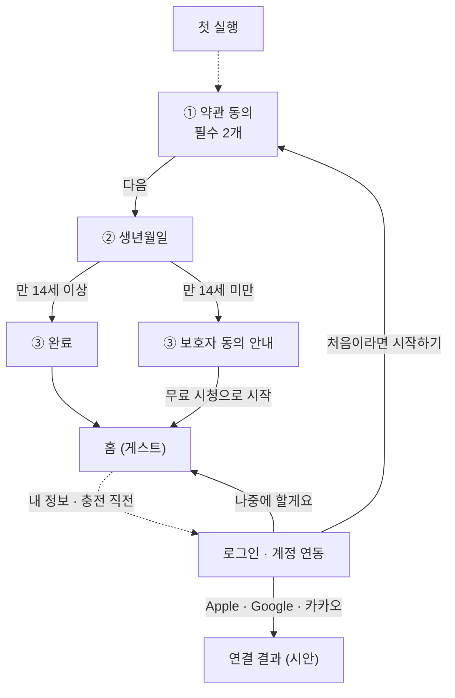
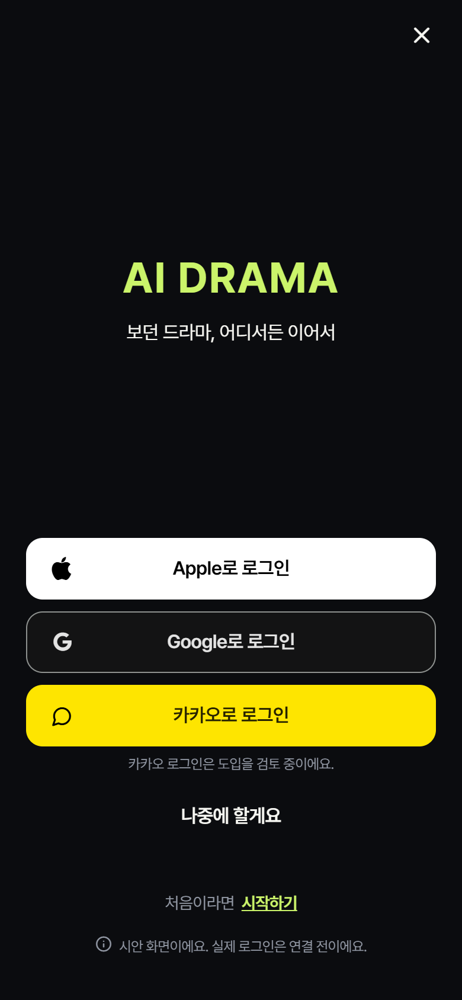
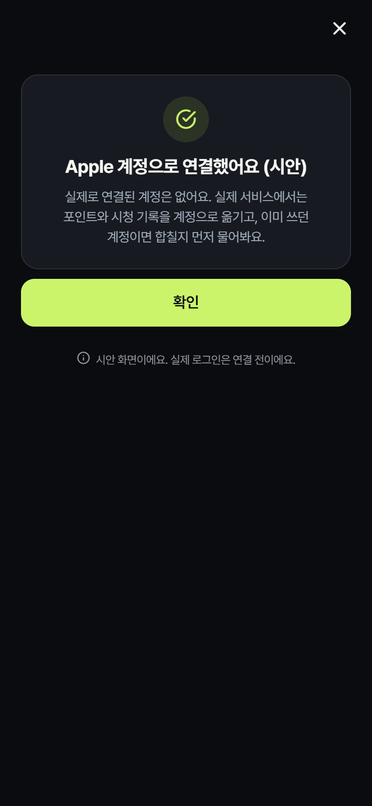
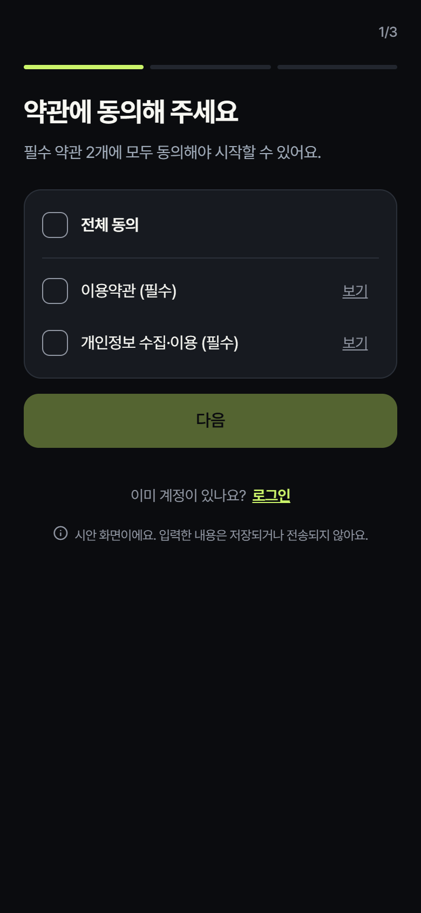
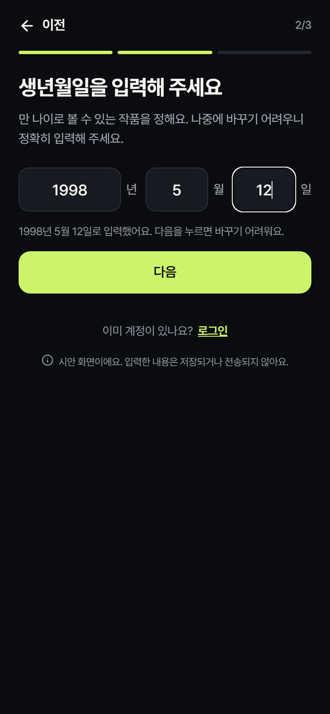
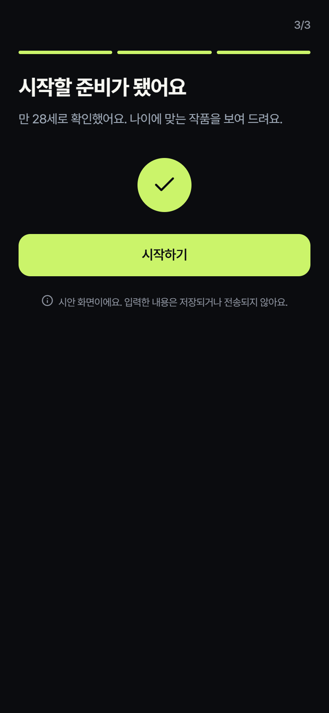
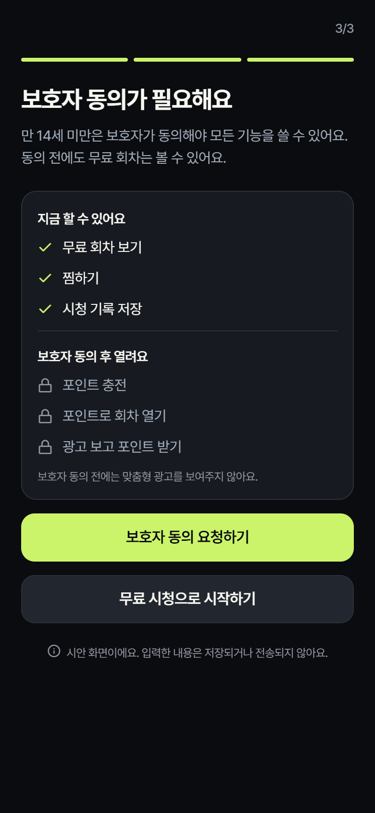

# 09. 앱 로그인 · 시작하기 시안 (화면 프로토타입)

> 작성 2026-11-13 · 상태 `[시안]` · 코드: `front/src/app/auth/`, `front/src/screens/AuthLoginScreen.tsx`, `front/src/screens/AuthSignupScreen.tsx`, `front/src/components/authUi.tsx`, `front/src/features/auth/authAge.ts`

## 화면 한눈에 보기

점선은 아직 앱에 연결하지 않은 진입점이다(6장).

휴대폰 화면 폭(390px) 캡처다. 수치와 버튼 결과는 시안이다.

| 로그인 (AUT-01) | | |
|:-:|:-:|:-:|
|  |  | |
| ① 로그인 · 계정 연동 | ② 연결 결과 (시안) | |

| 시작하기 (AUT-02 · AUT-04) | | |
|:-:|:-:|:-:|
|  |  |  |
| ① 약관 동의 | ② 생년월일 | ③ 만 14세 이상: 완료 |
|  | | |
| ③ 만 14세 미만: 보호자 동의 안내 | | |

## 1. 정한 모델

- 기획서 모델(03 §1-1~1-3)을 그대로 따른다. 첫 실행에 **AUT-02(필수 동의 + 생년월일)** 를 마치면 익명 게스트로 시작하고, 원할 때 **AUT-01에서 소셜 계정을 연결**한다. 이름·이메일·비밀번호로 가입하는 단계는 없다. 기획 담당이 "회원가입"이라고 부른 단계는 화면에서 "시작하기"(AUT-02)로 표시한다.
- **화면 시안만** 만들었다. 서버 호출, 저장, 전역 상태 변경이 없다. 입력값은 화면을 떠나면 사라진다. 두 화면 아래쪽에 시안 안내 문구를 작게 표시한다.
- 개발자의 `/login`(개발용 자동 로그인)과 세션 코드는 건드리지 않았다.

## 2. 화면과 경로

| 화면 | 경로 | 내용 |
|---|---|---|
| 로그인·계정 연동 (AUT-01) | `/auth/login` | 연결 목적 안내, `Apple로 계속하기` → `Google로 계속하기` → `카카오로 계속하기`, `나중에 할게요`, 닫기(X), `처음이라면 시작하기` 링크 |
| 시작하기 (AUT-02 + AUT-04) | `/auth/signup` | 한 경로 안의 3단계: ① 약관 동의 → ② 생년월일 → ③ 완료(만 14세 이상) 또는 보호자 동의 안내(만 14세 미만). 맨 위에 진행 표시(1/3), 2단계에만 `이전`, 1·2단계 아래에 `이미 계정이 있나요? 로그인` 링크 |

- 시작하기에서 `로그인`을 누르면 로그인 화면을 위에 연다(push). 로그인의 닫기(X)·`나중에 할게요`·`확인`은 시작하기의 같은 단계로 돌아가고, 입력값도 남아 있다. AUT-02는 건너뛸 수 없기 때문이다(03 §1-1). 실제 서비스에서도 AUT-02 도중에 로그인했는데 그 계정에 현재 필수 동의나 생년월일이 없으면 AUT-02를 다시 보여준다(05 AUT-01 ④).
- 로그인의 `처음이라면 시작하기`는 스택에 시작하기가 있으면 그 화면으로 돌아가고(`dismissTo`), 없으면 로그인 화면을 시작하기로 바꾼다. 그래서 두 화면이 번갈아 쌓이지 않는다.
- 폭 480px로 가운데 정렬해 모바일(390px)과 데스크톱 웹에서 같은 모양으로 보인다.
- 웹 브라우저는 한글을 음절 사이에서도 줄바꿈해서 "회 / 차"처럼 단어가 쪼개진다. 제목·설명 글에는 웹에서만 `word-break: keep-all`(`authUi.tsx`의 `keepAll`)을 줘서 단어 단위로 줄을 바꾼다. iOS·Android 기기에서의 줄바꿈은 실제 기기에서 따로 확인해야 한다.

## 3. 로그인 (AUT-01)

- 버튼 순서는 Apple → Google → 카카오다. iOS에 Google·카카오를 넣으면 Apple 로그인도 함께 있어야 한다(App Store 심사 4.8, 03 §1-2).
- 버튼 모양: Apple은 어두운 배경에 권장하는 흰색 스타일(흰 바탕·검은 글자), Google은 다크 테마(#131314 바탕·#8E918F 테두리·#E3E3E3 글자), 카카오는 #FEE500 바탕·검은색 85% 글자. 흰 버튼 두 개가 붙어 보이지 않게 Google은 다크 테마를 골랐다. 높이 52px, 전체 폭.
- 로고는 의존성을 추가하지 않으려고 이미 있는 아이콘 폰트로 대신했다(FontAwesome `apple`·`google`, 카카오는 Feather `message-circle`). **출시 전에 공식 버튼·에셋으로 바꿔야 한다**: Apple은 시스템 Sign in with Apple 버튼, Google은 다색 G 로고, 카카오는 공식 말풍선 심볼.
- 카카오는 `[TBD]`(03 §1-2)라서 버튼 아래에 "카카오 로그인은 도입을 검토 중이에요."를 붙였다. 도입하지 않기로 하면 버튼과 이 문구를 함께 지운다.
- "계속하면 약관에 동의한 것으로 봐요" 같은 문구는 넣지 않았다. 필수 동의는 AUT-02에서 명시적으로 받는다(05 AUT-01 ④). 05 ④의 이용약관·개인정보 처리방침 링크는 연결할 MY-06 화면이 아직 없어서 빼고, 첫 실행 전인 사용자를 위해 `처음이라면 시작하기` 링크를 넣었다.
- 닫기(X)와 `나중에 할게요`는 이전 화면으로 돌아가고, 이전 화면이 없으면 홈으로 간다.
- **흉내만 내는 부분**: 제공자 버튼을 누르면 안내 문구와 `처음이라면 시작하기` 링크가 사라지고, "Apple 계정으로 연결했어요 (시안)" 결과 카드와 `확인`만 남는다. 카드에는 실제로 연결된 계정이 없다는 것과, 실제 서비스에서는 이미 쓰던 계정이면 합칠지 먼저 묻는다는 것을 적었다. `확인`을 누르면 이전 화면(없으면 홈)으로 간다. 05의 인증 취소, 연결 실패, 확인 중 상태와 AUT-03 병합 확인은 이 시안에 없다.

## 4. 시작하기 (AUT-02 · AUT-04)

### 4-1. 약관 동의

| 항목 | 구분 | 비고 |
|---|---|---|
| 전체 동의 | – | 누르면 아래 필수 항목을 모두 켜거나 끈다. 둘 다 켜지면 저절로 체크된다 |
| 이용약관 | 필수 | `보기`: "확정 전 약관이에요. 출시 전 법률 검토 후 바뀌어요." + AI 생성 콘텐츠 제공 고지(03 §3-6) |
| 개인정보 수집·이용 | 필수 | `보기`: 같은 확정 전 안내 + 수집 항목·이용 목적·보유 기간·동의 거부 권리와 그 결과의 뼈대(개인정보 보호법 제15조②). 내용은 확정 전 |

- 필수 두 항목에 모두 동의해야 `다음`이 켜진다.
- 선택 동의(광고성 앱 푸시, 야간 알림)는 P0에서 받지 않으므로 넣지 않았다(FN-AUT-04). 유료 서비스 이용약관은 첫 충전 직전에 받는다(05 AUT-02).
- 05 AUT-02는 생년월일을 먼저 적었지만, 생년월일도 개인정보라서 수집·이용 동의를 먼저 받도록 순서를 바꿨다.
- `보기`는 화면 안의 창으로 열린다. 문서를 읽어도 동의 상태는 바뀌지 않는다.

### 4-2. 생년월일

- 연·월·일을 **세 칸**에 나눠 숫자 키패드로 받는다. `YYYY-MM-DD` 한 칸으로 받지 않은 이유: iOS 숫자 키패드에는 `-` 키가 없어서 하이픈을 자동으로 넣어 줘야 하고, 지우거나 고칠 때 커서가 꼬이기 쉽다. 세 칸이면 숫자만 치면 되고, 칸이 차면 다음 칸으로 넘어간다. 05 AUT-02도 연·월·일 입력이다. 월과 일은 한 자리도 받는다(5 = 05).
- 안내 문구: "만 나이로 볼 수 있는 작품을 정해요. 나중에 바꾸기 어려우니 정확히 입력해 주세요." 잘못 입력했을 때 고치는 방법은 아직 `[TBD]`(03 §3-9: 고객센터 문의 또는 1회 수정)라서 방법을 약속하지 않았다.
- 올바른 날짜가 입력되면 예시 문구 대신 "1990년 1월 1일로 입력했어요. 다음을 누르면 바꾸기 어려워요."로 한 번 더 확인시킨다. 3단계에서는 되돌아갈 수 없기 때문이다.
- 검사 규칙(`checkBirthDate`):

| 경우 | 문구 |
|---|---|
| 연도 4자리·월·일 중 빈 칸 | 연도 4자리와 월, 일을 모두 입력해 주세요. |
| 달력에 없는 날짜(2/30, 평년 2/29, 13월 등) | 달력에 없는 날짜예요. 다시 확인해 주세요. |
| 오늘(KST) 이후 | 오늘 이후 날짜는 입력할 수 없어요. |
| 만 120세 초과 | 만 120세 이하로 입력해 주세요. |

- `다음`은 세 칸이 다 차야 켜진다. 한 번 누른 뒤에는 고칠 때마다 다시 검사한다.
- 만 나이(`ageOn`): 올해 생일이 지났으면 (올해 − 출생 연도), 안 지났으면 1을 뺀다. 2월 29일생은 평년에 3월 1일부터 한 살 많아진다. "오늘"은 한국 날짜(UTC+9)이고, 함수는 오늘 날짜를 인자로 받는다.

### 4-3. 결과

- **만 14세 이상**: "시작할 준비가 됐어요" + "만 N세로 확인했어요. 나이에 맞는 작품을 보여 드려요." 스스로 입력한 생년월일로는 12·15세 등급만 판단하고, 청소년관람불가는 본인인증(AUT-05)이 따로 필요해서 모든 작품이 열린다고 쓰지 않았다(03 §3-9). → `시작하기`를 누르면 홈(`/`)으로 이동한다(replace).
- **만 14세 미만 (AUT-04)**: "보호자 동의가 필요해요"를 보여준다.
  - 지금 할 수 있는 것: 무료 회차 보기, 찜하기, 시청 기록 저장.
  - 보호자 동의 후에 열리는 것: 포인트 충전, 포인트로 회차 열기, 광고 보고 포인트 받기. 동의 전 보상형 광고 차단은 03 §1-1의 잠정 결정(2026-10-20)을 따랐다. 03 §1-1은 동의 전에 "무료 시청·찜·시청 기록처럼 꼭 필요한 기능만" 허용하고 F-01도 "동의 전엔 무료 시청·찜만"이라서 포인트로 회차 열기도 막는 쪽으로 표시했다. 웰컴 포인트로 회차를 여는 것을 허용할지는 기획 확인이 필요하다 `[확인 필요]`.
  - "보호자 동의 전에는 맞춤형 광고를 보여주지 않아요."(FN-AUT-08). P0는 광고성 알림 수신 동의를 받지 않으므로(03 §9) 동의 후에 알림이 시작되는 것처럼 보이지 않게 알림은 적지 않았다.
  - `보호자 동의 요청하기`: 요청은 보내지 않고 "보호자 동의를 기다리고 있어요" 상태만 보여준다. 확인 방법이 법률 검토 중이라는 안내도 함께 표시한다. 05 AUT-04의 보호자 휴대폰 번호 입력은 인증 방식이 `[TBD]`라서 넣지 않았다. 완료·거절·만료 상태도 없다.
  - `무료 시청으로 시작하기` → 홈(`/`).
- 3단계에는 `이전`이 없다. 보호자 동의 안내를 본 뒤 연도를 바꿔 다시 판정받을 수 없게 하기 위해서다. 실제 흐름에서도 3단계는 `POST /auth/guest`·`/me/age` 다음이라 되돌아가 고칠 수 없다. 2단계의 `이전`은 1단계로 가고, 동의 상태와 입력한 생년월일은 그대로 남는다.
- 단계는 이 화면의 상태라서, 기기 뒤로 가기는 따로 막았다. Android 뒤로 가기는 2단계에서 1단계로 가고, iOS 밀어서 뒤로 가기는 1단계에서만 켠다. 웹 브라우저의 뒤로 가기는 시작하기 화면 자체를 떠난다(입력값도 사라진다).

## 5. 접근성

- 체크박스는 `checkbox` 역할과 `aria-checked` 체크 상태를 갖는다(웹에서는 `aria-checked` 속성으로 나간다). 생년월일 칸에는 "출생 연도·월·일" 이름이 붙어 있다.
- 오류 문구와 결과 카드는 `polite` 라이브 영역이라 Android와 웹에서는 바뀔 때 스크린 리더가 읽는다. iOS VoiceOver는 라이브 영역을 지원하지 않으므로 출시 전에 `AccessibilityInfo.announceForAccessibility`로 보완해야 한다.
- 누를 수 있는 영역은 높이 44px 이상이다. 웹에서는 일(日) 칸에서 Enter를 누르면 제출된다.

## 6. 아직 연결하지 않은 진입점

이 시안 화면은 주소(`/auth/login`, `/auth/signup`)를 직접 열어야만 볼 수 있다. 아래 진입점은 모두 **개발자의 `/login`으로 그대로 간다**.

- 첫 실행 진입(SYS-01 → AUT-02). 첫 실행 여부를 확인해서 이 화면으로 보내는 장치가 없다.
- 내 정보의 `로그인`. 지금 내 정보 화면(`AccountScreen`)에는 로그인 버튼 자체가 없다.
- 세션 만료 창(`SessionExpiredDialog`)의 로그인, 포인트 이용 내역·보관함·작품 상세·재생·추천 화면의 `로그인`.
- 충전 직전 연동 권유와 미연동 경고(FN-AUT-03).

## 7. 실제로 연결하려면 필요한 서버 작업 `[제안]`

| API · 작업 | 내용 |
|---|---|
| `GET /legal-documents` | 필수 문서의 종류·버전·본문. `보기` 창과 동의 항목을 이 응답으로 그린다 |
| `POST /auth/guest` | AUT-02 응답(문서 버전별 동의 + 생년월일)을 검증한 뒤 게스트 계정과 토큰을 발급하고 동의 이력을 함께 기록한다(FN-SYS-02). 토큰은 기기 보안 저장소에 둔다 |
| `POST /me/age` | 생년월일 제출 → `{age, guardianConsentRequired, contentAgeLimit}`. 만 나이는 서버가 KST 기준으로 다시 계산한다 |
| `POST /me/consents` | 동의·철회 이력 `{items:[{item, documentVersion, action}], source}`. 낡은 버전은 409, 필수 미동의는 403 |
| `POST /me/guardian-consent` · `GET /me/guardian-consent` | 14세 미만 보호자 동의 요청·상태(`pending`·`granted`·`denied`). 보호자 확인 방식과 보관 기간은 법률 검토 후 확정 |
| `POST /auth/social` | `{provider, idToken}`. Apple(Sign in with Apple), Google(Google Sign-In), 카카오(Kakao SDK, `[TBD]`) 앱 SDK 연동과 서버의 토큰 검증 |
| `POST /auth/merge` (AUT-03) | 이미 데이터가 있는 계정에 로그인하면 병합 요약을 보여주고 명시적으로 승인한 경우에만 합친다(03 §1-3) |
| 서버 측 제한 | 동의·나이·보호자 동의 상태에 따라 광고 보상·충전·회차 열기를 서버에서도 막는다(03 §1-1) |

전환할 때는 `_docs/api/`에 인증·동의 API 계약을 추가하고, 이 화면의 흉내 동작을 API 호출로 바꾸며, 6장의 진입점을 새 경로로 연결한다.

## 8. 확인이 필요한 것

| 질문 | 근거 | 결정할 사람 |
|---|---|---|
| 카카오 로그인을 넣을까? | 03 §1-2 `[TBD]` | 기획 |
| 생년월일을 잘못 넣었을 때 고치는 방법(고객센터 문의 또는 1회 수정)은? | 03 §3-9 `[TBD]` | 기획 |
| 만 14세 미만 보호자 확인 방식과 보관 기간은? | FN-AUT-08 `[TBD: 법률 검토]` | 기획·법률 |
| 보호자 동의 전에도 웰컴 포인트로 회차 열기를 허용할까? | 4-3 `[확인 필요]` | 기획 |
| 6장의 진입점을 언제, 어느 경로로 연결할까? (개발자 `/login`을 바꿀지 포함) | 6장 | 개발자 |
| 출시 전 공식 로그인 버튼·로고로 교체 | 3장 | 개발자 |
